<!-- mcp-name: dev.repowise/repowise -->

[English](README.md) | [简体中文](README.zh-CN.md) | [日本語](README.ja.md)

<div align="center">

<a href="https://www.repowise.dev/?src=oss_readme_hero"></a>

<h1 align="center">エージェントにコードベースを読み直させるためにお金を払うのは、もうやめましょう。</h1>

<p align="center">Repowise は、コード、git の履歴、テスト、設計判断を、あなたのマシン上で一度だけインデックス化します。<br />
コーディングエージェントは grep したりファイルを開いたりする代わりにインデックスに問い合わせるので、作業量はおよそ半分になります。<br />
同じ答えをダッシュボードでも確認できます：何がこれを呼び出しているのか、何が壊れるのか、何から直すべきか、そしてその理由。</p>

<p align="center">
  <a href="#quickstart"></a>
  <a href="https://www.repowise.dev/?src=oss_readme_hero"></a>
</p>

<table align="center">
<tr>
<td align="center" width="260"><a href="docs/BENCHMARKS.md#per-model-agent-loop"><b>開くファイルが最大 99% 減少</b></a><br /><sub>テストしたすべてのモデルで減少 · <em>最大 47% 高速化</em></sub></td>
<td align="center" width="260"><a href="docs/BENCHMARKS.md#per-model-agent-loop"><b>出力が最大 51% 減少</b></a><br /><sub>Sonnet 4.6 · <em>31.6% 減少、5 つのコンテキストツールの中で最良</em></sub></td>
<td align="center" width="260"><a href="docs/BENCHMARKS.md#1-finding-the-right-files"><b>正しいファイルの 88% を発見</b></a><br /><sub>1 回の呼び出しで · <em>次点のツール：61%</em></sub></td>
</tr>
</table>

<a href="https://www.repowise.dev/?src=oss_readme_hero">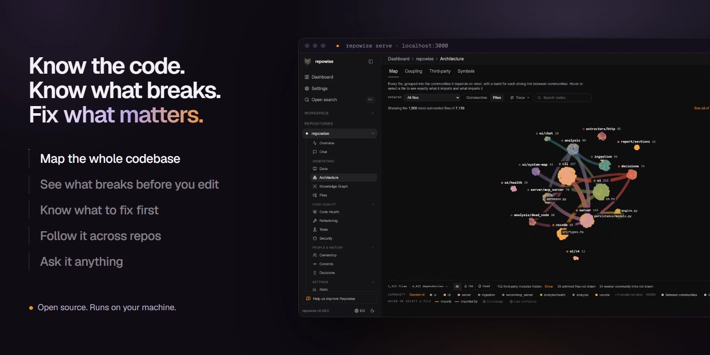</a>

<p align="center"><sub>
グラフ、リスク、ヘルス、テスト、デッドコードは <strong>LLM を一切呼び出しません</strong> · インデックス化に API キーは不要 ·
29 の言語 · Claude Code、Codex、Cursor、あらゆる MCP ホストに対応 · 無料のオープンソース
</sub></p>

<p align="center">
  <a href="https://repowise.dev/repo/repowise-dev/repowise"></a>
  <a href="https://repowise.dev/repo/repowise-dev/repowise/code-health"></a>
  <a href="https://pypi.org/project/repowise/"></a>
  <a href="https://www.gnu.org/licenses/agpl-3.0"></a>
</p>

<p align="center">
  <a href="#quickstart"><strong>クイックスタート</strong></a> ·
  <a href="#your-agent-stops-guessing"><strong>エージェント向け</strong></a> ·
  <a href="#what-it-does"><strong>できること</strong></a> ·
  <a href="#hosted"><strong>ホスト版</strong></a> ·
  <a href="#measured-against-the-field"><strong>ベンチマーク</strong></a> ·
  <a href="#for-teams-and-enterprises"><strong>チーム向け</strong></a> ·
  <a href="https://docs.repowise.dev"><strong>ドキュメント</strong></a>
</p>

</div>

---

<a id="quickstart"></a>
<a id="set-it-up-in-one-line"></a>

## 1 行でセットアップ

リポジトリで Claude Code、Codex、Cursor、または MCP に対応した任意のエージェントを開き、次を貼り付けてください：

```text
Read https://docs.repowise.dev/setup.md and set up Repowise in this repository.
```

エージェントが Repowise をインストールし、API キーなしでリポジトリをインデックス化し、自身をインデックスに接続します。
お金がかかる操作の前には、必ずあなたに確認します。手動で行う場合は次のとおりです：

```bash
uv tool install repowise          # needs Python 3.11+ and Git. Or: pipx install repowise
cd /path/to/your/repo
repowise init --yes --no-prose    # graph, git, health, dead code, docs. No key, no spend.
                                  # answers and docs: run repowise generate (one command, no re-index)
                                  # local semantic search: ollama pull embeddinggemma && repowise reindex --embedder ollama
repowise serve                    # local dashboard (needs Node 20+; first run downloads the UI)
```

`serve` はブラウザーでダッシュボードを開きます。最初のインデックス化のあとは短いガイドツアーから始まり、
Setup では、エージェントの接続、同期の有効化、カバレッジやモデルの追加ができます。

Claude Code を再起動するか `/mcp` を実行してから、*「`src/auth.py` を変更したら何が壊れる？」*
や *「Repowise の `get_overview` を使ってこのリポジトリを要約して」* と聞いてみてください。
`init` はこのリポジトリ用に Claude Code を設定し、グローバルな repowise の MCP エントリがない場合は追加します。
別のリポジトリで使われているエントリを動かすことはありません。[すべてのエージェント向けの詳しいセットアップ →](docs/start/QUICKSTART.md)

---

<a id="your-agent-stops-guessing"></a>

## エージェントが当て推量をやめる

インデックスがないと、エージェントはタスクのたびにコードベースを一から調べ直します：grep して、
ファイルを開き、さらに 3 つ開き、また grep する。Repowise はそうした質問にあらかじめ答えを用意しておくので、
エージェントは一度聞くだけで作業に取りかかれます。

5 つのモデルで、Repowise を使ったエージェントは開くファイルが**最大 99% 少なく**、書く量が
**最大 51% 少なく**、回答が**最大 47% 速く**なり（Sonnet 4.6）、72 問中 71 問に正解しました。
すべてのモデルで、開くファイルが減りました。
[モデルごとの結果 →](docs/BENCHMARKS.md#per-model-agent-loop)

`django/django` で他の 4 つのコンテキストツールと並べて比較したところ、Repowise の削減効果が最も大きく、
**ツール呼び出しは 7.2 回ではなく 3.8 回**、**出力は 31.6% 少なく**、回答の質も同等でした。
[測定方法 →](docs/BENCHMARKS.md#2-what-changes-in-a-real-agent-loop)

- エージェントは**タスクに合わせた 10 個の MCP ツール**を使えます。複数のファイルについて一度に質問すると、
  呼び出し元、リスク、テスト、オーナー、そしてコードの背後にある理由を 1 つの回答で得られます。
  [ツール一覧 ↓](#the-ten-mcp-tools)
- **コマンドのノイズを最大 99% 削減。** `repowise distill` は、エージェントが読む前にテスト、インストール、git の
  出力を削り、エラー行はすべて残します。
  [Distill →](docs/agent/DISTILL.md)
- **エージェントが聞く前にコンテキストを提供。** オプションの[フック](docs/agent/HOOKS.md)が、壊れやすいファイルや
  古いパスについてエージェントに警告し、Repowise はインデックスをもとに `CLAUDE.md` と
  `AGENTS.md` を最新の状態に保ちます。
- **削減効果を自分で確認。** `repowise saved` とダッシュボードの Usage and savings
  ページで、エージェントが読まずに済んだ Token の量を確認できます。

---

<a id="why-repowise"></a>
<a id="what-it-does"></a>

## できること

コード、その履歴、その設計判断を 1 つのインデックスにまとめ、3 つの用途に使います：
コードを理解する、安全に変更する、そして改善し続ける。

<table>
<tr>
<td width="50%" valign="top">
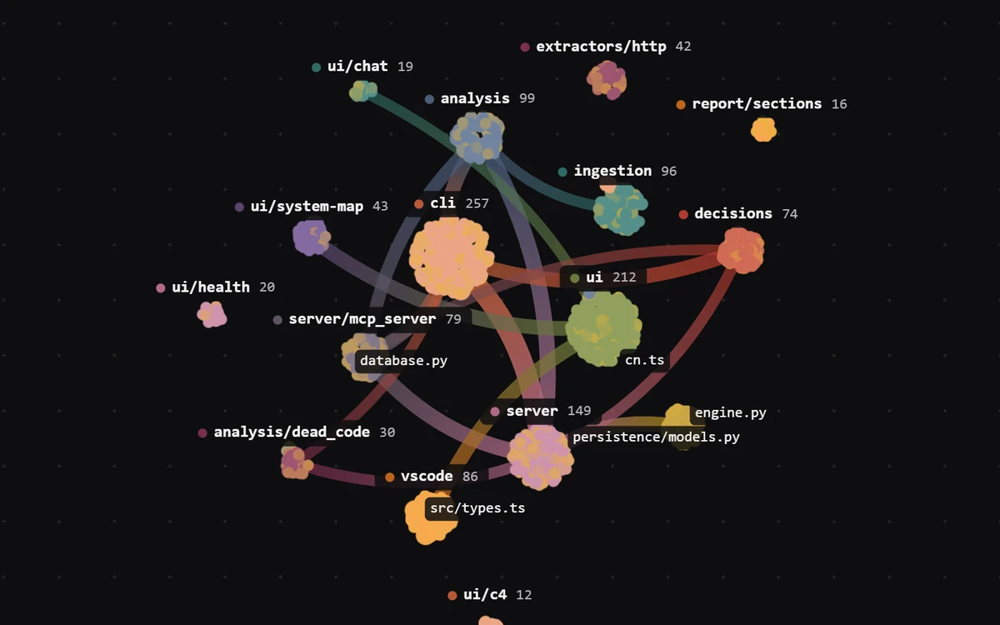
<h3>全体のつながりを見る</h3>
29 の言語にまたがるコールグラフ、探索できるアーキテクチャマップ、C4 ビュー、
そしてすべてのモジュールとファイルの生成された wiki。<br />
<a href="docs/layers/GRAPH.md">グラフ</a> · <a href="docs/layers/WIKI.md">ドキュメント</a>
</td>
<td width="50%" valign="top">
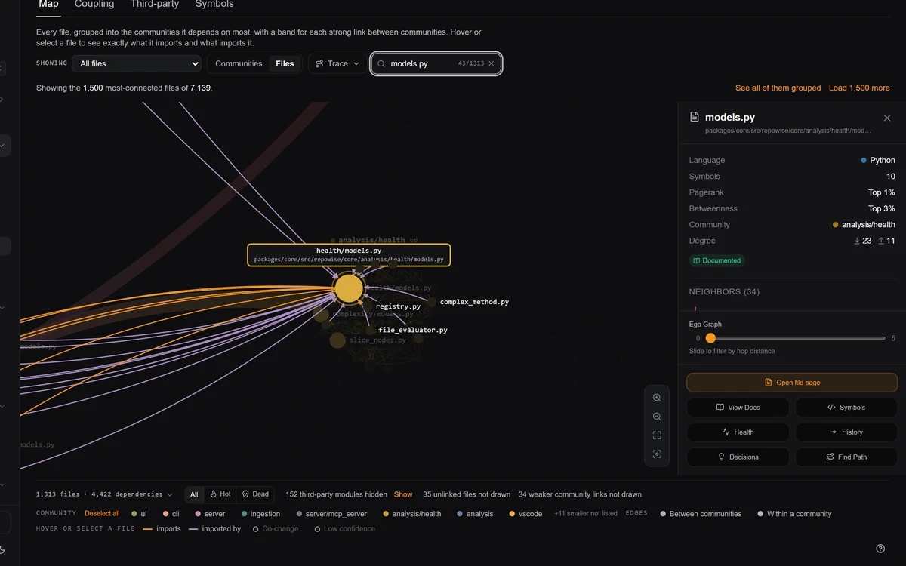
<h3>何が壊れるかを知る</h3>
変更したものを呼び出しているすべての箇所、通常は一緒に変更されるのに差分に含まれていないファイル、
そしてそこに到達するテスト。<br />
<a href="docs/layers/CHANGE_RISK.md">変更リスク</a> · <a href="docs/layers/TEST_INTELLIGENCE.md">テスト</a>
</td>
</tr>
<tr>
<td width="50%" valign="top">
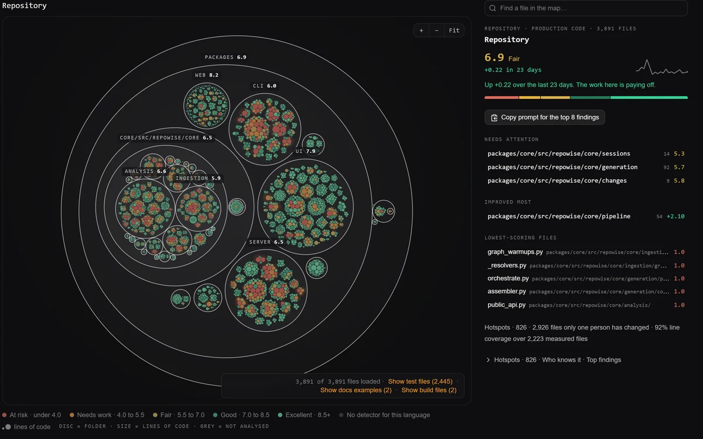
<h3>重要なものを直す</h3>
実際のバグ履歴で検証された、すべてのファイルに対する 1〜10 のヘルススコア、
順位付けされた「まず直すべきもの」のキュー、リファクタリング計画、そしてデッドコード。<br />
<a href="docs/layers/CODE_HEALTH.md">コードヘルス</a> · <a href="docs/layers/REFACTORING.md">リファクタリング</a>
</td>
<td width="50%" valign="top">
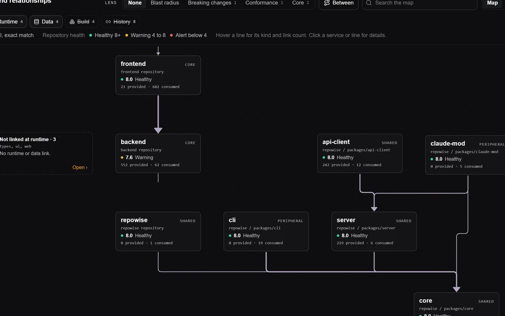
<h3>リポジトリをまたいで追う</h3>
サービスと、その間の HTTP、gRPC、イベントのコントラクト。破壊的変更に対するガードと、
それが影響する利用側のファイルも示します。<br />
<a href="docs/scale/WORKSPACES.md">ワークスペース</a>
</td>
</tr>
<tr>
<td width="50%" valign="top">
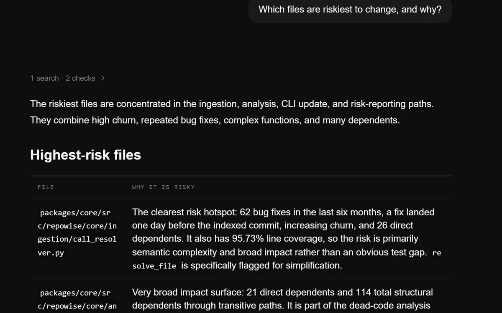
<h3>何でも質問する</h3>
ダッシュボードからは出典付きの回答とグラフを、エージェントには MCP を通じて同じ回答を
提供します。<br />
<a href="docs/start/DASHBOARD.md">ダッシュボード</a> · <a href="docs/agent/MCP_TOOLS.md">MCP ツール</a>
</td>
<td width="50%" valign="top">
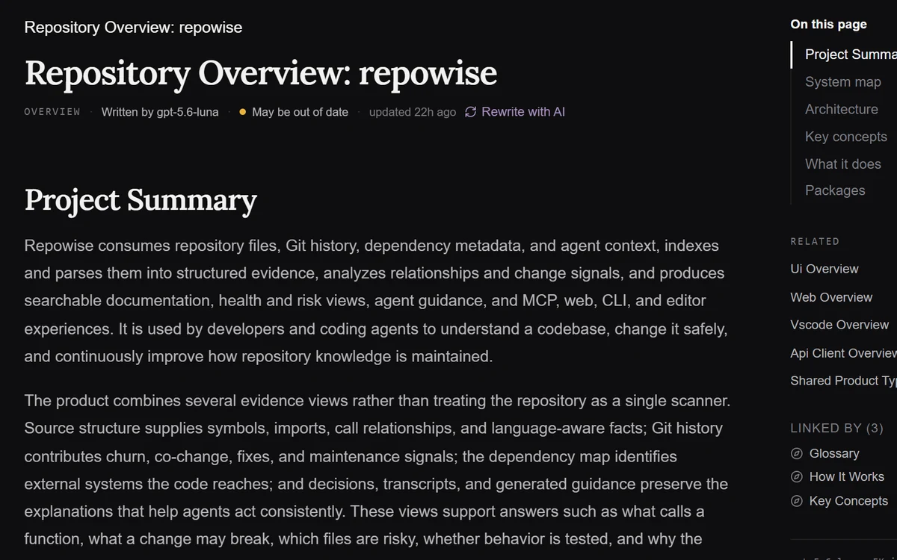
<h3>理由を記憶する</h3>
ADR、コメント、コミット、PR、エージェントのセッションから掘り起こした設計判断を、それぞれが
関係するコードに結びつけます。さらに、ドキュメントがコードと合っているかもチェックします。<br />
<a href="docs/layers/DECISIONS.md">設計判断</a> · <a href="docs/layers/DOC_DRIFT.md">ドキュメントのずれ</a>
</td>
</tr>
</table>

<details>
<summary><strong>答えられるすべての質問</strong></summary>

### コードを理解する

| あなたの質問 | Repowise の答え |
|---|---|
| *このリポジトリでチェックアウトはどう動いている？* | コールグラフと生成されたドキュメントから組み立てた出典付きの回答を、1 回の呼び出しで返します。[検索と回答](docs/layers/WIKI.md) |
| *この関数を何が呼び出していて、この関数は何を呼び出している？* | 解析した 29 の言語にまたがるコールグラフ。すべてのエッジに、どのように解決されたか、どの程度信頼できるかが記録されており、各エントリポイントからの実行フローもたどれます。[グラフ](docs/layers/GRAPH.md) |
| *このコードベースのドキュメントは作れる？* | すべてのモジュールとファイルの wiki を、キーなしでコードの構造から生成するか、選んだ場合はモデルが執筆します。コミットのたびに差分で更新されます。[ドキュメント](docs/layers/WIKI.md) |
| *どのドキュメントが間違っている？* | Markdown をツリーと照合し、コードにもう存在しないファイルやシンボルへの参照をすべて、修正すべき行とともに示します。[ドキュメントのずれ](docs/layers/DOC_DRIFT.md) |
| *なぜこういう作りになっている？* | ADR、`# WHY:` コメント、コミットと PR の履歴、エージェントのセッションから掘り起こした設計判断を、それぞれ関係するコードに結びつけ、古くなったときには警告します。[設計判断](docs/layers/DECISIONS.md) |
| *このコードに詳しいのは誰？* | オーナー、バス係数、主な作者が離れたときに薄れていくオーナーシップ、そしてレビュアーの候補。[オーナーシップ](docs/layers/OWNERSHIP.md) |
| *アーキテクチャを見られる？* | 探索できる依存関係マップ、C4 ビュー、Structurizr へのエクスポート。モデルは使いません。[ダッシュボード](docs/start/DASHBOARD.md) |

### 安全に変更する

| あなたの質問 | Repowise の答え |
|---|---|
| *これを変更したら何が壊れる？* | シンボル単位の影響範囲：変更したものの呼び出し元、過去に一緒に変更されてきたのに差分に含まれていないファイル、そしてそこに到達するテスト。[変更リスク](docs/layers/CHANGE_RISK.md) |
| *この PR はどのくらいリスクがある？* | その変更がリポジトリ自身の最近のコミットと比べてどの位置にあるかを、理由とともに、エージェントが実行できる指示として返します。[変更リスク](docs/layers/CHANGE_RISK.md) |
| *どのテストを実行すべき？* | 差分が実際に通るテストを、カバレッジレポートがあればそこから、なければコールグラフから求めます。[テストインテリジェンス](docs/layers/TEST_INTELLIGENCE.md) |
| *この PR でテストされていない行が増えた？* | パッチカバレッジ、変更行のブランチカバレッジ、パス単位のゲートを、GitHub、GitLab、または任意のランナーの CI で提供します。[CI ゲート](docs/start/CI.md) |
| *この API の変更で別のリポジトリが壊れる？* | HTTP、gRPC、トピック、OpenAPI のコントラクトをリポジトリ間で照合し、破壊的変更に対するガードと、影響を受ける利用側のファイルを示します。[ワークスペース](docs/scale/WORKSPACES.md) |
| *ほかに誰かこのファイルを編集している？* | 同じファイルやその共変更パートナーに手を入れているほかのオープンなブランチを、それぞれ挙げた理由とともに示します。[ブランチの重なり](docs/layers/CHANGE_RISK.md#branch-overlap) |
| *今、シークレットをコミットしてしまった？* | 作業ツリーと git の全履歴から見つかったキー、トークン、危険な呼び出しを、pre-commit チェックと CI ゲートとともに提供します。[セキュリティシグナル](docs/layers/SECURITY.md) |

### 改善し続ける

| あなたの質問 | Repowise の答え |
|---|---|
| *まず何を直すべき？* | 変更頻度、ファンイン、カバレッジ、バグ履歴を使って、影響と労力を比較した順位付きのキュー。[まず直すべきもの](docs/layers/CODE_HEALTH.md#fix-first) |
| *技術的負債はどこにある？* | 59 の決定論的な検出器による、すべてのファイルの 1〜10 のスコア。欠陥リスク、保守性、パフォーマンスに分かれ、実際のバグ履歴で検証されています。[コードヘルス](docs/layers/CODE_HEALTH.md) |
| *なぜこれは遅い？* | N+1 クエリ、ループ内の I/O、非同期コード内のブロッキング呼び出し、二次的なループを、関数やファイルの境界をまたいで追跡します。[パフォーマンス](docs/layers/PERFORMANCE.md) |
| *これを安全に分割するには？* | 7 種類の具体的なリファクタリング計画：Extract Method、Extract Class、Extract Helper、Move Method、Split File、Break Cycle、Performance Fix。移動する正確なシンボルと、一緒に移動するものも示します。そのままエージェントに渡せます。[リファクタリング](docs/layers/REFACTORING.md) |
| *何を削除できる？* | 到達不能なファイル、使われていないエクスポート、使われていないパッケージを、それぞれ信頼度の段階と根拠とともに示します。[デッドコード](docs/layers/DEAD_CODE.md) |
| *バグが繰り返し入るのはどこ？* | バグ修正のコミットをファイルとシンボルまでたどり、エージェントがバグの温床を編集したときに警告します。[バグ履歴](docs/layers/BUG_HISTORY.md) |
| *テストはちゃんと何かをテストしている？* | アサーションのないテスト、自分のモックしかチェックしていないテスト、そしてテストされていないホットスポット。[テスト品質のにおい](docs/layers/CODE_HEALTH.md#findings) |

</details>

<details>
<summary><strong>意外とできること</strong></summary>

- **カバレッジを実行せずにテストカバレッジを把握。** ほとんどのリポジトリはカバレッジレポートを
  出力しません。Repowise は import とコールグラフから「これはテストされているか、何によってか」に答え、
  すべての回答に「計測値」か「推定値」かのラベルを付けます。
- **あなたのリポジトリで自身のヘルススコアを検証します。** インデックス化のたびに、スコアの最も低いファイルのうち
  実際に最近の履歴でバグ修正があったものがいくつあるかを報告するので、あなたのコードベースでスコアが
  当てにならない場合はそれがわかります。
- **エージェントのセッションから学びます。** トランスクリプトの取得を有効にすると、あなたが何度も繰り返している
  修正（「共有の HTTP クライアントを使って」）が追跡される設計判断になり、あとでエージェントにフィードバックされます。
  トランスクリプトがあなたのマシンの外に出ることはありません。
- **`CLAUDE.md` と `AGENTS.md` を書きます。** 実際のインデックスから作成して最新の状態に保つので、
  MCP に対応していないエージェントでも、必要な情報を持った状態で作業を始められます。
- **エージェントが読む前にコマンドの出力を縮めます。** `repowise distill pytest`
  はすべての失敗を残してノイズを取り除き、何も失われません：`expand` コマンドで
  削った部分をいつでも元に戻せます。
- **新しい git worktree は最初からインデックス済み。** リンクされた worktree は、ゼロから始めるのではなく、
  ベースのチェックアウトからインデックスを引き継ぎます。
- **依存している外部システムを把握します。** PyPI、npm、Cargo、Go、NuGet、Maven、CMake のパッケージマニフェストから、
  コードが到達するサービスとライブラリのマップを作ります。

</details>

---

<a id="hosted"></a>

## ホスト版

ここまでの内容はすべて、あなた自身のマシンで無料で動きます。[repowise.dev](https://www.repowise.dev/?src=oss_readme_section)
はそれをあなたの代わりに実行します：クラウドでインデックス化され、push のたびに最新になり、プライベートリポジトリにも対応し、
Claude、ChatGPT、Cursor 向けの 1 つの MCP エンドポイント、Jira と Confluence、チームの
ワークスペース、そしてすべてのリポジトリで [PR ボット](#the-pr-bot)を利用できます。

<a href="https://www.repowise.dev/?src=oss_readme_section">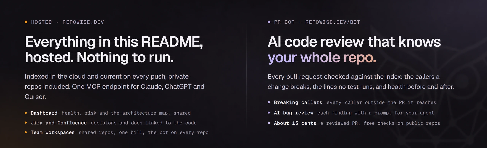</a>

<p align="center">
  <a href="https://www.repowise.dev/login?mode=signup&src=oss_readme_section"></a>
  <a href="https://www.repowise.dev/bot?src=oss_readme_section"></a>
</p>

すでにローカルでインデックス化していますか？ `repowise publish` を使えば、コマンド 1 つでリポジトリを repowise.dev に載せられます。
GitHub のリモートをインデックス化するので、あなたのマシンからは何もアップロードされません。
パブリックリポジトリは無料です。

---

<a id="know-whats-dangerous-before-you-merge"></a>

## マージする前に何が壊れるかを知る

これらはすべてグラフと git の履歴から求めており、LLM は使わないので、同じ差分には
常に同じ答えが返ります。

- **変更リスク。** 任意のコミットやブランチを、リポジトリ自身の最近のコミットと比べて 0〜10 で採点し、
  何を壊す可能性があるか、忘れている関連ファイル、足りないテスト、
  実行すべきテストを示します。`repowise risk main..HEAD`
  （[リファレンス](docs/layers/CHANGE_RISK.md)）
- **カバレッジを実行せずにテストを把握。** どのテストがファイルに到達し、差分がどのテストを通るかを、
  カバレッジレポートがあればそこから、なければコールグラフから求めます：
  実行すべきテストの判定は **97.5% 正確**です。
  `repowise impacted-tests main..HEAD`（[リファレンス](docs/layers/TEST_INTELLIGENCE.md)）
- **バグの温床。** バグ修正が繰り返し入るファイルを示し、エージェントがそれを編集したときに
  警告します。（[リファレンス](docs/layers/BUG_HISTORY.md)）
- **ブランチの重なり。** 同じファイルを編集しているほかのオープンなブランチ。`repowise overlap`
  （[リファレンス](docs/layers/CHANGE_RISK.md#branch-overlap)）
- **CI で。** パッチカバレッジ、ドキュメントのずれ、セキュリティ、変更リスクを、
  [GitHub Action](docs/start/CI.md#github-actions)、[GitLab テンプレート](docs/start/CI.md#gitlab)、
  または素の CLI を通じてゲートとして使え、SARIF でも出力できます。API キーは不要です。[CI での Repowise →](docs/start/CI.md)

<a id="the-pr-bot"></a>

**すべてのプルリクエストで。** **[Repowise PR ボット](https://www.repowise.dev/bot?src=oss_readme_bot)**
は、リポジトリ全体を把握した AI コードレビューです。各 PR をインデックスと照らし合わせてチェックします：

- **壊れる呼び出し元：** 変更された関数に到達する、PR の外にあるすべての呼び出し元。
- **変更行のカバレッジ：** 追加された行のうち、どのテストも実行しない行を CI のレポートから示します。
- **追加行のセキュリティ：** シークレットと危険な呼び出しを、その行に指摘します。
- **変更前後のヘルス：** 手を入れたファイルを変更の前後で採点し、変更によって残る
  デッドコードを示します。
- **変更リスクとレビュアー：** リポジトリの履歴に対するリスクと、コードのオーナー。
- **AI によるバグレビュー：** 差分の行で見つかったバグを、それぞれエージェント向けのプロンプトとともに示します。

コメントは 1 つで、常に最新に保たれます。問題のない PR には短い「安全にマージできます」が付き、
**Repowise review** チェックでマージをゲートできます。パブリックリポジトリのチェックは無料です。AI
レビューは Pro または Teams で、レビュー済み PR 1 件あたり約 15 セント、シート料金はかかりません。

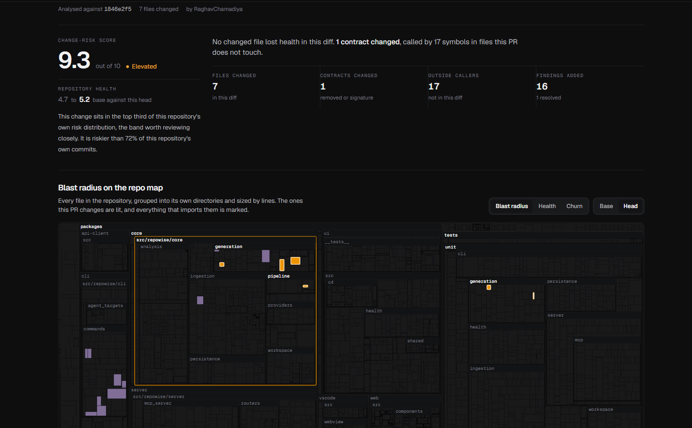

<sub>実際の PR に対する実際のレビュー：[repowise-dev/repowise#5127](https://github.com/repowise-dev/repowise/pull/5127) ·
[その分析ページ →](https://repowise.dev/pr/repowise-dev/repowise/5127) ·
[PR ボットを見る →](https://www.repowise.dev/bot?src=oss_readme_bot) ·
[GitHub にインストール →](https://github.com/apps/repowise-bot)</sub>

<a id="change-evidence"></a>

### すべての変更を、その根拠とともに

マージされた各 PR やコミットは **Change Record** になります：何に手を入れたか、誰がオーナーか、
そこに到達するテスト、またがるコントラクトと設計判断、そしてマージ後に何が起きたか。
フォージの API は一切呼び出しません。

| あなたの質問 | Repowise の答え |
|---|---|
| *この PR で何が入って、何がそれを裏付けている？* | 変更の根拠のチェックリスト。各項目は `ok`、`attention`、`unknown` のいずれかで、in-toto 形式でエクスポートできます。[Change Records](docs/layers/CHANGES.md) |
| *決済コードへの変更には CI でより高い基準を課せる？* | `.repowise/policies.yaml` のルールを、名前、タグ、重要度でコンポーネントに対応付け、`repowise check` で評価し、SARIF または JUnit で出力します。[変更ポリシー](docs/layers/REPORTS.md#change-policy) |
| *何かが壊れた。どの変更から読むべき？* | 最近の変更を、エラー、スタックトレース、issue と照らし合わせて順位付けします。43 件の実際のリグレッションでは、後の revert や修正で名指しされた変更が 67% のケースで上位 5 件に入りました。共有ファイルによる順位付けでは 28% でした。[容疑者](docs/layers/CHANGES.md#suspects) |
| *これのオーナーは誰で、まだそれに取り組んでいる？* | カタログと CODEOWNERS のオーナーを持つ Backstage 形式のコンポーネントを、直近 90 日のコミットと比較します。[コンポーネント](docs/layers/REPORTS.md#components-and-ownership) |
| *監査人や買収側に現状を示せる？* | 根拠パック：リポジトリの評価、期間ごとの変更レポート、コンポーネントの一覧を、JSON、Markdown、HTML、CSV で提供します。[レポート](docs/layers/REPORTS.md) |

---

<a id="code-health"></a>

## 何を直すべきかを正確に知る

すべてのファイルに、**59 の決定論的な検出器**による 1〜10 のスコアが付き、3 つの観点で読めます：
欠陥リスク、保守性、パフォーマンス。N+1 クエリやループ内の I/O などのパフォーマンスの指摘は、
関数やファイルをまたいで追跡されます。

スコアは実際のバグと照らし合わせて検証されています。21 のオープンソースプロジェクトで、同じレビュー予算のもと、
Repowise による順位付けは、後にバグが見つかったファイルを **CodeScene の 2.3 倍**発見しました。
また、インデックス化のたびにあなたのリポジトリで自身を検証します：*「ヘルスの最も低い 20 ファイルのうち 16 ファイルで、
過去 6 か月にバグ修正がありました。ベースラインの 24% の 3.3 倍です。」*

そのうえで、修正方法を 7 種類の計画から 1 つ示します：**Extract Method**、**Extract Class**、
**Extract Helper**、**Move Method**、**Split File**、**Break Cycle**、**Performance
Fix**。移動する正確なシンボルを示し、中心的なファイルの修正が末端のファイルの同じ修正より先に来るように
順位付けします。各計画には、エージェントにコピーするボタンがあります。

```bash
repowise next                          # what to fix first, ranked by impact and effort
repowise health --refactoring-targets  # concrete plans
repowise dead-code                     # what can go, by confidence tier
```

[コードヘルス](docs/layers/CODE_HEALTH.md) · [リファクタリング](docs/layers/REFACTORING.md) ·
[デッドコード](docs/layers/DEAD_CODE.md) · [検証方法 →](docs/BENCHMARKS.md#5-code-health-predicts-defects)

---

<a id="past-one-repo"></a>

## リポジトリをまたいで

実際のシステムは 1 つのリポジトリにとどまらず、コストの高い障害はその間で起こります。バックエンドの
コントラクトを変更すると、Repowise は、それを利用するフロントエンドの呼び出し、下流のサービス、
そして新しい依存関係が破るアーキテクチャのルールを、リリース前に示します。

| ワークスペースインテリジェンス | 答えられること |
|---|---|
| **コントラクトマップ** | 各 HTTP、gRPC、イベント、ソケット、データのコントラクトを、どのサービスが提供し、どのサービスが利用している？ リンクは、確定か候補かの信頼度と、ソース上の根拠を保持します。 |
| **リポジトリをまたぐ影響範囲** | このプロバイダーが変わったら、構造的に到達するのはどの下流サービスで、過去の共変更によってずれる可能性があるのはどれ？ |
| **破壊的変更のガード** | エンドポイントが削除されたり、OpenAPI、proto、シグネチャの形が互換性のない形で変わったりしていない？ そのコントラクトにリンクしている利用側のファイルはどれ？ |
| **テストへの影響** | このプロバイダーの変更に対して、利用側のリポジトリのどのテストを実行すべき？ カバレッジから計測するか、コールグラフから推定します。 |
| **コードとしてのアーキテクチャ** | 現在のシステムグラフは、宣言された依存関係のルールに違反していたり、循環を含んでいたりしない？ `repowise workspace check` で CI をゲートできます。 |
| **アーキテクチャのヘルス** | 全体はどのくらい結合している？ 伝播コスト、循環しているコア、サービスの役割、そして決定論的な 1〜10 のアーキテクチャスコア。 |
| **フェデレーションされたコンテキスト** | 1 つのダッシュボードと 1 つの MCP サーバーが、リポジトリ単位の根拠を保ったまま、すべてのリポジトリにまたがって答えます。 |

[ワークスペースのガイドと対応表 →](docs/scale/WORKSPACES.md) ·
[インデックスを最新に保つ →](docs/scale/AUTO_SYNC.md)

---

<a id="measured-against-the-field"></a>

## 他のツールとの比較測定

すべてのツールに同じリポジトリ、コミット、質問を使い、それぞれが公表している機能をすべて使わせたうえで、
私たちが作成していない正解データと照らし合わせました。

<div align="center">
<picture>
  <source media="(prefers-color-scheme: dark)" srcset=".github/assets/bench/agent-output-tokens-dark.svg" />
  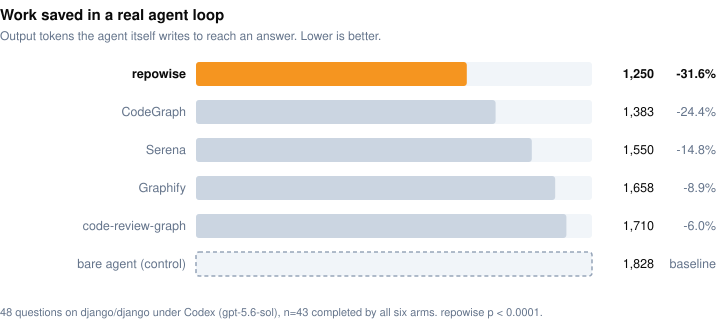
</picture>
<picture>
  <source media="(prefers-color-scheme: dark)" srcset=".github/assets/bench/file-coverage-dark.svg" />
  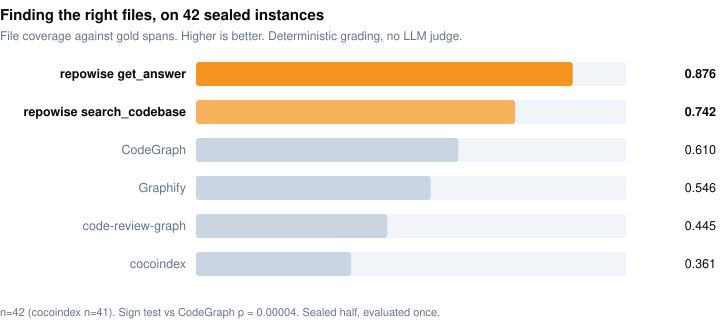
</picture>
</div>

| | 結果 |
|---|---|
| **すべてのモデルで開くファイルが減少** | 開くファイルが**最大 99% 減少**、**出力が最大 51% 減少**、**最大 47% 高速化**、72 問中 71 問正解（Sonnet 4.6）。Opus 5.5 では 48 問中 48 問正解。*5 つのモデル、モデルより新しいコードに関する 24 問* |
| **他のコンテキストツールより少ない作業量** | **出力が 31.6% 減少**、ツール呼び出しは 7.2 回ではなく 3.8 回、開いたファイルは 7.2 個ではなく 3.0 個。5 つのコンテキストツールの中で最良。*n=43、p<0.0001* |
| **正しいファイルを見つける** | 修正に必要なファイルの **88%** を発見。次点のツールは 61%、封印されたセットでの結果です。*n=42、p=0.00004* |
| **バグを予測するヘルス** | 同じレビュー予算で、後にバグが見つかったファイルの再現率は CodeScene の **2.3 倍**。*2,770 ファイル、p=0.003* |
| **コマンドの出力** | 最大 **99.5%** 縮小（`npm ci`）、`git log` で 89%、`git diff` で 86%、エラー行は 1 行も失われません |
| **コンパイラーとも一致するコールグラフ** | Go、TypeScript、Dart、C、Python で **93.8%〜99.8%** の精度。各言語自身のツールチェーンで判定しています。他の 4 つのツールと比べ、7 つのセルのうち 7 つで、同じだけグラフを見つけたうえでより正確なツールはありません |
| **スケール** | 1 台のノート PC で **1,500 万行**（dotnet/runtime）。コールグラフの構築に必要なメモリは **75 MB** で、次点のツールの 10 分の 1 です |

**[すべての結果を、わかりやすい言葉と方法とともに →](docs/BENCHMARKS.md)** ·
[土台となった研究 →](docs/LINEAGE.md)

<details>
<summary><strong>機能面での比較</strong></summary>

これらすべてと競合する単一の製品はないため、1 つの表にはまとめていません。*計測*と記した行は
直接比較の数値で、サンプルサイズ、テスト、すべての行を含む
**[docs/BENCHMARKS.md](docs/BENCHMARKS.md)** にリンクしています。記号のない行は機能の有無であり、計測値ではありません。

### エージェントのコンテキストレイヤーとして

| | repowise | CodeGraph | Serena | DeepWiki |
|---|---|---|---|---|
| セルフホスト可能、オープンソース | ✅ AGPL-3.0 | ✅ | ✅ | ❌ クラウドのみ |
| プライベートリポジトリ、クラウド不要 | ✅ | ✅ | ✅ | ❌ OSS のフォークのみ |
| 提供する MCP ツール | デフォルト 10 + オプトイン 7 | 1 | 29 | 3 |
| **正解ファイルの発見** *（[計測](docs/BENCHMARKS.md#1-finding-the-right-files)、n=42 封印済み）* | ✅ **0.876** | 0.610 | この実行には含まれず | 未計測 |
| **素のエージェントと比べた出力 Token** *（[計測](docs/BENCHMARKS.md#2-what-changes-in-a-real-agent-loop)、n=43）* | ✅ **-31.6%** | -24.4% | -14.8% | 未計測 |
| **グラフの構築に必要なメモリ** *（[計測](docs/BENCHMARKS.md#what-it-costs-to-run)、5 ツール、35 リポジトリ）* | ✅ **75 MB**、35 中 35 で最小 | 757 MB | 未計測 | 該当なし、クラウド |
| **グラフの構築にかかる時間** *（[計測](docs/BENCHMARKS.md#what-it-costs-to-run)、同じ実行）* | **2.77 秒**、35 中 14 で最速 | **3.65 秒**、16 で最速 | 未計測 | 該当なし、クラウド |
| **フルインデックスの構築にかかる時間、django** *（[計測](docs/BENCHMARKS.md#what-it-costs-to-run)）* | ⚠️ **366.8 秒**、この中で最も遅い | ✅ **16.4 秒** | 未計測 | 該当なし、クラウド |
| **コンパイラーが判定したコールエッジの精度** *（[計測](docs/BENCHMARKS.md#8-the-same-question-against-an-answer-key-we-do-not-control)、5 ツール、7 セル）* | ✅ **同じだけ見つけたうえでより正確なものはなし**、7 中 7 | 7 で精度が低い | 未計測 | 未計測 |
| 生成されたドキュメント | ✅ | ❌ | ❌ | ✅ |
| 先回りするエージェントフック | ✅ Claude + Codex | ❌ | ❌ | ❌ |
| 生成された `CLAUDE.md` / `AGENTS.md` | ✅ | ❌ | ❌ | ❌ |
| コマンド出力の蒸留 | ✅ 元に戻せる | ❌ | ❌ | ❌ |
| アーキテクチャ上の意思決定の記録 | ✅ | ❌ | ❌ | ❌ |
| 複数リポジトリのワークスペースインテリジェンス | ✅ コントラクト、共変更、フェデレーションされた MCP | ❌ | ❌ | ❌ |

**2 つのコストの行は、別々の問いに答えています。** コールグラフの構築では、私たちは
計測したツールの中で最も軽く、次点のおよそ 10 分の 1 で、速さも最速のツールとほぼ同じです。
*インデックス全体*の構築では、CodeGraph のほうが**私たちより 22 倍速い**です。
その時点で私たちは、git 履歴のレイヤー、wiki、設計判断、ヘルスの計算も構築しているからです。
モデルによる文章生成を有効にすると、**135 倍**になります。

<sub>競合は CodeGraph 1.5.0、Graphify 0.9.31、Serena 1.6.2.dev0、code-review-graph 2.3.7 を
2026 年 8 月に計測しました。Repowise のコンパイラー判定の数値は 2026-10-03 時点の main のもので、
その他の Repowise の行は 2026 年 8 月の `081a59fa` のものです。</sub>

### コードヘルスツールとして

| | repowise | CodeScene |
|---|---|---|
| セルフホスト可能、オープンソース | ✅ AGPL-3.0 | ⚠️ オンプレミスの Docker、プロプライエタリ |
| コードヘルススコア（1〜10） | ✅ 59 の検出器、うち 22 がヘルススコアに影響（[数え方](docs/layers/CODE_HEALTH.md)） | ✅ 25〜30 |
| Brain Method / LCOM4 / ゴッドクラス | ✅ | ✅ |
| **20% のレビュー予算で見つかった欠陥** *（[計測](docs/BENCHMARKS.md#5-code-health-predicts-defects)、2,770 ファイル）* | ✅ **0.173** | 0.074 |
| **労力を考慮した順位付け、Popt** *（計測、p=0.003）* | ✅ **0.607** | 0.462 |
| **その予算での適合率** *（計測）* | 0.580 | ✅ **0.636**、より短いリスト |
| **判別能、ROC AUC** *（計測、対応あり）* | 0.731 | 0.705、*p=0.054、有意差なし* |
| Git インテリジェンス（ホットスポット、オーナーシップ、共変更） | ✅ | ✅ |
| マージ前の変更リスクの採点 | ✅ 0〜10 + 指示 | ✅ |
| ファイルをまたぐ具体的なリファクタリング計画 | ✅ グラフを考慮 + 影響範囲 | ⚠️ 関数内のみ |
| テストカバレッジのインテリジェンス | ✅ LCOV/Cobertura/Clover/JaCoCo/Go | ❌ |
| デッドコードの検出 | ✅ | ❌ |
| MCP を通じて AI エージェントに提供 | ✅ | ✅ |

このカテゴリーで、公開された実証的な欠陥研究を持つベンダーは CodeScene だけです。そのため、
直接比較の相手に選びました。私たちが 132 ファイルを指摘するところで、CodeScene が指摘するのは約 27 ファイルです。

### PR ボット、LLM レビューボットとの比較

| | Repowise PR ボット | CodeRabbit | Greptile |
|---|---|---|---|
| 価格 | ✅ **レビュー済み PR 1 件あたり約 15 セント**、シート料金なし | 開発者のシートごと | 開発者のシートごと、加えてクレジット |
| シンボル単位の影響範囲 | ✅ コールグラフ | ❌ | ⚠️ コンテキストからの文章 |
| PR に含まれていない共変更パートナー | ✅ git の履歴 | ❌ | ❌ |
| リポジトリ自身の履歴に対する変更リスク | ✅ 0〜10 + パーセンタイル | ❌ | ❌ |
| 問題のない PR には静か | ✅ 短い「安全にマージできます」1 つ | ⚠️ 設定可能 | ⚠️ 設定可能 |

Repowise は、そのリポジトリに最も長く携わってきたエンジニアのようにプルリクエストを読みます。
すべての呼び出し元、手を入れたファイルの履歴、それらに関わる設計判断を把握したうえでです。その裏にあるチェックには
モデルが不要で、パブリックリポジトリでは無料です。詳しい比較はこちら：**[repowise.dev/compare →](https://www.repowise.dev/compare)**

</details>

---

## 対応言語

**29 の言語を AST まで解析し、5 段階のはしごで 43 の言語に対応。エコシステム用のハンドラーがある場合はフレームワークも考慮します。**
すべての言語がオープンソース版に含まれています。

<p>
  <strong>Full &nbsp;</strong>
  
  
  
  
  
  
  
  
  
  
  
  
  
  
  
</p>
<p>
  <strong>Good &nbsp;</strong>
  
  
  
  
  
  
  
  
  
  
  
  
  &nbsp;<strong>· Partial &nbsp;</strong>
  
  
</p>

<details>
<summary><strong>はしご全体と、各段階で得られるもの</strong></summary>

| 段階 | 言語 | 得られるもの |
|---|---|---|
| **Full**（15） | Python · TypeScript · JavaScript · Svelte · Vue · Astro · Java · Kotlin · Go · Rust · C++ · C# · Scala · Ruby · Apex (Salesforce) | パイプライン全体：AST のシンボル、import の解決、解決済みのコールグラフ、継承関係、docstring、フレームワークのエッジ、コードヘルスのマーカー |
| **Good**（12） | C · Swift · PHP · Dart · Object Pascal · COBOL · GDScript · VB.NET · Elixir · F# · Objective-C · Perl | 上記のうちヘルスの全機能を除くすべて。対応表全体に記載された言語ごとの上限の範囲内です |
| **Partial**（2） | Luau / Roblox · Razor / Blazor | Luau：AST のシンボルと `require()` の解決、Rojo と `.luaurc` に対応。Razor：コンポーネントのシンボル、`@code` とコンポーネントタグの呼び出しエッジ、C# のヘルスマーカー。import の解決はまだありません |
| **Lightweight**（6） | Clojure · Haskell · Lean 4 · Erlang · HTML · QML | 実際のファイル間の import グラフ。シンボル単位の情報はありません |
| **Structural**（8） | R · Zig · Julia · Elm · OCaml · Crystal · Nim · D | git の履歴：blame、ホットスポット、共変更、オーナーシップ、バグ履歴 |

SQL と dbt のプロジェクトは `ref()` / `source()` のリネージュを、シェルスクリプトは関数単位の
シンボルを得られ、HTML ページは `<script src>` と `<link href>` の依存関係を提供し、
OpenAPI、Protobuf、GraphQL、Dockerfile、Terraform などの形式には専用の
ハンドラーがあります。それ以外のものも、git の履歴を通じて追跡されます。

すべてのコールエッジには、**どのように解決されたか、どの程度信頼できるか**が記録されています。
`same_file` の 0.95 から、リポジトリ全体での名前の一致の 0.50 まであり、推測であるものは推測と明記されます。
各言語自身のコンパイラーで判定した言語ごとの精度：
[docs/BENCHMARKS.md#accuracy-by-language](docs/BENCHMARKS.md#accuracy-by-language)。

対応表全体：**[docs/layers/LANGUAGE_SUPPORT.md →](docs/layers/LANGUAGE_SUPPORT.md)** ·
言語の追加は 5 つの小さなステップで済み、パーサーのコアを変更する必要はありません：
**[docs/architecture/language-support.md →](docs/architecture/language-support.md)** ·
はしごを上がっていく予定の言語：**[ロードマップ →](ROADMAP.md#languages)**

</details>

---

## 対応エージェントとエディター

**9 つのエージェントにエンドツーエンドで対応 · うち 2 つは Full ティア · その他の MCP ホストも貼り付け 1 回で使えます。**

<p>
  <strong>Full tier &nbsp;</strong>
  
  
</p>
<p>
  <strong>Good tier &nbsp;</strong>
  
  
  
  
  
  
</p>
<p>
  <strong>Basic tier &nbsp;</strong>
  
</p>

**Full** は、Repowise が持つすべての機能です：MCP ツール、スキル、スラッシュコマンド、管理された
指示ファイル、ツール呼び出しのフックレベルでのインターセプト、そしてセッション後のトランスクリプトの解析。
**Good** は、MCP ツールに加えて指示ファイルまたはスキルで、トランスクリプトの解析はありません
（フックは対応表に記載されている場合のみ）。**Basic** は MCP の設定のみです。MCP に対応したその他のものは、スニペット 1 つで使えます：
`repowise agents print-config claude-code` は、Cline、Zed、Gemini CLI、または `mcpServers` を読む任意のホスト向けの
サーバーエントリを出力します。
[連携の対応表 →](docs/agent/INTEGRATIONS.md)

**VS Code では**、Repowise の拡張機能が、push する前に変更で何が壊れるかを表示します
（最もリスクの高いファイル、下流にあるもの、忘れている関連ファイル、足りないテスト、
レビュアーの候補）。さらに、ガターとステータスバーにヘルスを、ホバーで呼び出し元とオーナーシップを、
CodeLens でリファクタリング計画を表示します。1 回のインストールで MCP サーバーも登録されるので、
同じインデックスがあなたとエージェントの両方に使われます。Marketplace または Open VSX からインストールし、
**Repowise: Set Up This Repository** を実行してください。[VS Code ガイド →](docs/agent/VSCODE.md)

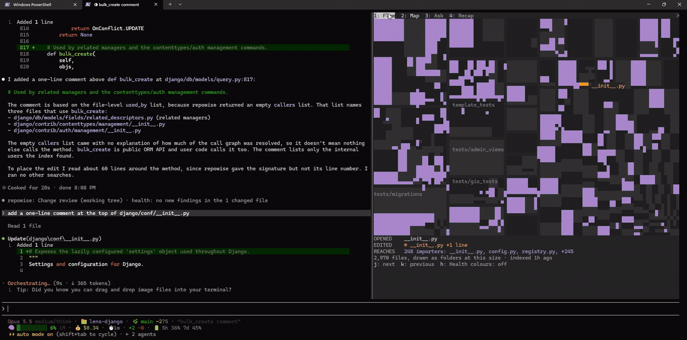

**Claude Code では**、Repowise プラグインに含まれる Lens が、Claude の作業中にインデックスが
把握していることを表示します：今いるファイルとそれに依存するファイルの数、ファイルを編集したターンのあとの変更
レビュー（コードヘルス、実行すべきテスト、同じファイルに手を入れているほかのブランチ）、そして `/lens`。
`/lens` は、Flow（各ターンを受け入れる前に確認すべきこと）、Claude が検索、オープン、編集したものと
その編集が到達する範囲で照らされたリポジトリのマップ、Ask、そしてセッションの振り返りを備えたペインです。
ボタンを押さない限り Claude には何も送られず、Lens 自身がモデルを呼び出すことはありません。
Claude Code 2.1.287 以降が必要で、マップには `repowise serve --no-ui` の実行が必要です。[Lens ガイド →](docs/agent/LENS.md)

---

<a id="the-ten-mcp-tools"></a>

## 10 個の MCP ツール

Claude Code では 10 個すべてが表示されます。リクエストのたびにすべてのツールのスキーマを送るクライアント
（Codex、Cursor、VS Code と Copilot など）では、各リクエストを小さく保つため、デフォルトで 5 つのコアツールが表示されます。
`repowise config set mcp.tools standard` を実行すると、そこでも 10 個すべてが表示されます。`repowise init` と `repowise agents add` は、接続した各エージェントに何が表示されるかを出力します。

すべてのレスポンスには `_meta` エンベロープが付き、インデックス化したコミット、インデックスの経過時間、そして
インデックスがチェックアウトより遅れているときの古さの警告が含まれるので、エージェントは今読んだ内容を
どの程度信頼できるかを常に把握できます。

<details>
<summary><strong>MCP ツールの一覧を見る</strong></summary>

| ツール | このツールだけが答えられること |
|---|---|
| `get_overview()` | アーキテクチャの概要、モジュールマップ、エントリポイント、git のヘルス。見慣れないコードベースで最初に呼び出すツールです。 |
| `get_answer(question)` | ハイブリッド検索（全文検索とベクトル検索）、グラフの展開、そして調整済みの単一の `confidence` を持つ出典付きの回答 1 つ。検索、読み込み、推論を 1 往復で行います。 |
| `get_context(targets, include?)` | ファイル、モジュール、シンボルのトリアージカード：概要、シグネチャ、ホットスポットのフラグ、関係する設計判断、シンボル ID。`include` で呼び出し元、呼び出し先、オーナーシップ、メトリクスを開けます。1 回の呼び出しで多数のターゲットをまとめて扱えます。 |
| `get_symbol("file.py::Name")` | インデックス化された 1 つのシンボルのソースを、正確な行範囲とともに返します。 |
| `search_codebase(query)` | コードとドキュメントを、シンボル、パス、概念で検索するハイブリッド検索。 |
| `get_risk(targets?, changed_files?)` | ホットスポット、依存するもの、共変更パートナー、オーナーシップ、テストの不足、バグ履歴。`changed_files` を渡すと PR モードになり、`directive` が返ります。 |
| `get_change_risk(revspec)` | コミット、範囲、未コミットの変更が、欠陥リスク、保守性、パフォーマンスの観点で何を悪化させたか、それに触れるテスト、そしてその差分が最近のコミットと比べてどの位置にあるか。 |
| `get_why(query?, targets?)` | アーキテクチャ上の設計判断を、その根拠そのままとともに返します。設計判断がない場合は git の考古学にフォールバックします。 |
| `get_dead_code(...)` | 到達不能なコードを信頼度の段階ごとに示し、ワークスペースモードではリポジトリをまたぐ利用側も示します。 |
| `get_health(targets?, include?)` | 3 つの観点すべてにわたるヘルススコアと指摘、Fix first、カバレッジ、傾向、ドキュメントのずれ、リファクタリング計画。 |

10 個は意図的な上限です：小さく、タスクに合わせた構成のほうが、大きな構成よりもエージェントにとって選びやすいからです。
さらに 7 つのツール（依存関係のパス、実行フロー、リファクタリングのコード生成、指摘のトリアージ、
ワークスペースのアーキテクチャ用の 3 つのツール）はオプトインです。パラメーター、例、使い分け：
**[docs/agent/MCP_TOOLS.md →](docs/agent/MCP_TOOLS.md)**

</details>

---

<a id="for-teams-and-enterprises"></a>

## チームと企業向け

AI は変更を作るコストを下げます。しかし、その結果を理解するコストは下げません。
Repowise は、開発者、エージェント、レビュアー、プラットフォームチームに、何が存在し、何がそれに依存し、
何がリスクで、何が壊れるかについての同じ根拠を、1 つのインデックスから提供します。
個別のヘルスツール、デッドコードツール、エージェント向けのコード検索レイヤー、ドキュメント生成ツール、
テスト影響分析サービスの代わりになります。

| デプロイ形態 | コードが読まれる場所 | ネットワークの外に出るもの |
|---|---|---|
| **セルフホスト、オープンソース**（`pip install repowise`） | あなたのマシン | オフにできる匿名の CLI テレメトリと、文章生成を有効にした場合のみ、あなた自身の LLM プロバイダー |
| **セルフホスト、商用** | あなたの VPC またはエアギャップされたネットワーク | エアギャップモードでは何も出ません |
| **ホスト版**（[repowise.dev](https://www.repowise.dev)） | 私たちが管理するインデクサー | コードはプラットフォームに送られます |

グラフ、git、ヘルス、変更リスク、テスト、デッドコード、そして PR ボットのチェックは **LLM を一切呼び出さず**、
生のソースが保存されることはありません。プルリクエストの AI レビューはオプトインです。文章生成はオプションで、あなた自身の
プロバイダー上で、または Ollama を使って完全にオフラインで実行できます。

**他の人に渡せる根拠。**

| 誰が聞いているか | Repowise が作成するもの |
|---|---|
| 変更管理をレビューする監査人（SOC 2 CC8.1、ISO 27001 A.8.32、PCI DSS 6.5） | 期間中のすべての変更を、レビューの記録、到達するテスト、ポリシーの判定、その後の結果とともに：`repowise report changes` |
| ソフトウェアの棚卸しのレビュー（PCI DSS 6.3.2） | オーナーチーム、言語、エントリポイント、import しているパッケージを持つコンポーネント：`repowise report inventory` |
| あるパッケージをどのコードが使っているかを尋ねるセキュリティチーム | コンポーネント、オーナーチーム、到達可能性を伴う import 箇所と、CycloneDX 1.6 形式の利用状況のエクスポート：`repowise packages where` |
| 買収側、取締役会、移行委員会 | コンポーネントの状態、ホットスポット、バス係数、デッドコード、テストの到達範囲、コントラクト：`repowise report assessment` |
| インシデントのレビュー | 最初に読むべき最近の変更を、それぞれの裏付けとなるシグナルとともに：`repowise suspects` |

**どの git ホストでも使えます。** インデックス化はローカルのチェックアウトを読むからです：GitHub（PR ボット、
Action、webhook）、GitLab（CI テンプレート、webhook）、Bitbucket などは CLI を通じて、
そして素のディレクトリや Perforce と SVN のエクスポートでは、履歴を除くすべてのレイヤーを利用できます。

商用ライセンスは、シートごと、インデックス化するリポジトリごと、または全社単位で提供され、
担当者、SLA、四半期ごとのアーキテクチャレビューが付きます。AGPL のもとで社内で Repowise を使っても、
自社のコードを公開する義務は生じません。

**[商用の詳細と機能の状況](docs/business/COMMERCIAL.md)** ·
**[セキュリティレビューパック](docs/business/SECURITY_COMPLIANCE.md)** ·
**[自社での評価](docs/business/EVALUATION.md)** ·
[hello@repowise.dev](mailto:hello@repowise.dev)

---

## プライバシー

- **決定論的またはオフラインのモード：** `--no-prose` を使うと、コードから得た内容はあなたのインフラ内にとどまります。
  CLI は**匿名でオプトアウト可能な**利用状況のテレメトリ（コマンド名と大まかな環境情報のみ）を送信します。
  `repowise telemetry disable`、`REPOWISE_TELEMETRY_DISABLED=1`、`DO_NOT_TRACK=1`、または `REPOWISE_OFFLINE=1` でオフにできます。
  [収集される内容 →](docs/reference/TELEMETRY.md)
- **オプションの LLM 機能：** 文章の生成、設計判断の抽出、リファクタリングのコード生成は、
  コードから作成したプロンプトを、あなた自身のキーで設定したプロバイダーに直接送信します。
  Repowise がそれらの呼び出しを中継することはありません。
- **保存されるもの：** グラフ、埋め込み、生成された wiki ページ、git のメタデータ。生の
  ソースは一時的に処理されるだけで、永続化されることはありません。
- **完全なオフライン：** Ollama とローカルの埋め込みモデルを使えば、外部への呼び出しはゼロになります。

セキュリティレビューを行っていますか？ **[docs/business/SECURITY_COMPLIANCE.md →](docs/business/SECURITY_COMPLIANCE.md)**

---

## CLI

<details>
<summary><strong>すべてのコマンドの一覧</strong></summary>

```bash
repowise init [PATH]      # index a codebase (plan screen; --yes --no-prose needs no key)
repowise generate [PATH]  # answers and docs with a model, on an existing index (no re-index)
repowise serve            # local dashboard and API
repowise update [PATH]    # incremental update (--workspace for every repo)
repowise watch            # re-index on file change
repowise search "<q>"     # hybrid search (fulltext / semantic / symbol / path)
repowise ask "<q>"        # a synthesized answer with citations
repowise context <files>  # triage card: layer, hotspot, fix history, freshness
repowise symbol <id>      # one symbol's body, with verified line bounds
repowise why <q|path>     # decisions, rationale, git archaeology
repowise next             # what to fix first
repowise health           # code-health KPIs and lowest-scoring files
repowise risk main..HEAD  # score a branch or PR range
repowise overlap          # other branches editing the same files
repowise impacted-tests   # only the tests a diff exercises
repowise changes show ID  # one merged change and its evidence checklist
repowise check            # evaluate .repowise/policies.yaml against a change
repowise suspects         # recent changes ranked against a symptom
repowise components       # declared and derived components, owners vs activity
repowise packages where   # where a third-party package is imported
repowise report           # assessment, change evidence and inventory packs
repowise report repo      # what Repowise found, most urgent first
repowise evidence setup   # how to collect coverage, test results and profiles here
repowise perf measure -- <cmd>  # did a change make a command faster or slower?
repowise dead-code        # unreachable code by confidence tier
repowise doc-drift        # documentation the code no longer supports
repowise security         # secrets and risky patterns, tree or full history
repowise decision list    # architectural decisions
repowise export --format structurizr  # the architecture as Structurizr DSL
repowise distill pytest   # compact, errors-first, reversible command output
repowise saved            # tokens and dollars saved by distillation
repowise workspace add    # multi-repo workspace management
repowise doctor           # check setup, API keys, index drift
repowise publish          # put this repo on repowise.dev (indexed from GitHub; public repos free)
repowise uninstall        # remove what repowise wrote, and say what it left
```

すべてのコマンドとフラグ：**[docs/reference/CLI_REFERENCE.md](docs/reference/CLI_REFERENCE.md)** ·
設定：**[docs/reference/CONFIG.md](docs/reference/CONFIG.md)** ·
うまく動かないとき：**[docs/start/TROUBLESHOOTING.md](docs/start/TROUBLESHOOTING.md)** ·
すべてのドキュメント：**[docs/README.md](docs/README.md)**

</details>

---

## コントリビューション

```bash
git clone https://github.com/repowise-dev/repowise
cd repowise
uv sync --all-packages
uv run repowise --version
uv run pytest tests/unit/
```

初めてですか？ 始めるのに 3,000 個のファイルを読む必要はありません。私たちは、Repowise 自身で構築した
このリポジトリの公開インデックスを用意しており、push のたびに再インデックス化しています：
[**repowise で repowise を探索する →**](https://repowise.dev/repo/repowise-dev/repowise)
（アーキテクチャ、ホットスポット、オーナーシップ、設計判断、そして自由に選んで取り組める、順位付けされた
[リファクタリングのバックログ](https://repowise.dev/repo/repowise-dev/repowise/refactoring)）。

言語や LLM プロバイダーの追加方法を含む完全なガイド：
[CONTRIBUTING.md](.github/CONTRIBUTING.md) · アーキテクチャ：
[docs/architecture/](docs/architecture/README.md)

---

## ライセンス

AGPL-3.0。Repowise を社内で使う個人、チーム、企業は無料で利用できます。

商用ライセンス（エンタープライズ向けのセキュリティとコンプライアンスのレイヤー、SSO/SCIM、RBAC、
ワークフローの連携、優先サポートと SLA、または AGPL の義務なしに Repowise を製品に組み込むこと）については、
**[docs/business/COMMERCIAL.md](docs/business/COMMERCIAL.md)** を参照するか、
[hello@repowise.dev](mailto:hello@repowise.dev) にお問い合わせください。

---

<div align="center">

<em>AI エージェントが同じファイルを 4 回目の <code>cat</code> をするのを見るのにうんざりしたエンジニアのために作りました。</em>

<p align="center"><sub>⭐ Repowise があなたのワークフローに役立ったら、<strong>スターを付けてください</strong>。あなたには何のコストもかからず、小さなチームがこれをオープンに作り続けるための励みになります。</sub></p>

<p align="center">
  <a href="https://repowise.dev"><strong>repowise.dev</strong></a> ·
  <a href="https://www.repowise.dev/explore"><strong>探索する →</strong></a> ·
  <a href="https://discord.gg/cQVpuDB6rh"><strong>Discord</strong></a> ·
  <a href="https://x.com/repowisedev"><strong>X</strong></a> ·
  <a href="mailto:hello@repowise.dev"><strong>hello@repowise.dev</strong></a>
</p>

</div>
