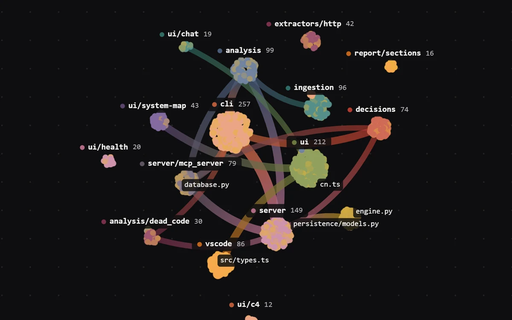
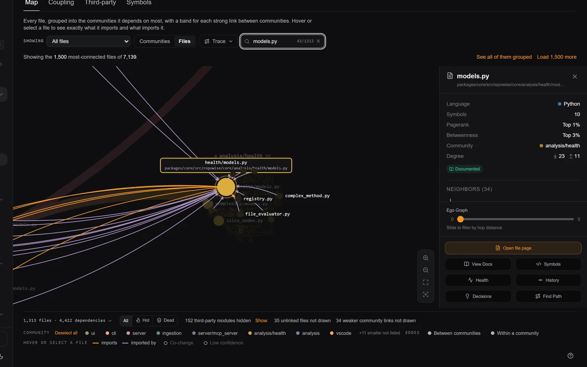
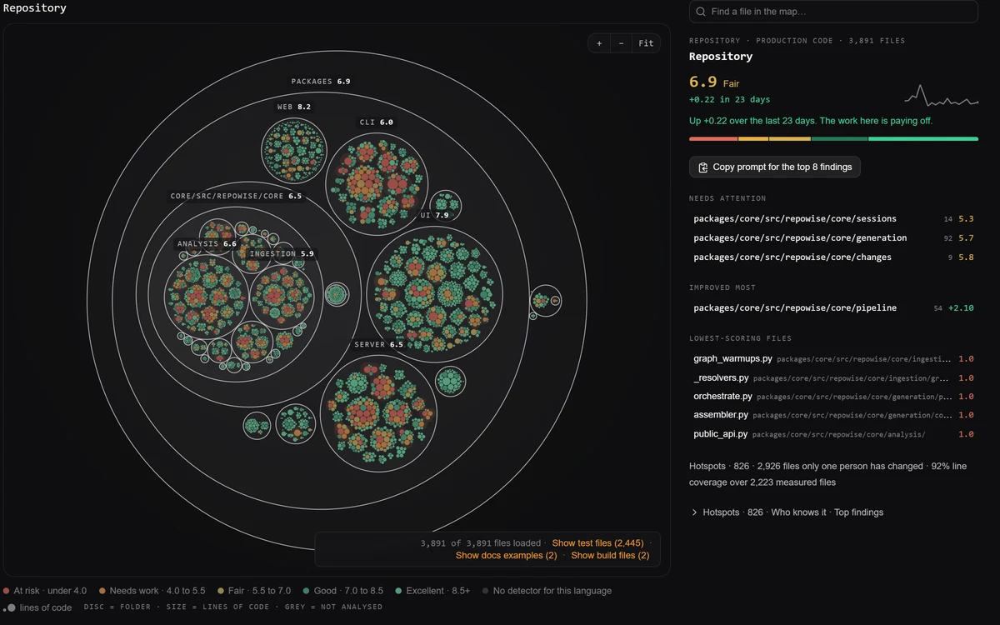
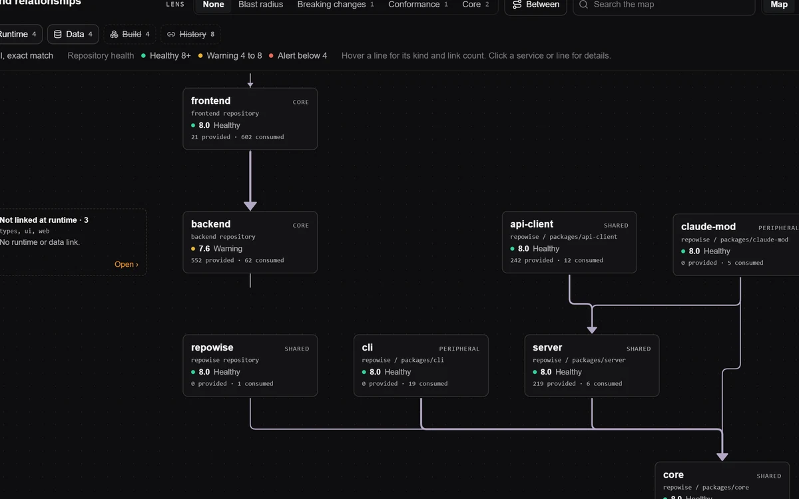
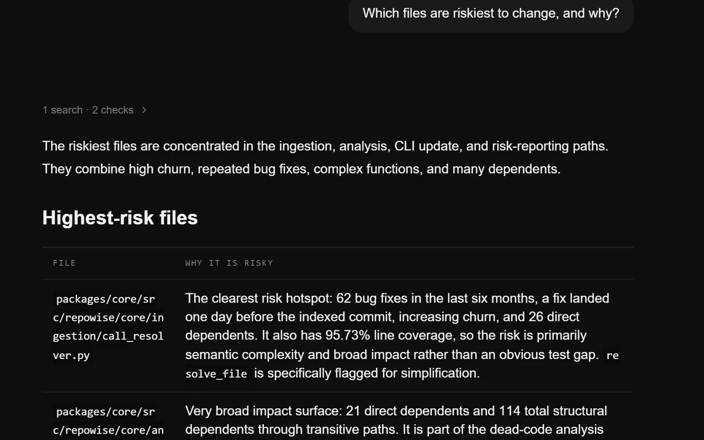
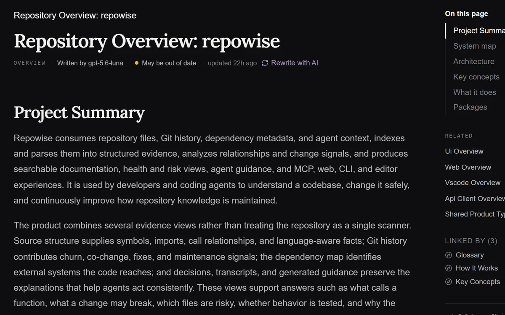
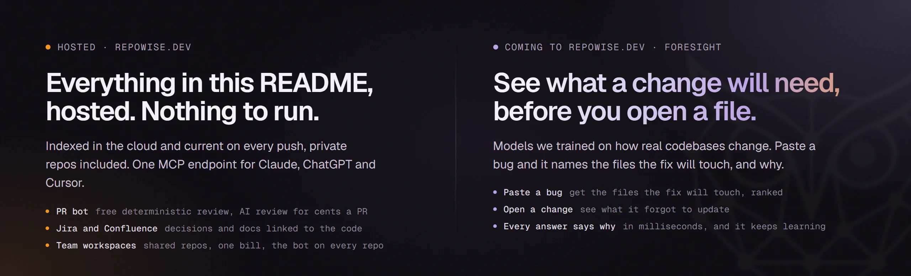
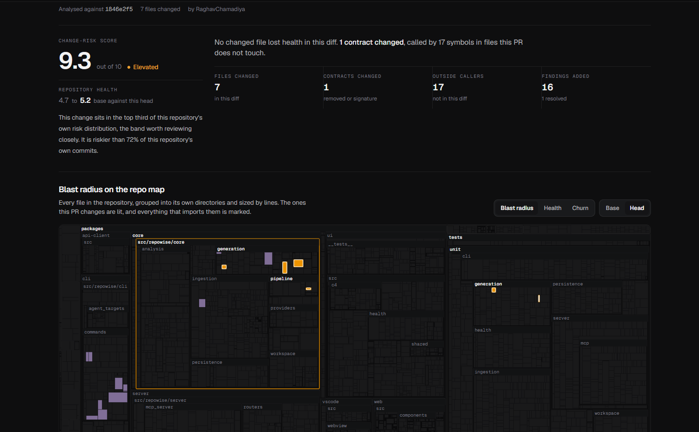
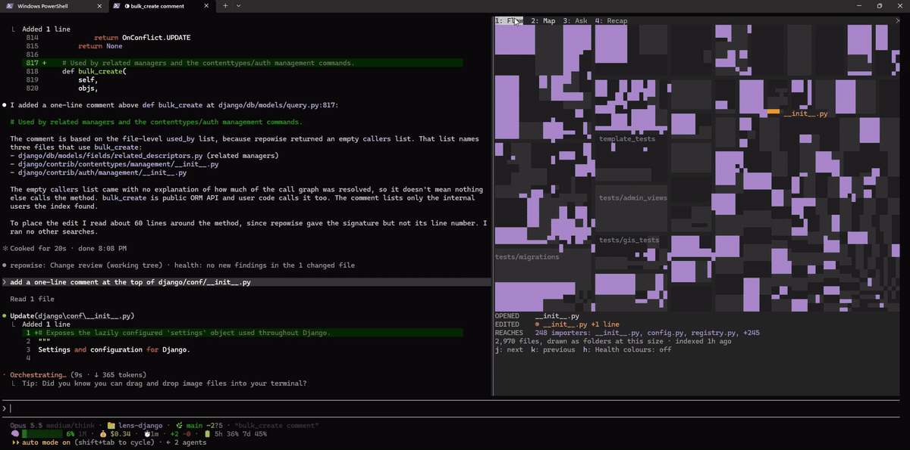

<!-- mcp-name: dev.repowise/repowise -->

[English](README.md) | [简体中文](README.zh-CN.md)

<div align="center">

<a href="https://www.repowise.dev/?src=oss_readme_hero"></a>

<h1 align="center">Stop paying your agent to re-read your codebase.</h1>

<p align="center">Repowise indexes your code, git history, tests and decisions once, on your machine.<br />
Your coding agent asks the index instead of grepping and opening files, so it does about half the work.<br />
You get the same answers in a dashboard: what calls this, what breaks, what to fix first, and why.</p>

<p align="center">
  <a href="#quickstart"></a>
  <a href="https://www.repowise.dev/?src=oss_readme_hero"></a>
</p>

<table align="center">
<tr>
<td align="center" width="260"><a href="docs/BENCHMARKS.md#2-what-changes-in-a-real-agent-loop"><b>Half the tool calls</b></a><br /><sub>your agent opens 3 files where it opened 7 · <em>31.6% less output</em></sub></td>
<td align="center" width="260"><a href="docs/BENCHMARKS.md#4-command-output-compression"><b>Up to 99% less noise</b></a><br /><sub>from test runs, installs and git output · <em>every error line kept</em></sub></td>
<td align="center" width="260"><a href="docs/BENCHMARKS.md#1-finding-the-right-files"><b>88% of the right files</b></a><br /><sub>found in one call · <em>next best tool: 61%</em></sub></td>
</tr>
</table>

<a href="https://www.repowise.dev/?src=oss_readme_hero"></a>

<p align="center"><sub>
Graph, risk, health, tests and dead code make <strong>zero LLM calls</strong> · no API key to index ·
28 languages · Claude Code, Codex, Cursor and any MCP host · free and open source
</sub></p>

<p align="center">
  <a href="https://repowise.dev/repo/repowise-dev/repowise"></a>
  <a href="https://repowise.dev/repo/repowise-dev/repowise/code-health"></a>
  <a href="https://pypi.org/project/repowise/"></a>
  <a href="https://www.gnu.org/licenses/agpl-3.0"></a>
</p>

<p align="center">
  <a href="#quickstart"><strong>Quickstart</strong></a> ·
  <a href="#your-agent-stops-guessing"><strong>For your agent</strong></a> ·
  <a href="#what-it-does"><strong>What it does</strong></a> ·
  <a href="#hosted"><strong>Hosted</strong></a> ·
  <a href="#measured-against-the-field"><strong>Benchmarks</strong></a> ·
  <a href="#for-teams-and-enterprises"><strong>Teams</strong></a> ·
  <a href="https://docs.repowise.dev"><strong>Docs</strong></a>
</p>

</div>

---

<a id="quickstart"></a>
<a id="set-it-up-in-one-line"></a>

## Set it up in one line

Open Claude Code, Codex, Cursor or any MCP-capable agent in your repository and paste:

```text
Read https://docs.repowise.dev/setup.md and set up Repowise in this repository.
```

The agent installs Repowise, indexes the repo with no API key, connects itself to
the index, and asks you before anything costs money. To do it by hand:

```bash
uv tool install repowise          # or: pipx install repowise / pip install repowise
cd /path/to/your/repo
repowise init --yes --no-prose    # graph, git, health, dead code, docs. No key, no spend.
                                  # (add model-written docs any time with: repowise generate)
repowise serve                    # dashboard + MCP server (needs Node 20+; first run downloads the UI)
```

Restart Claude Code or run `/mcp`, then ask *"What breaks if I change
`src/auth.py`?"* or *"Use Repowise `get_overview` to summarize this repository."*
`init` wires Claude Code for this repo and points the global repowise MCP entry
here. [Full setup for every agent →](docs/start/QUICKSTART.md)

---

<a id="your-agent-stops-guessing"></a>

## Your agent stops guessing

Without an index, an agent rediscovers your codebase on every task: grep, open a
file, open three more, grep again. Repowise answers those questions ahead of time,
so the agent asks once and gets on with the work.

In a measured run on `django/django`, an agent with Repowise made **3.8 tool calls
instead of 7.2**, opened **3.0 files instead of 7.2** and wrote **31.6% less**, with
answers just as good. That is the largest saving of the five context tools we
tested. On a small local model the output cut reaches **47.9%**.
[How it was measured →](docs/BENCHMARKS.md#2-what-changes-in-a-real-agent-loop)

- Your agent gets **ten task-shaped MCP tools**. Ask about several files at once
  and get callers, risk, tests, owners and the reasons behind the code in one answer.
  [The tool list ↓](#the-ten-mcp-tools)
- **Up to 99% less command noise.** `repowise distill` trims test, install and git
  output before the agent reads it and keeps every error line.
  [Distill →](docs/agent/DISTILL.md)
- **Context before the agent asks.** Optional [hooks](docs/agent/HOOKS.md) warn it
  off fragile files and stale paths, and Repowise keeps your `CLAUDE.md` and
  `AGENTS.md` current from the index.
- **See your own savings.** `repowise saved` and the dashboard's Usage and savings
  page count the tokens your agent no longer has to read.

---

<a id="why-repowise"></a>
<a id="what-it-does"></a>

## What it does

One index of your code, its history and its decisions, used three ways: to
understand the code, to change it safely, and to keep improving it.

<table>
<tr>
<td width="50%" valign="top">

<h3>See how it fits together</h3>
A call graph across 28 languages, an architecture map you can explore, C4 views,
and a generated wiki for every module and file.<br />
<a href="docs/layers/GRAPH.md">The graph</a> · <a href="docs/layers/WIKI.md">Docs</a>
</td>
<td width="50%" valign="top">

<h3>Know what breaks</h3>
Every caller of what you changed, the files that usually change with it but are
missing from your diff, and the tests that reach it.<br />
<a href="docs/layers/CHANGE_RISK.md">Change risk</a> · <a href="docs/layers/TEST_INTELLIGENCE.md">Tests</a>
</td>
</tr>
<tr>
<td width="50%" valign="top">

<h3>Fix what matters</h3>
A 1 to 10 health score for every file, validated against real bug history, a
ranked fix-first queue, refactoring plans and dead code.<br />
<a href="docs/layers/CODE_HEALTH.md">Code health</a> · <a href="docs/layers/REFACTORING.md">Refactoring</a>
</td>
<td width="50%" valign="top">

<h3>Follow it across repos</h3>
Services and the HTTP, gRPC and event contracts between them, with a guard for
breaking changes and the consumer files they affect.<br />
<a href="docs/scale/WORKSPACES.md">Workspaces</a>
</td>
</tr>
<tr>
<td width="50%" valign="top">

<h3>Ask it anything</h3>
Cited answers and charts from the dashboard, or the same answers through MCP for
your agent.<br />
<a href="docs/start/DASHBOARD.md">Dashboard</a> · <a href="docs/agent/MCP_TOOLS.md">MCP tools</a>
</td>
<td width="50%" valign="top">

<h3>Remember why</h3>
Decisions mined from ADRs, comments, commits, PRs and agent sessions, each tied to
the code it governs, plus docs checked against the code.<br />
<a href="docs/layers/DECISIONS.md">Decisions</a> · <a href="docs/layers/DOC_DRIFT.md">Doc drift</a>
</td>
</tr>
</table>

<details>
<summary><strong>Every question it answers</strong></summary>

### Understand the code

| You ask | Repowise gives you |
|---|---|
| *How does checkout work in this repo?* | A cited answer built from the call graph and the generated docs, in one call. [Search and answers](docs/layers/WIKI.md) |
| *What calls this function, and what does it call?* | A call graph across 28 parsed languages, every edge stamped with how it was resolved and how far to trust it, plus traced execution flows from each entry point. [The graph](docs/layers/GRAPH.md) |
| *Can I get docs for this codebase?* | A wiki for every module and file, rendered from the code's structure with no key, or written by a model when you choose. It updates incrementally after each commit. [Docs](docs/layers/WIKI.md) |
| *Which of our docs are wrong?* | Markdown checked against the tree: every reference to a file or symbol the code no longer has, with the line to edit. [Doc drift](docs/layers/DOC_DRIFT.md) |
| *Why is it built this way?* | Decisions mined from ADRs, `# WHY:` comments, commit and PR history and your agent sessions, each tied to the code it governs and flagged when it goes stale. [Decisions](docs/layers/DECISIONS.md) |
| *Who knows this code?* | Owners, bus factor, fading ownership when the main author goes quiet, and suggested reviewers. [Ownership](docs/layers/OWNERSHIP.md) |
| *Can I see the architecture?* | An explorable dependency map, C4 views, and a Structurizr export, no model involved. [Dashboard](docs/start/DASHBOARD.md) |

### Change it safely

| You ask | Repowise gives you |
|---|---|
| *What breaks if I change this?* | Symbol-level blast radius: the callers of what you changed, the files that historically change with it but are missing from your diff, and the tests that reach it. [Change risk](docs/layers/CHANGE_RISK.md) |
| *How risky is this PR?* | Where the change ranks against your repository's own recent commits, with the reasons, as a directive your agent can act on. [Change risk](docs/layers/CHANGE_RISK.md) |
| *Which tests should run?* | The tests a diff actually exercises, from a coverage report if you have one and from the call graph if you do not. [Test intelligence](docs/layers/TEST_INTELLIGENCE.md) |
| *Did this PR add untested lines?* | Patch coverage, branch coverage on changed lines and path-scoped gates in CI, on GitHub, GitLab or any runner. [CI gates](docs/start/CI.md) |
| *Will this API change break another repo?* | HTTP, gRPC, topic and OpenAPI contracts matched across repositories, with a breaking-change guard and the consumer files it affects. [Workspaces](docs/scale/WORKSPACES.md) |
| *Is anyone else editing these files?* | Other open branches touching the same files or their co-change partners, each with the reason it is listed. [Branch overlap](docs/layers/CHANGE_RISK.md#branch-overlap) |
| *Did we just commit a secret?* | Keys, tokens and risky calls found in the working tree and in full git history, with a pre-commit check and a CI gate. [Security signals](docs/layers/SECURITY.md) |

### Improve it continuously

| You ask | Repowise gives you |
|---|---|
| *What should we fix first?* | A ranked queue weighing impact against effort, using churn, fan-in, coverage and bug history. [Fix first](docs/layers/CODE_HEALTH.md#fix-first) |
| *Where is the debt?* | A 1 to 10 score for every file from 53 deterministic detectors, split into defect risk, maintainability and performance, validated against real bug history. [Code health](docs/layers/CODE_HEALTH.md) |
| *Why is this slow?* | N+1 queries, I/O in loops, blocking calls inside async code and quadratic loops, traced across function and file boundaries. [Performance](docs/layers/PERFORMANCE.md) |
| *How do I break this up safely?* | Concrete refactoring plans: Extract Method, Extract Class, Move Method, Split File, Break Cycle, with the exact symbols that move and what moves with them. Ready to hand to an agent. [Refactoring](docs/layers/REFACTORING.md) |
| *What can we delete?* | Unreachable files, unused exports and unused packages, each with a confidence tier and the evidence behind it. [Dead code](docs/layers/DEAD_CODE.md) |
| *Where do bugs keep landing?* | Bug-fix commits traced to files and symbols, and a warning when your agent edits a bug magnet. [Bug history](docs/layers/BUG_HISTORY.md) |
| *Are our tests testing anything?* | Tests with no assertions, tests that only check their own mocks, and untested hotspots. [Test-quality smells](docs/layers/CODE_HEALTH.md#findings) |

</details>

<details>
<summary><strong>Things people do not expect it to do</strong></summary>

- **Test coverage without running coverage.** Most repositories never produce a
  coverage report. Repowise answers "is this tested, and by what" from the import and
  call graph, and labels every answer measured or inferred.
- **It checks its own health score on your repository.** After each index it reports
  how many of the lowest-scoring files actually had bug fixes in your recent history,
  so a bad score on your codebase is visible to you.
- **It learns from your agent sessions.** With transcript capture on, the corrections
  you keep repeating ("use the shared HTTP client") become tracked decisions it
  feeds back to the agent later. Transcripts never leave your machine.
- **It writes your `CLAUDE.md` and `AGENTS.md`** from the real index and keeps them
  current, so even an agent with no MCP support starts informed.
- **It shrinks command output before your agent reads it.** `repowise distill pytest`
  keeps every failure and drops the noise, and nothing is lost: an `expand` command
  restores any cut.
- **New git worktrees start indexed.** A linked worktree seeds its index from the base
  checkout instead of starting cold.
- **It knows which external systems you depend on.** Package manifests across PyPI,
  npm, Cargo, Go, NuGet, Maven and CMake feed a map of the services and libraries the
  code reaches.

</details>

---

<a id="hosted"></a>
<a id="foresight"></a>

## Hosted, and Foresight

Everything above runs free on your own machine. [repowise.dev](https://www.repowise.dev/?src=oss_readme_section)
runs it for you, private repos included, and is where **Foresight** arrives first:
models trained on years of real commits and fixes that rank the files a fix will
touch, name what a change forgot, and explain every answer, with no LLM.
[What Foresight does →](docs/business/FORESIGHT.md)

<a href="https://www.repowise.dev/?src=oss_readme_section"></a>

<p align="center">
  <a href="https://www.repowise.dev/login?mode=signup&src=oss_readme_section"></a>
  <a href="https://www.repowise.dev/foresight?src=oss_readme_section"></a>
</p>

Already indexed locally? `repowise publish` puts the repo on repowise.dev in one
command. It indexes your GitHub remote, so nothing is uploaded from your machine.
Public repos are free.

---

<a id="know-whats-dangerous-before-you-merge"></a>

## Know what breaks before you merge

All of this comes from the graph and git history, with no LLM, so the same diff
always gets the same answer.

- **Change risk.** Score any commit or branch 0 to 10 against your repository's own
  recent commits, with what it may break, the companion files it forgot, the
  tests it is missing and the tests to run. `repowise risk main..HEAD`
  ([reference](docs/layers/CHANGE_RISK.md))
- **Tests without a coverage run.** Which tests reach a file and which ones a diff
  exercises, from a coverage report when you have one and from the call graph
  when you do not: **97.5% correct** on which tests to run.
  `repowise impacted-tests main..HEAD` ([reference](docs/layers/TEST_INTELLIGENCE.md))
- **Bug magnets.** Which files keep getting bug fixes, with a warning when your agent
  edits one. ([reference](docs/layers/BUG_HISTORY.md))
- **Branch overlap.** Other open branches editing the same files. `repowise overlap`
  ([reference](docs/layers/CHANGE_RISK.md#branch-overlap))
- **In CI.** Patch coverage, doc drift, security and change risk as gates through the
  [GitHub Action](docs/start/CI.md#github-actions), a [GitLab template](docs/start/CI.md#gitlab)
  or plain CLI, with SARIF output. No API key. [Repowise in CI →](docs/start/CI.md)

<a id="the-pr-bot"></a>

**On every pull request.** The free **[Repowise PR Bot](https://github.com/apps/repowise-bot)**
posts one comment, edited in place on every push, with the callers outside the PR,
the tests and companion files it is missing, and its change risk. A green PR gets no
comment at all.



<sub>A real comment on a real PR: [repowise-dev/repowise#1204](https://github.com/repowise-dev/repowise/pull/1204) ·
[its analysis page →](https://repowise.dev/pr/repowise-dev/repowise/1204) ·
[install the PR bot →](https://github.com/apps/repowise-bot)</sub>

<a id="change-evidence"></a>

### Every change, with its evidence

Each merged PR or commit becomes a **Change Record**: what it touched, who owns it,
the tests that reach it, the contracts and decisions it crosses, and what happened
after it landed. No forge API is called.

| You ask | Repowise gives you |
|---|---|
| *What landed in this PR, and what backs it up?* | The change's evidence checklist, each item `ok`, `attention` or `unknown`, with an in-toto export. [Change Records](docs/layers/CHANGES.md) |
| *Can CI hold changes to our payment code to a higher bar?* | Rules in `.repowise/policies.yaml`, matched to components by name, tag or criticality and evaluated by `repowise check`, with SARIF or JUnit output. [Change policy](docs/layers/POLICY.md) |
| *Something broke. Which change do we read first?* | Recent changes ranked against an error, a stack trace or an issue. On 43 real regressions, the change a later revert or fix named was in the top 5 for 67% of them, against 28% for ranking by shared files. [Suspects](docs/layers/CHANGES.md#suspects) |
| *Who owns this, and are they still working on it?* | Backstage-shaped components with owners from your catalog and CODEOWNERS, compared with the last 90 days of commits. [Components](docs/layers/COMPONENTS.md) |
| *Can we show an auditor or an acquirer where we stand?* | Evidence packs: a repository assessment, a change report for a period and a component inventory, as JSON, Markdown, HTML or CSV. [Reports](docs/layers/REPORTS.md) |

---

<a id="code-health"></a>

## Know exactly what to fix

Every file gets a 1 to 10 score from **53 deterministic detectors**, read three ways:
defect risk, maintainability and performance. Performance findings such as N+1
queries and I/O in loops are traced across functions and files.

The score is checked against real bugs. On 21 open-source projects, ranking by
Repowise found **2.3x as many later-buggy files as CodeScene** in the same review
budget. It also checks itself on your repository after every index: *"16 of the 20
lowest-health files had a bug fix in the last 6 months, 3.3x the 24% baseline."*

Then it names the fix: **Extract Method**, **Extract Class**, **Move Method**,
**Split File** or **Break Cycle**, with the exact symbols that move, ranked so a fix
on a central file comes before the same fix on a leaf. Each plan has a copy-to-agent
button.

```bash
repowise next                          # what to fix first, ranked by impact and effort
repowise health --refactoring-targets  # concrete plans
repowise dead-code                     # what can go, by confidence tier
```

[Code health](docs/layers/CODE_HEALTH.md) · [Refactoring](docs/layers/REFACTORING.md) ·
[Dead code](docs/layers/DEAD_CODE.md) · [How it was validated →](docs/BENCHMARKS.md#5-code-health-predicts-defects)

---

<a id="past-one-repo"></a>

## Across your repositories

Real systems are more than one repository, and the expensive failures live between
them. Change a backend contract and Repowise names the frontend calls that consume
it, the services downstream, and the architecture rule the new dependency breaks,
before it ships.

| Workspace intelligence | What it answers |
|---|---|
| **Contract map** | Which services provide and consume each HTTP, gRPC, event, socket and data contract? Links keep their exact or candidate confidence and the source evidence. |
| **Cross-repo blast radius** | If this provider changes, which downstream services are in structural reach, and which may drift through historical co-change? |
| **Breaking-change guard** | Was an endpoint removed or an OpenAPI, proto or signature shape changed incompatibly, and which consumer files are linked to that contract? |
| **Test impact** | Which tests in the consumer repos should run for this provider change, measured from coverage or inferred from the call graph? |
| **Architecture as code** | Does the live system graph violate declared dependency rules or contain cycles? `repowise workspace check` gates CI. |
| **Architecture health** | How coupled is the estate? Propagation cost, the cyclic core, service roles and a deterministic 1-10 architecture score. |
| **Federated context** | One dashboard and one MCP server answer across every repository while keeping repo-level evidence. |

[Workspace guide and support matrix →](docs/scale/WORKSPACES.md) ·
[Keeping the index fresh →](docs/scale/AUTO_SYNC.md)

---

<a id="measured-against-the-field"></a>

## Measured against the field

The same repositories, commits and questions for every tool, each given its full
advertised surface, against answer keys we did not write.

<div align="center">
<picture>
  <source media="(prefers-color-scheme: dark)" srcset=".github/assets/bench/agent-output-tokens-dark.svg" />
  
</picture>
<picture>
  <source media="(prefers-color-scheme: dark)" srcset=".github/assets/bench/file-coverage-dark.svg" />
  
</picture>
</div>

| | Result |
|---|---|
| **Work saved in an agent loop** | 3.8 tool calls instead of 7.2, 3.0 files opened instead of 7.2, **31.6% less output**. The best of five context tools. *n=43, p<0.0001* |
| **Finding the right files** | **0.876** of the files a fix needed, against 0.610 for the next tool, on a sealed set. *n=42, p=0.00004* |
| **Command output** | Up to **99.5%** smaller (`npm ci`), 89% for `git log`, 86% for `git diff`, no error line lost |
| **Call graph the compiler agrees with** | **95% to 99.6%** precision on Go, TypeScript, Dart, C and Python, graded by each language's own toolchain. Against four other tools, none that finds as much of the graph gets more of it right, in 7 of 7 cells |
| **Health that predicts bugs** | **2.3x** CodeScene's recall of later-buggy files at the same review budget. *2,770 files, p=0.003* |
| **Scale** | **15 million lines** (dotnet/runtime) on one laptop. Building the call graph takes **75 MB**, 10x less than the next tool |

**[Every result, in plain English, with the method →](docs/BENCHMARKS.md)** ·
[The research it is built on →](docs/LINEAGE.md)

<details>
<summary><strong>How it compares on capability</strong></summary>

No single product competes with all of this, so there is no single table. Rows marked
*measured* are head-to-head numbers that link to
**[docs/BENCHMARKS.md](docs/BENCHMARKS.md)**, where the sample sizes, the tests and the
rows we lose live. Unmarked rows are capability presence, not measurements.

### As an agent context layer

| | repowise | CodeGraph | Serena | DeepWiki |
|---|---|---|---|---|
| Self-hostable, open source | ✅ AGPL-3.0 | ✅ | ✅ | ❌ cloud only |
| Private repo, no cloud | ✅ | ✅ | ✅ | ❌ OSS forks only |
| MCP tools served | 10 default + 7 opt-in | 1 | 29 | 3 |
| **Finds the gold files** *([measured](docs/BENCHMARKS.md#1-finding-the-right-files), n=42 sealed)* | ✅ **0.876** | 0.610 | not in this run | not measured |
| **Output tokens vs a bare agent** *([measured](docs/BENCHMARKS.md#2-what-changes-in-a-real-agent-loop), n=43)* | ✅ **-31.6%** | -24.4% | -14.8% | not measured |
| **Memory to build the graph** *([measured](docs/BENCHMARKS.md#what-it-costs-to-run), 5 tools, 35 repos)* | ✅ **75 MB**, lowest on 35 of 35 | 757 MB | not measured | n/a, cloud |
| **Time to build the graph** *([measured](docs/BENCHMARKS.md#what-it-costs-to-run), same run)* | **2.77s**, fastest on 14 of 35 | **3.65s**, fastest on 16 | not measured | n/a, cloud |
| **Time to build the full index, django** *([measured](docs/BENCHMARKS.md#what-it-costs-to-run))* | ⚠️ **366.8s**, slowest here | ✅ **16.4s** | not measured | n/a, cloud |
| **Call-edge precision, hand-graded** *([measured](docs/BENCHMARKS.md#7-edge-precision), 560 rows, 9 languages)* | ✅ **85.7%** | 58.6% | not measured | not measured |
| **Call-edge precision, judged by a compiler** *([measured](docs/BENCHMARKS.md#8-the-same-question-against-an-answer-key-we-do-not-control), 5 tools, 7 cells)* | ✅ **nothing that finds as much gets more of it right**, 7 of 7 | lower precision in 7 | not measured | not measured |
| Generated documentation | ✅ | ❌ | ❌ | ✅ |
| Proactive agent hooks | ✅ Claude + Codex | ❌ | ❌ | ❌ |
| Generated `CLAUDE.md` / `AGENTS.md` | ✅ | ❌ | ❌ | ❌ |
| Command-output distillation | ✅ reversible | ❌ | ❌ | ❌ |
| Architectural decision records | ✅ | ❌ | ❌ | ❌ |
| Multi-repo workspace intelligence | ✅ contracts, co-change, federated MCP | ❌ | ❌ | ❌ |

**The two cost rows answer different questions.** Building the call graph, we are the
lightest tool measured, about ten times lighter than the next, and roughly as fast as
the fastest. Building the *whole* index, CodeGraph is **22x faster than we are**,
because by then we have also built the git-history layer, the wiki, the decisions and
the health pass. If a call graph is all you need, that is the right trade and you
should take it. With model-written prose on, it is **135x**.

**The hand-graded precision row cuts both ways.** About fourteen percent of the call
edges we draw are wrong, and on `seastar` CodeGraph grades better than we do. The
compiler row exists because we graded the hand-read one ourselves: on Go and
TypeScript the answer key is the Go team's own call graph and the `tsc` checker's own
resolution, which we neither wrote nor can tune. Precision alone is easy to win by
drawing almost nothing, and recall alone by drawing everything, so the claim is the
pair.

<sub>Competitors measured at CodeGraph 1.5.0, Graphify 0.9.31, Serena 1.6.2.dev0 and
code-review-graph 2.3.7 in August 2026. Repowise compiler-graded figures are from main
on 2026-10-03; the other Repowise rows are from `081a59fa`, August 2026.</sub>

### As a code health tool

| | repowise | CodeScene |
|---|---|---|
| Self-hostable, open source | ✅ AGPL-3.0 | ⚠️ on-prem Docker, proprietary |
| Code health score (1-10) | ✅ 53 detectors, 25 scoring | ✅ 25-30 |
| Brain Method / LCOM4 / god class | ✅ | ✅ |
| **Defects found at a 20% review budget** *([measured](docs/BENCHMARKS.md#5-code-health-predicts-defects), 2,770 files)* | ✅ **0.173** | 0.074 |
| **Effort-aware ranking, Popt** *(measured, p=0.003)* | ✅ **0.607** | 0.462 |
| **Precision at that budget** *(measured)* | 0.580 | ✅ **0.636**, a shorter list |
| **Discrimination, ROC AUC** *(measured, paired)* | 0.731 | 0.705, *p=0.054, not significant* |
| Business impact (resolution time) | ❌ *we could not replicate this on open data* | ✅ Code Red study |
| Git intelligence (hotspots, ownership, co-change) | ✅ | ✅ |
| Pre-merge change-risk scoring | ✅ 0-10 + directives | ✅ |
| Concrete cross-file refactoring plans | ✅ graph-aware + blast radius | ⚠️ within-function only |
| Test-coverage intelligence | ✅ LCOV/Cobertura/Clover/JaCoCo/Go | ❌ |
| Dead code detection | ✅ | ❌ |
| Serves it to an AI agent over MCP | ✅ | ✅ |

CodeScene is the only other vendor in this category with a published empirical defect
study, which is why it is the one we ran head to head. It flags about 27 files where
we flag 132, so if you want a short list to act on, its threshold is the better fit.

### Documentation generators

DeepWiki, Google Code Wiki and Swimm generate documentation from a repository, which
overlaps one of our layers. **We have not measured against them**, so there is no
table here.

### The PR bot, against LLM review bots

| | Repowise PR Bot | CodeRabbit | Greptile |
|---|---|---|---|
| LLM calls per PR | ✅ **zero** | ❌ every review | ❌ every review |
| Same diff, same review | ✅ deterministic | ❌ sampled output | ❌ sampled output |
| Your code sent to a model provider | ✅ never | ❌ yes | ❌ yes |
| Symbol-level blast radius | ✅ call graph | ❌ | ⚠️ prose, from context |
| Co-change partners missing from the PR | ✅ git history | ❌ | ❌ |
| Change risk vs the repo's own history | ✅ 0-10 + percentile | ❌ | ❌ |
| Silent on a clean PR | ✅ by default | ⚠️ configurable | ⚠️ configurable |

An LLM reviewer is a different product: it can read intent, and it can be wrong in a
new way on every run. This one does set arithmetic over a call graph and a git
history, so pushing the same diff twice gives the same review twice. Full side-by-side
comparisons: **[repowise.dev/compare →](https://www.repowise.dev/compare)**

</details>

---

## Supported languages

**28 languages parsed to an AST, 42 on a five-rung ladder, framework-aware where an
ecosystem handler exists.** Every language ships in the open-source distribution.

<p>
  <strong>Full &nbsp;</strong>
  
  
  
  
  
  
  
  
  
  
  
  
  
  
  
</p>
<p>
  <strong>Good &nbsp;</strong>
  
  
  
  
  
  
  
  
  
  
  
  &nbsp;<strong>· Partial &nbsp;</strong>
  
  
</p>

<details>
<summary><strong>The full ladder, and what each rung gives you</strong></summary>

| Rung | Languages | What you get |
|---|---|---|
| **Full** (15) | Python · TypeScript · JavaScript · Svelte · Vue · Astro · Java · Kotlin · Go · Rust · C++ · C# · Scala · Ruby · Apex (Salesforce) | The whole pipeline: AST symbols, import resolution, a resolved call graph, heritage, docstrings, framework edges and code-health markers |
| **Good** (11) | C · Swift · PHP · Dart · Object Pascal · COBOL · GDScript · VB.NET · Elixir · F# · Objective-C | All of the above except the full health suite, within the language-specific ceilings in the full matrix |
| **Partial** (2) | Luau / Roblox · Razor / Blazor | Luau: AST symbols and `require()` resolution, Rojo and `.luaurc` aware. Razor: component symbols, `@code` and component-tag call edges, C# health markers; no import resolution yet |
| **Lightweight** (6) | Clojure · Haskell · Lean 4 · Erlang · HTML · QML | A real file-to-file import graph, and no symbol-level claims |
| **Structural** (8) | R · Zig · Julia · Elm · OCaml · Crystal · Nim · D | Git history: blame, hotspots, co-change, ownership, bug history |

SQL and dbt projects get `ref()` / `source()` lineage, shell scripts get function-level
symbols, HTML pages contribute their `<script src>` and `<link href>` dependencies, and
OpenAPI, Protobuf, GraphQL, Dockerfile, Terraform and similar formats get dedicated
handlers. Anything else is still tracked through git history.

Every call edge is stamped with **how it was resolved and how much to trust it**, from
`same_file` at 0.95 down to a repo-wide name match at 0.50, labelled as the guess it
is. Accuracy per language, graded against each language's own compiler:
[docs/BENCHMARKS.md#accuracy-by-language](docs/BENCHMARKS.md#accuracy-by-language).

Full matrix: **[docs/layers/LANGUAGE_SUPPORT.md →](docs/layers/LANGUAGE_SUPPORT.md)** ·
adding a language takes five small steps and no changes to the parser core:
**[docs/architecture/language-support.md →](docs/architecture/language-support.md)** ·
languages moving up the ladder: **[roadmap →](ROADMAP.md#languages)**

</details>

---

## Supported agents and editors

**Eight agents wired end to end · two at the Full tier · every other MCP host one
paste away.**

<p>
  <strong>Full tier &nbsp;</strong>
  
  
</p>
<p>
  <strong>Good tier &nbsp;</strong>
  
  
  
  
  
  
</p>

**Full** is every surface Repowise has: MCP tools, skills, slash commands, a managed
instructions file, hook-level interception of tool calls, and transcript mining after
the session. **Good** is MCP tools plus an instructions file or skills, without transcript mining
(hooks only where the matrix says). **Basic** is the MCP config alone. Anything else that speaks MCP is one snippet away:
`repowise agents print-config claude-code` prints a server entry for Cline, Windsurf,
Zed, Gemini CLI or any host that reads `mcpServers`.
[Integration matrix →](docs/agent/INTEGRATIONS.md)

**In VS Code**, the Repowise extension shows what your change breaks before you push
(riskiest files, what is downstream, forgotten companion files, missing tests,
suggested reviewers), health in the gutter and status bar, callers and ownership on
hover, and refactoring plans as CodeLens. One install also registers the MCP server,
so the same index serves you and your agent. Install from the Marketplace or Open VSX
and run **Repowise: Set Up This Repository**. [VS Code guide →](docs/agent/VSCODE.md)



**In Claude Code**, Lens ships inside the Repowise plugin and shows you what the index
knows while Claude works: the file it is on and how many files depend on it, a change
review after a turn that edits files (code health, tests to run, other branches on the
same files), and `/lens`, a pane with Flow (what to check before accepting each turn),
a map of the repo lit by what Claude searched, opened and edited and what its edits
reach, Ask, and a session recap. Nothing reaches Claude unless you press a button, and
Lens makes no model calls of its own. It needs Claude Code 2.1.287 or later, and the
map needs `repowise serve --no-ui` running. [Lens guide →](docs/agent/LENS.md)

---

## The ten MCP tools

Every response carries a `_meta` envelope with the indexed commit, the index age and a
stale warning when the index has fallen behind your checkout, so your agent always
knows how much to trust what it just read.

<details>
<summary><strong>See the MCP tool surface</strong></summary>

| Tool | What only this tool answers |
|---|---|
| `get_overview()` | Architecture summary, module map, entry points, git health. The first call on an unfamiliar codebase. |
| `get_answer(question)` | Hybrid retrieval (full-text plus vector), graph expansion and one cited answer with a single calibrated `confidence`. Search, read and reason in a single round-trip. |
| `get_context(targets, include?)` | Triage card for files, modules or symbols: summary, signatures, hotspot flag, governing decisions, symbol ids. `include` opens callers, callees, ownership and metrics. Batch many targets in one call. |
| `get_symbol("file.py::Name")` | One indexed symbol's source with exact line bounds. |
| `search_codebase(query)` | Hybrid search over code and docs, by symbol, path or concept. |
| `get_risk(targets?, changed_files?)` | Hotspots, dependents, co-change partners, ownership, test gaps, bug history. Pass `changed_files` for PR mode and get a `directive` back. |
| `get_change_risk(revspec)` | What a commit, range or uncommitted change made worse across defect risk, maintainability and performance, the tests that touch it, and how the diff ranks against recent commits. |
| `get_why(query?, targets?)` | Architectural decisions with their verbatim evidence. Falls back to git archaeology when no decision exists. |
| `get_dead_code(...)` | Unreachable code by confidence tier, with cross-repo consumers in workspace mode. |
| `get_health(targets?, include?)` | Health scores and findings across all three lenses, Fix first, coverage, trends, doc drift and refactoring plans. |

Ten is a deliberate ceiling: a small, task-shaped surface is easier for an agent to
choose from than a large one. Seven more tools (dependency paths, execution flows,
refactoring code generation, finding triage, and three workspace architecture tools)
are opt-in. Parameters, examples and when to use which:
**[docs/agent/MCP_TOOLS.md →](docs/agent/MCP_TOOLS.md)**

</details>

---

<a id="for-teams-and-enterprises"></a>

## For teams and enterprises

AI makes producing a change cheaper. It does not make understanding its
consequences cheaper. Repowise gives developers, agents, reviewers and platform
teams the same evidence about what exists, what depends on it, what is risky and
what will break, from one index, in place of a separate health tool, dead-code
tool, code-search layer for agents, docs generator and test-impact service.

| Deployment | Where your code is read | What leaves your network |
|---|---|---|
| **Self-hosted, open source** (`pip install repowise`) | your machine | anonymous CLI telemetry you can switch off, and your own LLM provider only if you turn prose on |
| **Self-hosted, commercial** | your VPC or an air-gapped network | nothing at all in air-gapped mode |
| **Hosted** ([repowise.dev](https://www.repowise.dev)) | our managed indexer | your code goes to the platform |

Graph, git, health, change risk, tests, dead code and PR review make **zero LLM
calls**, and raw source is never stored. Prose is optional and runs on your own
provider or fully offline through Ollama.

**Evidence you can hand to someone else.**

| Who is asking | What Repowise produces |
|---|---|
| An auditor reviewing change management (SOC 2 CC8.1, ISO 27001 A.8.32, PCI DSS 6.5) | Every change in the period with its review record, reaching tests, policy verdict and later outcome: `repowise report changes` |
| A software inventory review (PCI DSS 6.3.2) | Components with owner teams, languages, entry points and the packages they import: `repowise report inventory` |
| A security team asking which of your code uses a package | Import sites with component, owner team and reachability, plus a CycloneDX 1.6 usage export: `repowise packages where` |
| An acquirer, a board or a migration committee | Component posture, hotspots, bus factor, dead code, test reach and contracts: `repowise report assessment` |
| An incident review | The recent changes to read first, with the signals behind each: `repowise suspects` |

**Any git host works**, because indexing reads a local checkout: GitHub (PR bot,
Action, webhooks), GitLab (CI template, webhooks), Bitbucket and others through the
CLI, and plain directories or Perforce and SVN exports for every layer except
history.

Commercial licences come per seat, per indexed repository or enterprise-wide, with a
named contact, an SLA and a quarterly architecture review. Using Repowise inside
your company under the AGPL creates no obligation to publish your own code.

**[Commercial detail and capability status](docs/business/COMMERCIAL.md)** ·
**[Security review pack](docs/business/SECURITY_COMPLIANCE.md)** ·
**[Evaluating it for your company](docs/business/EVALUATION.md)** ·
[hello@repowise.dev](mailto:hello@repowise.dev)

---

## Privacy

- **Deterministic or offline mode:** with `--no-prose`, code-derived content stays on
  your infrastructure. The CLI reports **anonymous, opt-out** usage telemetry (command
  names and coarse environment only); turn it off with `repowise telemetry disable`,
  `DO_NOT_TRACK=1`, or by running fully offline.
  [What's collected →](docs/reference/TELEMETRY.md)
- **Optional LLM features:** generated prose, decision extraction and refactoring code
  generation send code-derived prompts directly to the provider configured with your
  own key. Repowise does not proxy those calls.
- **What's stored:** the graph, embeddings, generated wiki pages and git metadata. Raw
  source is processed transiently and never persisted.
- **Fully offline:** Ollama plus a local embedding model means zero external calls.

Doing a security review? **[docs/business/SECURITY_COMPLIANCE.md →](docs/business/SECURITY_COMPLIANCE.md)**

---

## CLI

<details>
<summary><strong>Every command at a glance</strong></summary>

```bash
repowise init [PATH]      # index a codebase (plan screen; --yes --no-prose needs no key)
repowise generate [PATH]  # write wiki pages with a model, on demand
repowise serve [PATH]     # MCP server + local dashboard
repowise update [PATH]    # incremental update (--workspace for every repo)
repowise watch            # re-index on file change
repowise search "<q>"     # hybrid search (fulltext / semantic / symbol / path)
repowise ask "<q>"        # a synthesized answer with citations
repowise context <files>  # triage card: layer, hotspot, fix history, freshness
repowise symbol <id>      # one symbol's body, with verified line bounds
repowise why <q|path>     # decisions, rationale, git archaeology
repowise next             # what to fix first
repowise health           # code-health KPIs and lowest-scoring files
repowise risk main..HEAD  # score a branch or PR range
repowise overlap          # other branches editing the same files
repowise impacted-tests   # only the tests a diff exercises
repowise changes show ID  # one merged change and its evidence checklist
repowise check            # evaluate .repowise/policies.yaml against a change
repowise suspects         # recent changes ranked against a symptom
repowise components       # declared and derived components, owners vs activity
repowise packages where   # where a third-party package is imported
repowise report           # assessment, change evidence and inventory packs
repowise dead-code        # unreachable code by confidence tier
repowise doc-drift        # documentation the code no longer supports
repowise security         # secrets and risky patterns, tree or full history
repowise decision list    # architectural decisions
repowise export --format structurizr  # the architecture as Structurizr DSL
repowise distill pytest   # compact, errors-first, reversible command output
repowise saved            # tokens and dollars saved by distillation
repowise workspace add    # multi-repo workspace management
repowise doctor           # check setup, API keys, index drift
repowise publish          # put this repo on repowise.dev (indexed from GitHub; public repos free)
repowise uninstall        # remove what repowise wrote, and say what it left
```

Every command and flag: **[docs/reference/CLI_REFERENCE.md](docs/reference/CLI_REFERENCE.md)** ·
config: **[docs/reference/CONFIG.md](docs/reference/CONFIG.md)** ·
something not working: **[docs/start/TROUBLESHOOTING.md](docs/start/TROUBLESHOOTING.md)** ·
all docs: **[docs/README.md](docs/README.md)**

</details>

---

## Contributing

```bash
git clone https://github.com/repowise-dev/repowise
cd repowise
uv sync --all-packages
uv run repowise --version
uv run pytest tests/unit/
```

New here? You do not have to read 3,000 files to start. We keep a public index of this
repository built by Repowise itself, re-indexed on every push:
[**explore repowise with repowise →**](https://repowise.dev/repo/repowise-dev/repowise)
(architecture, hotspots, ownership, decisions, and a ranked
[refactoring backlog](https://repowise.dev/repo/repowise-dev/repowise/refactoring) you
are welcome to pick from).

Full guide, including how to add languages and LLM providers:
[CONTRIBUTING.md](.github/CONTRIBUTING.md) · architecture:
[docs/architecture/](docs/architecture/README.md)

---

## License

AGPL-3.0. Free for individuals, teams and companies using Repowise internally.

For commercial licensing (the enterprise security and compliance layer, SSO/SCIM, RBAC,
workflow integrations, priority support and SLA, or embedding Repowise in a product
without AGPL obligations), see
**[docs/business/COMMERCIAL.md](docs/business/COMMERCIAL.md)** or contact
[hello@repowise.dev](mailto:hello@repowise.dev).

---

<div align="center">

<em>Built for engineers who got tired of watching their AI agent <code>cat</code> the same file for the fourth time.</em>

<p align="center"><sub>⭐ If Repowise earns a place in your workflow, <strong>give it a star</strong>. It costs you nothing, and it's the signal that keeps a small team building this in the open.</sub></p>

<p align="center">
  <a href="https://repowise.dev"><strong>repowise.dev</strong></a> ·
  <a href="https://www.repowise.dev/explore"><strong>Explore →</strong></a> ·
  <a href="https://discord.gg/cQVpuDB6rh"><strong>Discord</strong></a> ·
  <a href="https://x.com/repowisedev"><strong>X</strong></a> ·
  <a href="mailto:hello@repowise.dev"><strong>hello@repowise.dev</strong></a>
</p>

</div>
