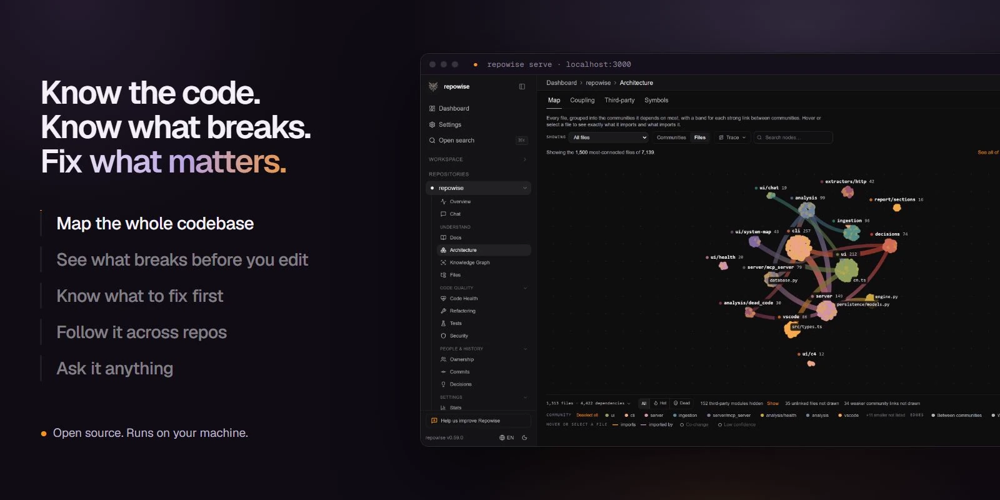

[English](README.md) | [简体中文](README.zh-CN.md)

# Repowise

Repowise 在你自己的机器上，把代码、依赖图、git 历史、测试、文档和设计决策做成一份索引。你和编程智能体直接问它，不用每次重新把仓库翻一遍。

一个人在笔记本上免费使用。开源版本包含全部引擎能力，商业层是在此之上、面向整个组织的运行方式。协议是 [AGPL-3.0](LICENSE)。不想在本机跑的话，[repowise.dev](https://www.repowise.dev/?src=oss_readme_section) 可以托管，私有仓库也包括在内。

<p align="center">

</p>

<p align="center"><sub>智能体查询的是本地索引，仪表盘和 CLI 读的是同一份。没有 API key，也没有上传数据。</sub></p>

## 对编程智能体有什么用

没有索引时，智能体每接到一个任务就重新搜索、打开文件、再读一遍。Repowise 把这些答案提前算好：谁调用谁、改下去会碰到哪里、当初为什么这样写。智能体因此少读文件，自己写出的内容也会变短；动手改之前，就能看到这次改动的影响范围。

项目要的是让人和智能体像长期维护这个仓库的人一样理解它。输出变短是这件事的结果。在 `django/django` 的 43 个问题上，配对的智能体循环里，Repowise 把智能体自己的输出减少了 **31.6%**（p&lt;0.0001），工具调用从 7.2 次降到 3.8 次。同一次实验里，这两项都少于其他上下文工具。42 个答案封存的检索任务上，它找对修复所需文件的比例是 **0.876**，下一名是 **0.610**。方法和我们输掉的每一行见 [docs/BENCHMARKS.md](docs/BENCHMARKS.md)。

图、变更风险、代码健康、测试和死代码都不调用大模型。同一份 diff，答案相同，计算留在你自己的网络里。曾在一台笔记本上一次性索引 1500 万行代码，之后每次提交增量更新。

## 三种用法

一份索引，三件事。

### 看懂代码

- 这个模块怎么工作：一次调用就能拿到带来源的回答，依据是依赖图和生成的文档。[搜索与文档](docs/layers/WIKI.md)
- 谁调用了这个函数，它又调用了谁：28 种语言解析到 AST。每条边标明怎么解析的、可以信到什么程度，也能从入口追执行路径。[依赖图](docs/layers/GRAPH.md)
- 为什么当初这样写：从 ADR、`# WHY:` 注释、提交、PR 和智能体会话里挖出决策，连到它所约束的代码，过期了会标出来。[决策](docs/layers/DECISIONS.md)
- 文档有没有写错：Markdown 里指向已经不存在的文件或符号会被标出，并给出要改的那一行。[文档漂移](docs/layers/DOC_DRIFT.md)

### 安全地改

- 改这里会碰到什么：符号级的影响范围，包括调用方、历史上会一起改但这次 diff 里没有的文件，以及能覆盖到的测试。[变更风险](docs/layers/CHANGE_RISK.md)
- 这条 PR 有多险：按本仓库自己近期的提交来排位，并给出智能体可以执行的指示。命令是 `repowise risk main..HEAD`。
- 该跑哪些测试：有覆盖率报告就用实测，没有就从依赖图推断。[测试](docs/layers/TEST_INTELLIGENCE.md)

### 持续改进

- 先修什么：按影响和代价排序。命令是 `repowise next`。[优先修复](docs/layers/CODE_HEALTH.md#fix-first)
- 技术债在哪：53 个确定性检测器给每个文件打 1 到 10 分，分成缺陷风险、可维护性和性能。[代码健康](docs/layers/CODE_HEALTH.md)
- 可以删什么：不可达的文件、未使用的导出和未使用的包，按置信度分档，并附上依据。[死代码](docs/layers/DEAD_CODE.md)
- 怎么拆才安全：Extract Method、Extract Class、Move Method、Split File、Break Cycle 这类具体计划，标明要移动的符号，可以直接交给编程智能体。[重构](docs/layers/REFACTORING.md)

## 快速开始

在 Claude Code、Codex、Cursor 或任何支持 MCP 的编程智能体里打开仓库，粘贴下面这句。智能体会自己安装、在不需要 API key 的情况下完成索引，并在花钱之前先问你。

```text
Read https://docs.repowise.dev/setup.md and set up Repowise in this repository.
```

也可以自己装。需要 Python 3.11+。`repowise serve` 还需要 Node.js 20+，第一次运行会下载界面。

```bash
uv tool install repowise          # or: pipx install repowise / pip install repowise
cd /path/to/your/repo
repowise init --yes --no-prose    # graph, git, health, dead code, documentation. No key, no spend.
repowise serve                    # dashboard + MCP server (needs Node 20+; first run downloads the UI)
```

`repowise init --yes --no-prose` 会建依赖图、git 历史、代码健康、死代码和文档，不需要 API key，也不调用模型。`init` 会给本仓库接上 Claude Code，并把全局的 repowise MCP 条目指到这里。重启 Claude Code，或运行 `/mcp`，然后可以让它用 `get_overview` 概括这个仓库，或者问改一个文件会碰到什么。

国内访问官方 PyPI 不便时，可以用清华或阿里云镜像，二选一：

```bash
pip install -i https://pypi.tuna.tsinghua.edu.cn/simple repowise
pip install -i https://mirrors.aliyun.com/pypi/simple/ repowise
```

每种智能体的接法，以及用模型写文档的步骤，见 [英文快速开始](docs/start/QUICKSTART.md)。

## 编程智能体

任何支持 MCP 的编程智能体都能读这份索引，包括 Claude Code、Codex、Cursor，以及 Trae、Qwen Code、Kimi CLI。

Claude Code 和 Codex 是 Full：MCP 工具、skills、斜杠命令、说明文件、工具调用钩子，还有会话记录挖掘。Cursor、VS Code、OpenCode、Hermes、GitHub Copilot CLI 和 Kiro 是 Good：MCP 工具，加上说明文件或 skills，没有会话记录挖掘（钩子仅限矩阵里写明的）。Trae、Qwen Code、Kimi CLI 以及其他没有单独接入描述的客户端，把下面的输出贴进自己的 MCP 配置。这条命令只打印，不写文件。

```bash
repowise agents print-config claude-code
```

各档位的差别见 [docs/agent/INTEGRATIONS.md](docs/agent/INTEGRATIONS.md)。

默认有十个面向任务的 MCP 工具，一次调用可以带上多个目标，例如 `get_overview`、`get_answer`、`get_context`。另外七个默认关闭，需要时再打开。[工具说明](docs/agent/MCP_TOOLS.md)

## 文档与许可证

英文文档是完整版。

- [文档站](https://docs.repowise.dev)
- [快速开始](docs/start/QUICKSTART.md)
- [仪表盘](docs/start/DASHBOARD.md)
- [五层索引](docs/layers/INTELLIGENCE_LAYERS.md)
- [语言支持](docs/layers/LANGUAGE_SUPPORT.md)（28 种语言解析到 AST，五级阶梯一共 42 种，开源版本全部包含）
- [CLI 参考](docs/reference/CLI_REFERENCE.md)
- [英文 README](README.md)
- 许可证：[AGPL-3.0](LICENSE)
