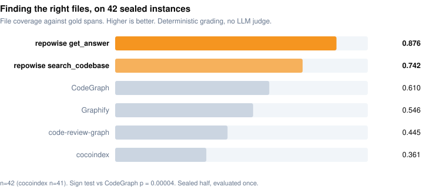
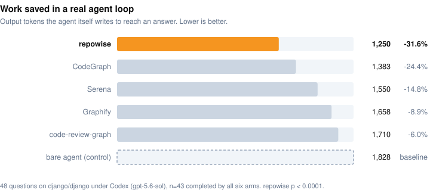

# Benchmarks

Repowise indexes a repository once, on your machine, into a call graph, git
history, code health, test links, decisions and documentation, and serves that
index to developers and their coding agents. Every number on this page is
measured on public repositories at pinned commits, against answer keys we did
not write, with the samples published in
**[repowise-bench](https://github.com/repowise-dev/repowise-bench)**. Where
another tool leads, that row is here too. The research behind each method is in
[LINEAGE.md](LINEAGE.md).

## At a glance

| Claim | Number | Sample |
|---|---|---|
| [Call graph checked by each language's compiler](#accuracy-by-language) (jedi for Python) | Precision **0.95 to 0.996** on Go, TypeScript, Dart, C and three of four Python repositories; Java **0.87 to 0.95**; Kotlin applications **0.94** | 24 repositories, 10 languages, recall beside every figure |
| [Call graph against four other tools](#8-the-same-question-against-an-answer-key-we-do-not-control) (Go, TypeScript) | No tool that finds as much of the graph gets more of it right, in **7 of 7** cells | 37,853 compiler edges, 5 tools |
| [Finding the right files](#1-finding-the-right-files) | **0.876** of the needed files found, against **0.610** for the next tool | 42 sealed instances, p = 0.00004 |
| [Work saved in an agent loop](#2-what-changes-in-a-real-agent-loop) | **31.6% less** agent output than no tool, 3.8 tool calls against 7.2 | 43 django questions on Codex, p < 0.0001 |
| [Health score against CodeScene](#5-code-health-predicts-defects) | **2.3x** the later-defective files inside a 20% review budget | 2,770 files, 21 repositories, p = 0.003 |
| [Which tests cover a file, with no coverage run](#test-intelligence) | **95.7%** precision on what reaches a file, **97.5%** on the tests to run | 46 claims and 47 targets, checked against per-test coverage |
| [Largest repository indexed](#scale) | **About 15M lines of code, 58,924 files** (dotnet/runtime) in 120 minutes at 11.7 GiB peak | one keyless run on a laptop |
| [Memory to build the call graph](#what-it-costs-to-run) | **75 MB** median against 757 MB for CodeGraph, lowest on **35 of 35** repositories | 35 repositories, 5 tools |

### One index, the work of several tools

Teams usually assemble these from separate products. Repowise builds them from
one local index, and most of it needs no model key.

| Category | Tools teams use today | What repowise does | Evidence |
|---|---|---|---|
| Code health | CodeScene, SonarQube maintainability rating | 53 detectors score every file on defect risk, maintainability and performance, then rank what to fix first | [Measured](#5-code-health-predicts-defects): 2.3x CodeScene's recall of later defects at a fixed review budget |
| Code graph and search for agents | Sourcegraph, CodeGraph, Serena | Call graph, hybrid search and answers served to agents over MCP | [Measured](#1-finding-the-right-files): retrieval, agent loop and graph accuracy against CodeGraph and Serena |
| Change risk and test impact | Codecov gates, test-impact tools | Where a change ranks among the repository's recent commits, which tests to run, coverage gates, all in the GitHub Action | [Measured](#test-intelligence): test selection precision |
| Dead code | Knip, vulture, ts-prune | Unreachable files, unused exports and unused packages, each with a confidence tier and its evidence, across languages | Capability |
| Documentation | DeepWiki, Swimm | A generated wiki per module and file (needs a model key), plus checks that flag docs the code no longer supports (no key) | Capability |
| Decision records | ADR files kept by hand | Finds decisions in ADRs, comments, commits and PR bodies, ties each to the code it governs, flags stale ones | Capability |
| Multi-repo contracts | Contract tests, hand-kept API catalogs | Matches HTTP, gRPC, message-topic and data contracts between repositories in a workspace, and flags breaking changes | Capability |

Repowise complements a security scanner such as Semgrep and an AI code reviewer
such as CodeRabbit. In open source, the pull-request surface is the GitHub
Action (gates, annotations, SARIF, GitLab Code Quality); the PR comment bot is a
separate free hosted GitHub App.

---

## Accuracy by language

A call graph is a map of which function calls which. It is what lets a tool say
what breaks when you change something. We check ours against each language's
own compiler: the compiler resolves every call site, and we count how many of
our edges it confirms (**precision**) and how many of its edges we found
(**recall**). Measured October 2026 on repowise main, each repository freshly
indexed from source.

| Language | Repository | Set | Answer key | Compiler edges | Precision | Recall |
|---|---|---|---|---:|---:|---:|
| Go | gitleaks | dev | scip-go (Go compiler) | 1,596 | **0.996** | 0.985 |
| TypeScript | zod | dev | `tsc` | 1,269 | **0.995** | 0.796 |
| TypeScript | hono | dev | `tsc` | 706 | **0.976** | 0.806 |
| Dart | pub | dev | Dart analyzer | 2,311 | **0.994** | 0.827 |
| Python | httpx | dev | jedi | 1,753 | **0.994** | 0.838 |
| Python | click | dev | jedi | 2,246 | **0.959** | 0.745 |
| Python | typer | held out | jedi | 2,099 | **0.963** | 0.846 |
| Python | attrs | held out | jedi | 1,328 | 0.495 | 0.370 |
| C | redis | dev | scip-clang (clang) | 34,349 | **0.950** | 0.709 |
| C | git | held out | scip-clang (clang) | 28,118 | **0.979** | 0.830 |
| Java | jsoup | dev | scip-java (javac) | 4,332 | **0.953** | 0.926 |
| Java | gson | dev | scip-java (javac) | 1,760 | **0.920** | 0.908 |
| Java | jackson-core | held out | scip-java (javac) | 4,832 | **0.918** | 0.898 |
| Java | javapoet | held out | scip-java (javac) | 698 | 0.884 | 0.865 |
| Java | joda-time | held out | scip-java (javac) | 8,164 | 0.872 | 0.843 |
| Kotlin | nowinandroid | dev | Kotlin K2 compiler | 643 | **0.944** | 0.652 |
| Kotlin | ktor-samples | dev | Kotlin K2 compiler | 347 | **0.936** | 0.628 |
| Kotlin | okio (JVM) | dev | Kotlin K2 compiler | 1,468 | 0.675 | 0.379 |
| C# | FluentValidation | dev | scip-dotnet (Roslyn) | 629 | **0.916** | 0.506 |
| C# | AutoMapper | held out | scip-dotnet (Roslyn) | 3,157 | 0.863 | 0.321 |
| C# | Polly (4 projects) | dev | scip-dotnet (Roslyn) | 1,171 | 0.724 | 0.233 |
| Rust | fd | dev | rust-analyzer | 231 | 0.899 | 0.619 |
| Rust | ripgrep | dev | rust-analyzer | 4,555 | 0.852 | 0.532 |
| C++ | fmt | dev | scip-clang (clang) | 1,636 | 0.777 | 0.385 |
| Apex | 7 public Salesforce repositories | dev | census of literal references, 90 hand-graded edges | 40,907 | **90/90** | 0.999 |

**Held out means never tuned on.** Dev repositories are the ones accuracy work
is developed against. Held-out repositories are chosen in advance and never used
to pick a fix, so they are the fairest read of what you will see on your own
code. Java's held-out repositories read 0.87 to 0.92, within a few points of its
dev repositories.

**How it is scored.** An edge matches when the caller and the callee land on
the same declaration line the compiler names. Apex has no public compiler index,
so its recall is read against a census of literal `new X(` and `X.m(` references
to classes in other files, and its precision from 30 hand-graded edges on each of
three repositories. Python has no compiler that
resolves calls, so its reference is jedi, the standard static analyser for
Python. Every cell carries a 95% confidence interval in the published
artifacts.

**Reading the lower rows.** Two libraries are structurally unusual: okio is a
multiplatform library whose `expect` and `actual` declarations share names with
the standard library, and attrs exports its API through chained module aliases
(`s = attributes = attrs`). Application-shaped code in the same languages reads
0.94 (Kotlin) and 0.96 to 0.99 (Python). In Java and C#, a large share of what
remains is the choice between overloads of the right method: counting any overload of the
right method as correct, Java reads 0.92 to 0.98 and Polly 0.89.

**Recall** depends on how many entry points a codebase has and how much it
dispatches dynamically, so compare it within a language, not across languages.

Reference versions: scip-go 0.2.7, scip-java 0.13.1, scip-dotnet 0.2.14,
scip-clang 0.3.1, rust-analyzer 1.96.0, jedi 0.20.0, Dart analyzer 14.5.0,
kotlinc 2.4.21. Per-repository scores, confidence intervals and the scoring
code: **[graph/](https://github.com/repowise-dev/repowise-bench/tree/master/graph)**.

---

## Call graph against a compiler, five tools

There are two ways to get a call graph wrong: miss calls that are real, or
invent calls that are not there. Either number alone is easy to game, so we
report the pair. The answer key is the **Go team's own call graph**
(`golang.org/x/tools`, RTA, over the fully type-checked program) and, on
TypeScript, **`tsc`'s own resolution** of every call site. Anyone with the
toolchain can regenerate both. Each cell is precision / recall.

| Cell | repowise | CodeGraph 1.5.0 | codebase-memory-mcp 0.10.8 | Graphify 0.9.31 | code-review-graph 2.3.7 |
|---|---|---|---|---|---|
| cobra (with tests) | **0.995** / 0.705 | 0.929 / 0.763 | 0.912 / 0.743 | 0.971 / 0.433 | 0.997 / 0.174 |
| gitleaks (no tests) | **0.991** / **0.971** | 0.972 / 0.920 | 0.934 / 0.967 | 0.997 / 0.886 | 0.759 / 0.026 |
| gitleaks (with tests) | **0.989** / 0.939 | 0.971 / 0.895 | 0.922 / 0.945 | 0.995 / 0.832 | 0.800 / 0.032 |
| syft (no tests) | **0.979** / 0.539 | 0.872 / 0.508 | 0.635 / 0.542 | 0.771 / 0.447 | 0.968 / 0.201 |
| syft (with tests) | **0.982** / 0.341 | 0.864 / 0.338 | 0.673 / 0.361 | 0.802 / 0.273 | 0.966 / 0.086 |
| zod (no tests) | **0.995** / **0.796** | 0.729 / 0.373 | 0.987 / 0.694 | 0.825 / 0.248 | 0.932 / 0.652 |
| hono (no tests) | **0.976** / **0.806** | 0.805 / 0.684 | 0.949 / 0.686 | 0.980 / 0.688 | 0.966 / 0.691 |

> **In all seven cells, no tool that finds as much of the call graph as we do
> gets more of it right.**

Read across any row: every tool more precise than us finds less of the graph,
and every tool that finds more is less precise. The claim names no threshold, so
it cannot be tuned by picking a cutoff, and two competitors added after it was
first written left it standing.

**The trade-offs in the field.** Some tools draw a larger map at lower
precision: on syft, more than a third of what the recall leader emits is a call
the Go compiler says does not exist. Others draw a smaller, very precise one:
the highest precision in the table, 0.997, comes from a graph holding 17% of the
calls in the repository. Repowise sits at high precision and leads recall
outright on both TypeScript cells and on gitleaks without tests; on cobra and
syft, tools that give up 5 to 25 points of precision find more of the graph.

<b>Method</b>

**Two methods agree.** On Go, a hand-graded audit read 29/30 for us and 29/30
for CodeGraph; the compiler, over about 1,600 edges on the same repository, read
97.6% and 97.2%. A person reading source and a type checker land within about a
point on both tools.

**Where recall goes.** On syft without tests, 44% of missed edges are dynamic
dispatch and a further 39% dispatch with a closure at one end. Interface
dispatch averages 6.5 possible targets per call site there, so matching a
higher-recall tool means emitting six edges where one is right.

**Recall varies by entry points.** It runs from 0.03 to 0.97 across rows, driven
by how many entry points the compiler had (4 on gitleaks, 268 on syft with
tests), so compare recall within a row.

- Edges the compiler cannot judge are charged to nobody (16% to 46% of a tool's
  output on TypeScript, where the pinned corpus installs no dependencies, so
  TypeScript is scored without tests).
- A library has no `main`, so cobra is analysed through its test binaries.
- Graphify tags 93% of its call edges `INFERRED` and we score all of them;
  code-review-graph is scored on resolved rows only.
- Competitor columns are August 2026 runs at the pinned versions above; the
  repowise column is October 2026 main.

Full method, per-cell artifacts and the pre-registration:
**[graph/experiments/g4-oracle-anchored](https://github.com/repowise-dev/repowise-bench/tree/master/graph/experiments/g4-oracle-anchored)**.

---

## Call edges hand-graded across nine languages

The compiler sections reach more tools or more languages; this one reaches both,
by having people read the source. 280 call edges per tool (560 in all), across
nine languages, every row read with its imports and enclosing scope open,
against CodeGraph 1.5.0 (August 2026).

| | Correct / n | 95% CI |
|---|---|---|
| **repowise** | **240/280 = 85.7%** | [81.1, 89.3] |
| CodeGraph 1.5.0 | 164/280 = 58.6% | [52.7, 64.2] |

| Language | repowise | CodeGraph | |
|---|---|---|---|
| TypeScript | 29/30 | 7/30 | separates |
| Go | 29/30 | 29/30 | tie |
| C# | 30/30 | 20/30 | separates |
| Python | 28/30 | 19/30 | separates |
| Kotlin | 27/30 | 13/30 | separates |
| Swift | 23/30 | 19/30 | tie |
| C++ | 22/30 | 16/30 | tie |
| Rust | 22/30 | 13/30 | tie |
| Java *(n=40)* | 30/40 | 28/40 | tie |

Four of nine cells separate at 95% confidence and five are ties; at n=30 the
interval is about ±16 points near 60%. Compiler-graded results for the same
languages are in [accuracy by language](#accuracy-by-language): Java 0.87 to
0.95, Kotlin applications 0.94, C# 0.72 to 0.92. Where the two methods differ,
as in C#, the compiler figure is the stricter read.

<b>Method</b>

30 rows per language per tool, seed 2026, stratified by resolution strategy.
Java is read at 40 rows across two repositories. C++ is read at 50 rows per
side and enters the pooled figure at a seeded 30, so every language carries the
same weight. All 600 graded rows are published, each with the call site, the
declaration it was bound to, the verdict and the reason, with a script that
rebuilds every table.

**[graph/experiments/g1-edge-precision/rows](https://github.com/repowise-dev/repowise-bench/tree/master/graph/experiments/g1-edge-precision/rows)**

---

## Finding the right files

Before a tool can save an agent work, it has to point at the right code.
ContextBench ships the files a fix actually needed, and a tool either returns
them or it does not. No LLM judge is involved. The 112 instances were split
70 / 42 by instance id before any work started, and the 42 stayed sealed until
the final measurement. Every figure below is from the sealed 42 (August 2026).

<picture>
  <source media="(prefers-color-scheme: dark)" srcset="../.github/assets/bench/file-coverage-dark.svg" />
  
</picture>

| Tool | File coverage | n | Precision | Files served |
|---|---:|---:|---:|---:|
| **repowise** (`get_answer`) | **0.876** | 42 | 0.087 | 19.2 |
| **repowise** (`search_codebase`) | **0.742** | 42 | 0.168 | 8.2 |
| CodeGraph | 0.610 | 42 | 0.093 | 14.0 |
| Graphify | 0.546 | 42 | 0.033 | 34.5 |
| code-review-graph | 0.445 | 42 | **0.240** | 5.4 |
| cocoindex | 0.361 | 41 | 0.092 | 7.1 |

Per instance against CodeGraph: `get_answer` **19 wins, 1 loss, 22 ties, sign
test p = 0.00004**; `search_codebase` 13 wins, 3 losses, 26 ties, p = 0.021.

The two repowise tools have different profiles. `get_answer` finds the most,
from about 19 files. `search_codebase` finds 0.742 from 8.2 files, the best
coverage per file served in the table. code-review-graph returns the fewest
files and so leads precision.

<b>Method</b>

**The sealed half confirms it.** Overfitting makes the unseen half score worse.
Ours scores better on it, and CodeGraph, which nobody tuned against either
half, scores the same on both, so the halves are equally hard.

| | Other half (n=70) | **Sealed half (n=42)** |
|---|---:|---:|
| repowise (`get_answer`) | 0.810 | **0.876** |
| repowise (`search_codebase`) | 0.684 | 0.742 |
| CodeGraph | 0.6093 | 0.6095 |

File coverage compares returned paths with the gold files and nothing else.
cocoindex's n is 41 because one instance returned no answer. Its placing was
[pre-registered before its index existed](https://github.com/repowise-dev/repowise-bench/tree/master/configs).
This measures retrieval; the next section measures the agent loop.

Raw cells:
**[rung8](https://github.com/repowise-dev/repowise-bench/tree/master/results/bakeoff_2026_08/rung8)**.

---

## What changes in a real agent loop

Every question in `django/django`'s question set, across five question shapes.
Six arms: repowise, four competing tools, and a bare agent with no tools. Same
prompt, each tool's full advertised surface, a fresh index on the same pinned
commit. Codex (`gpt-5.6-sol`), August 2026, over the 43 questions all six arms
completed.

<picture>
  <source media="(prefers-color-scheme: dark)" srcset="../.github/assets/bench/agent-output-tokens-dark.svg" />
  
</picture>

| Tool | Agent used it | Output tokens | vs bare agent | Tool calls | Leaner on | p |
|---|---:|---:|---:|---:|---:|---:|
| **repowise** | **44 / 44** | **1,250** | **-31.6%** | **3.8** | **37 of 44** | **<0.0001** |
| CodeGraph | 44 / 44 | 1,383 | -24.4% | 4.0 | 37 of 44 | <0.0001 |
| Serena | 43 / 43 | 1,550 | -14.8% | 10.1 | 35 of 43 | <0.0001 |
| Graphify | 43 / 43 | 1,658 | -8.9% | 7.4 | 31 of 43 | 0.003 |
| code-review-graph | 43 / 43 | 1,710 | -6.0% | 7.2 | 26 of 43 | 0.046 |
| *bare agent (control)* | 0 / 44 | 1,828 | baseline | 7.2 | n/a | n/a |

A third less output than working with no tool, in 3.8 tool calls against 7.2,
opening 3.0 files instead of 7.2. After correcting for five simultaneous
comparisons, three of the five reductions remain clearly significant,
repowise's among them. The saving grows with the work: 34.3% on the
harder half of questions, 27.2% on the easier half.

**On a local model.** With `qwen3:8b` under Ollama (15 questions), repowise cuts
output by 40.8% and wall clock by 27.5%. With only its local tools switched on
(`get_answer` off), the cut is 47.9% in output and 41.5% in wall clock, at about
the same answer quality as the bare agent.

<b>Method</b>

- **Work saved; quality unchanged.** No tool measurably changes answer
  quality: blind-judge scores sit within 0.04 to 0.25 points of the bare agent
  on a 10-point scale, inside the 0.69-point rerun noise.
- **Output tokens, not dollars.** Prompt caching makes whichever arm runs first
  look cheaper; output tokens are never cached, so those are what we publish.
- **Claude Code** (`claude-sonnet-5`, 15 questions, one run): output down
  15.9% (p = 0.035) when the agent calls repowise. Claude Code loads tool
  schemas on demand, so how often the agent reaches for a tool varies by run.

Raw data, every cell including failures:
**[rung9](https://github.com/repowise-dev/repowise-bench/tree/master/results/bakeoff_2026_08/rung9)**
(Codex) and
**[rung6](https://github.com/repowise-dev/repowise-bench/tree/master/results/bakeoff_2026_08/rung6)**
(15-question runs). Per-tool setup notes:
[head-to-head](https://github.com/repowise-dev/repowise-bench/tree/master/head-to-head).

---

## Code health predicts defects

A health score is worth something only if the files it flags are the files that
break. Each file is scored at a historical commit, bug fixes are counted over the
following six months, and nothing after the scoring commit feeds the score.

Across **21 repositories, 9 languages and 2,826 files**: **ROC AUC 0.737** (95%
CI 0.683 to 0.787). It beats recent churn by +0.100 AUC and prior-defect history
by +0.117 (DeLong p < 1e-9). On PROMISE/jEdit, a dataset it never saw, it holds
at 0.76 to 0.78.

**Against CodeScene**, the closest commercial product. Both tools scored the same
**2,770 files** at the same commit against the same defect labels:

| Paired test | repowise | CodeScene | |
|---|---:|---:|---|
| Recall at a 20%-of-lines review budget | **0.173** | 0.074 | p = 0.003 |
| Effort-aware ranking (Popt) | **0.607** | 0.462 | p = 0.003 |
| Defect density, size-normalized | **2.18x** | 0.56x | p = 0.003 |
| Discrimination (ROC AUC) | 0.731 | 0.705 | p = 0.054 |
| Precision at a 20%-of-lines review budget | 0.580 | **0.636** | p = 0.64, a tie |

Ranking by repowise health surfaces **2.3x the later-defective files** within the
same review budget. CodeScene flags about 27 files where we flag 132: a shorter
list for a team that wants to work through it quickly, at a similar precision.

<b>Method</b>

**What the score adds over file size.** File size alone discriminates about as
well (AUC 0.742). The score's advantage is effort-aware ranking, Popt +0.134
(95% CI +0.080 to +0.198), and that it says why a file is at risk.

**Weights are fitted, not hand-set:** a size-controlled logistic fit on files
scored before their bug window, so a detector earns weight only for defect lift
beyond being large. Of the 53 detectors, 25 move the defect score; the others
feed the maintainability or performance score, or are advisory.

Reports:
**[BENCHMARK\_REPORT.md](https://github.com/repowise-dev/repowise-bench/blob/master/health-defect/BENCHMARK_REPORT.md)** ·
**[COMPARISON\_REPORT.md](https://github.com/repowise-dev/repowise-bench/blob/master/health-defect/COMPARISON_REPORT.md)**

---

## Scale

Large public repositories, indexed end to end on one Windows laptop (31 GB RAM),
keyless (`repowise init --no-prose`), limited to 8 CPUs and 2 parse workers.
October 2026.

| Repository | Tracked files | Lines of code | First index | Peak memory | Index on disk |
|---|---:|---:|---:|---:|---:|
| dotnet/aspnetcore v8.0.31 | 15,510 | 1.5M | 20 min | 4.0 GiB | 1.4 GiB |
| elastic/elasticsearch v8.19.22 | 34,315 | 4.0M | 52 min | 7.8 GiB | 4.2 GiB |
| dotnet/runtime v8.0.31 | **58,924** | **15.0M** | **120 min** | **11.7 GiB** | 7.7 GiB |

Lines of code are non-blank lines in tracked source files (C#, IL, C, C++, Java,
TypeScript, JavaScript, Python, shell, assembly and similar), with data, markup and
docs left out. Peak memory is the whole process tree, one run per repository.

The first index is a one-time cost: it builds the call graph, git history, health,
tests, dead code and docs together. After that, each update re-analyses only what
changed. On aspnetcore, an update with no changes takes about 4 seconds.

---

## Test intelligence

Repowise links tests to the code they exercise from the call graph, with no
coverage run needed. We checked those inferred links against real per-test
coverage on this repository, over a slice with complete
per-test attribution (37 test files, 159 production files).

| Question | Precision | Sample |
|---|---:|---|
| Which tests reach this file | **95.7%** | 44 of 46 claims |
| Which tests to run for a change | **97.5%** | 47 targets, all answered |

Inferred answers are file-level; measured coverage, when you ingest it, is
line-level, and repowise labels which kind each answer is. Details:
[Test intelligence](layers/TEST_INTELLIGENCE.md#accuracy-and-limits).

---

## What it costs to run

### Building the call graph

Graph construction only, 35 repositories, five tools: 175 cells, none failed,
three timed runs each after a discarded warmup, nothing restored from cache.

| Tool | Median build | Median peak memory | Fastest on |
|---|---:|---:|---:|
| **repowise** | **2.77 s** | **75 MB** | 14 of 35 |
| CodeGraph | 3.65 s | 757 MB | **16 of 35** |
| codebase-memory-mcp | 6.21 s | 1,113 MB | 5 of 35 |
| code-review-graph | 9.97 s | 361 MB | 0 |
| Graphify | 12.23 s | 860 MB | 0 |

**Memory: lowest on 35 of 35 repositories**, about 10x below CodeGraph and 5x
below the next-lowest tool. The
gap widens with size: 64 MB against CodeGraph's 749 MB under 1,000 files, 152 MB
against 1,164 MB above, which leaves more room for the rest of a CI job. Speed
is level with CodeGraph: we lead under 1,000 files and
it leads above, where we do more resolution work per file.

### Building the whole index

A full `repowise init` builds five layers, not one, so it takes longer than a
graph-only tool: a graph-only tool builds in 16 to 45 seconds, repowise builds
five layers in about 6 minutes without prose. On `django/django`:

| Tool | Index time | What it builds |
|---|---:|---|
| CodeGraph | 16.4 s | call graph |
| code-review-graph | 44.8 s | call graph |
| Graphify | 141.5 s | call graph, communities |
| **repowise** (`--no-prose`) | **366.8 s** | graph, git history, search index, decisions, health |
| **repowise** (default, prose on) | **1,058 s** | the same, plus generated documentation |

The call graph itself takes about 3 seconds. The rest builds a 90,477-edge graph
with communities and flow tracing, git history across 2,630 files, 3,392 wiki
pages embedded for search, architectural decisions, and 5,317 health findings.
Updates after the first index are incremental.

<b>Method</b>

The graph table is construction only and the index table is a full
`repowise init`, so the two are not comparable with each other. Our graph is
built in memory, while CodeGraph writes a SQLite index; our memory figures come
from a subprocess arm built so peak RSS is read the same way as every
competitor's. Single machine and OS. A fitted build-cost curve for all five
tools across a 12x size range is in
[head-to-head](https://github.com/repowise-dev/repowise-bench/tree/master/head-to-head#the-result-nobody-in-the-field-had-published-a-build-cost-curve).

Per-repository tables:
**[graph/experiments/g6-build-cost](https://github.com/repowise-dev/repowise-bench/tree/master/graph/experiments/g6-build-cost)**.

---

## Command-output compression

`repowise distill <cmd>` compresses command output before the agent reads it:
errors first, exit code preserved, every omission recoverable through an inline
`[repowise#<ref>]` marker.

| Command | Raw tokens | Distilled | Saved |
|---|---:|---:|---|
| `pytest -q` (11 failures) | 3,374 | 1,317 | **61%**, all 11 `FAILED` lines kept |
| `git log -50` | 3,064 | 331 | **89%** |
| `git log --oneline -30` | 321 | 321 | 0%, already compact |
| `git status` (clean) | 83 | 83 | 0%, too small to distill |

Distill never inflates small output. Guide: [docs/agent/DISTILL.md](agent/DISTILL.md).

---

## Loading a commit's context

How many tokens an agent reads to take in one commit, over the 30 most recent
non-merge commits of `pallets/flask`, counted with `tiktoken` (`cl100k_base`):

| Strategy | Tokens per commit |
|---|---:|
| Full contents of every changed file | 13,984 |
| **`get_context` on the changed files** | **2,586** |
| `git diff` only | 1,412 |

`get_context` is 5.4x smaller than reading the changed files and returns every
symbol in each file with its signature and location, which the raw diff does
not.

---

## How we measure

- **Pre-register before running**, as its own commit, so a good result cannot
  become a different question afterwards.
- **Seal a held-out set**, split before any work begins and evaluated once.
- **Show precision and recall together**, and files served beside coverage.
- **Prove a tool was running before recording a zero.**
- **Use answer keys we did not write**: compilers, published benchmarks and
  real defect history.

Retrieval and the agent loop are measured on Python and Go; graph accuracy on
ten languages against their compilers (jedi for Python) and nine hand-graded. The method end to
end:
**[THE\_LOOP.md](https://github.com/repowise-dev/repowise-bench/blob/master/head-to-head/THE_LOOP.md)**.

## Where the depth is

The evidence is in **[repowise-bench](https://github.com/repowise-dev/repowise-bench)**:
every graded cell, every pre-registration, and what each run cost.

| Start here | For |
|---|---|
| **[graph/](https://github.com/repowise-dev/repowise-bench/tree/master/graph)** | Graph accuracy: per-language compiler scores, the five-tool comparison, hand-graded precision across nine languages, build cost |
| **[head-to-head](https://github.com/repowise-dev/repowise-bench/tree/master/head-to-head)** | Retrieval and agent-loop results and per-tool setup notes |
| **[health-defect](https://github.com/repowise-dev/repowise-bench/tree/master/health-defect)** | The defect-prediction study and the CodeScene comparison |
| **[results/bakeoff\_2026\_08](https://github.com/repowise-dev/repowise-bench/tree/master/results/bakeoff_2026_08)** | Every graded cell and every verbatim response |
| **[repro/README.md](https://github.com/repowise-dev/repowise-bench/blob/master/repro/README.md)** | Per claim: what it costs to reproduce |

Want your tool in the field? Adding a competitor is a YAML block. See
[CONTRIBUTING.md](https://github.com/repowise-dev/repowise-bench/blob/master/CONTRIBUTING.md).

Tool versions as measured: CodeGraph 1.5.0, Graphify 0.9.31, Serena 1.6.2.dev0,
code-review-graph 2.3.7, cocoindex as of 2026-08-09, codebase-memory-mcp 0.10.8.

## See also

- [The intelligence layers](layers/INTELLIGENCE_LAYERS.md)
- [Code health](layers/CODE_HEALTH.md)
- [Test intelligence](layers/TEST_INTELLIGENCE.md)
- [MCP tool reference](agent/MCP_TOOLS.md)
- [Roadmap](../ROADMAP.md)
