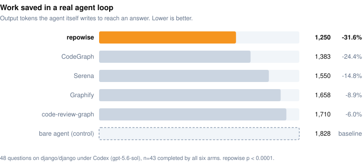
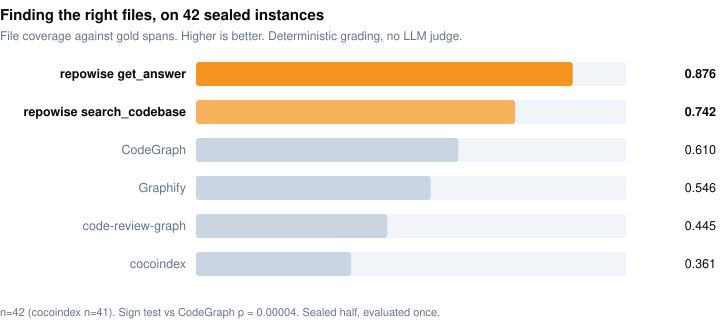

# Benchmarks

Repowise reads a codebase once, on your machine, and gives developers and their
AI coding agents the answers they would otherwise dig for. Measured on public
code, against answer keys we did not write, with every sample published in
**[repowise-bench](https://github.com/repowise-dev/repowise-bench)**.

| Result | What it means |
|---|---|
| **Up to 99% fewer files opened** | Sonnet 4.6 went from 3.28 files per question to 0.00, wrote 51% less, answered 47% faster and made 28% fewer tool calls, with 71 of 72 answers right. Every model we tested opened fewer files, and Opus 5.5 kept all 48 answers right. [Details](#per-model-agent-loop) |
| **31.6% less output** | Side by side with four other context tools, repowise saved the agent the most work: 3.8 tool calls instead of 7.2. [Details](#2-what-changes-in-a-real-agent-loop) |
| **53% fewer input tokens** | On CodeScaleBench's heavy "understand" tasks over large repositories, Haiku 4.5 with repowise docs and semantic search made 42% fewer file reads and 2.5 shell searches instead of 27.9, at 33% lower cost and the same accuracy. [Details](#codescalebench) |
| **88% of the right files** | Found in one call for a real bug fix, on cases sealed until the final run. The next tool finds 61%. [Details](#1-finding-the-right-files) |
| **2.3x the later bugs** | Its health score finds 2.3 times as many files that later need bug fixes as CodeScene, in the same review budget, across 21 projects. [Details](#5-code-health-predicts-defects) |
| **Up to 99.5% less noise** | Test, install and git output trimmed before the agent reads it, with every error line kept. [Details](#4-command-output-compression) |
| **15 million lines on a laptop** | dotnet/runtime indexed on one laptop with no API key, building the map with 10x less memory than the next tool. [Details](#scale) |

Also measured: **93.8% to 99.8%** of the calls it draws are confirmed by the
language's own compiler ([by language](#accuracy-by-language)), and **97.5%**
correct on which tests to run for a change ([tests](#test-intelligence)).

---

## Up to 99% fewer files opened, on every model

**What we asked.** We gave an AI coding agent 24 questions about real code, the
kind a developer asks before changing it: where something lives, how a request
flows, what breaks if a function changes. Each question ran with repowise and
without it, on five models in Claude Code, over three codebases (Python, Go and
Rust) created after every model's training cutoff.

**What we found.** Every model opened fewer files with repowise. At the current
build, Sonnet 4.6 answered in all 72 runs without opening a source file, wrote
51% less and was 47% faster. Opus 5.5 got all 48 answers right.

### Sonnet 4.6, current build

| Per question | Without repowise | With repowise | Change |
|---|---:|---:|---:|
| Files opened | 3.28 | **0.00** | **-100%** |
| Output tokens | 2,298 | **1,120** | **-51.2%** |
| Wall clock | 45 s | **24 s** | **-47.2%** |
| Tool calls | 6.5 | **4.7** | **-28%** |
| Answers right | 70 of 72 | **71 of 72** | |

### Opus 5.5

| Per question | Without repowise | With repowise | Change |
|---|---:|---:|---:|
| Files opened | 2.25 | **0.38** | **-83%** |
| Answers right | 48 of 48 | **48 of 48** | |

### Every model

| Model | Files opened | Output tokens | Tool calls | Wrote less on | Answers right, without / with |
|---|---:|---:|---:|---:|---:|
| **Sonnet 4.6** | 3.3 to **0.0** (**-100%**) | **-51.2%** | 6.5 to **4.7** | **19 of 24** | 70 / **71** of 72 |
| Sonnet 4.6, first build | 3.5 to **0.0** (**-99%**) | **-51.2%** | 7.1 to **5.3** | 18 of 24 | 70 / 67 of 72 |
| Haiku 4.5 | 3.7 to **0.3** (**-91%**) | -5.3% | 9.0 to 9.7 | 14 of 24 | 70 / 69 of 72 |
| Opus 5.5 | 2.2 to **0.4** (**-83%**) | -14.1% | 5.1 to **4.2** | **20 of 24** | 48 / **48** of 48 |
| Opus 4.8 | 2.1 to **0.4** (**-83%**) | -14.5% | 5.2 to **4.8** | 12 of 24 | 47 / 46 of 48 |
| Sonnet 5.5 | 1.5 to **0.9** (**-40%**) | -9.6% | 4.2 to **4.0** | **19 of 24** | 46 / **48** of 48 |

Files opened fall on every model, in every language and on every kind of
question. Intervals, wall clock and per-language slices are in
[How we measure](#method-agent-loop).

---

## 31.6% less output, side by side with other context tools

**What we asked.** The same real questions about `django/django`, once with no
tool and once with each of five context tools. Which one saves the agent the
most work?

**What we found.** Repowise. The agent made **3.8 tool calls instead of 7.2**,
opened **3.0 files instead of 7.2** and wrote **31.6% less**, with answers just
as good. The saving grows on harder questions (34.3%), and on a small local
model it reaches **47.9% less output and 41.5% less time**.

<picture>
  <source media="(prefers-color-scheme: dark)" srcset="../.github/assets/bench/agent-output-tokens-dark.svg" />
  
</picture>

| Tool | Agent used it | Output tokens | vs bare agent | Tool calls | Leaner on | p |
|---|---:|---:|---:|---:|---:|---:|
| **repowise** | **44 / 44** | **1,250** | **-31.6%** | **3.8** | **37 of 44** | **<0.0001** |
| CodeGraph | 44 / 44 | 1,383 | -24.4% | 4.0 | 37 of 44 | <0.0001 |
| Serena | 43 / 43 | 1,550 | -14.8% | 10.1 | 35 of 43 | <0.0001 |
| Graphify | 43 / 43 | 1,658 | -8.9% | 7.4 | 31 of 43 | 0.003 |
| code-review-graph | 43 / 43 | 1,710 | -6.0% | 7.2 | 26 of 43 | 0.046 |
| *bare agent (control)* | 0 / 44 | 1,828 | baseline | 7.2 | n/a | n/a |

Codex (`gpt-5.6-sol`), August 2026. With `qwen3:8b` under Ollama, repowise cuts
output by 40.8% with every tool on and by 47.9% with its local tools only.
[Method](#method-side-by-side).

---

## 53% fewer input tokens and 33% lower cost on CodeScaleBench

**What we asked.** CodeScaleBench's "understand" tasks ask an agent to explain
real, large codebases: how PostgreSQL executes a query, how Envoy routes a
request, how a Kubernetes CRD moves through its lifecycle. The task's own
checks grade every answer. How much reading and searching does repowise save,
and does the answer stay as good?

**What we found.** On 9 heavy tasks over large repositories, Claude Code with
Haiku 4.5 and a repowise index with written docs and semantic search used
**53% fewer input tokens**, made **42% fewer file reads** and ran **2.5 shell
searches instead of 27.9**, at **33% lower cost**. Accuracy held: the
grader-fixed score went from 0.803 to 0.830 (paired delta **+0.027**, 95% CI
[-0.028, +0.082]), non-inferior at the -0.05 margin set before the run.

| Per task, 9 heavy tasks | Without repowise | Repowise, keyless | Repowise, docs + semantic search | Docs + semantic vs without |
|---|---:|---:|---:|---:|
| Input tokens incl. cache | 2.12M | 1.06M | **1.00M** | **-53%** |
| Read calls | 20.7 | 15.5 | **12.0** | **-42%** |
| Distinct files read | 16.2 | 12.3 | **9.9** | **-39%** |
| Shell searches (grep, find, ls) | 27.9 | 3.9 | **2.5** | **-91%** |
| Turns | 51.3 | 36.0 | **33.4** | **-35%** |
| Tool calls, repowise included | 54.9 | 35.0 | **32.4** | **-41%** |
| Output tokens | 15.4k | 12.3k | **11.7k** | **-24%** |
| Cost (API-equivalent) | $0.408 | $0.274 | **$0.272** | **-33%** |
| Wall time (agent) | 171 s | 159 s | **160 s** | **-7%** |
| Accuracy, grader-fixed | 0.803 | 0.882 | 0.830 | **+0.027** |

Against no repowise, cost and input tokens are lower on all 9 tasks. Docs and semantic search add
to what keyless already saves: against keyless on the same tasks, Read calls
fall a further 23% (per task -27%, 95% CI [-46%, -2%]) at the same cost.

Across all 31 understand tasks we ran, with a keyless index, the agent ran
**71% fewer shell searches** (16.6 to 4.8 per task, lower on 29 of 31), made 21%
fewer reads, used 20% fewer input tokens and cost 10% less pooled (17% less on
the median task), with accuracy level (-0.010, 95% CI [-0.068, +0.049]). Every
valid trial, 61 of 61, called repowise. [Method](#method-codescalebench).

---

## 88% of the right files, in one call

**What we asked.** For a real bug, the benchmark (ContextBench) lists the files
the fix actually changed. Does the tool return them?

**What we found.** Repowise's answer tool found **88% of the needed files**. The
next best tool found 61%. Case by case it won 19 times and lost once. No AI judge
is involved, and every figure comes from 42 cases that stayed sealed until the
final run (August 2026).

<picture>
  <source media="(prefers-color-scheme: dark)" srcset="../.github/assets/bench/file-coverage-dark.svg" />
  
</picture>

| Tool | File coverage | n | Precision | Files served |
|---|---:|---:|---:|---:|
| **repowise** (`get_answer`) | **0.876** | 42 | 0.087 | 19.2 |
| **repowise** (`search_codebase`) | **0.742** | 42 | 0.168 | 8.2 |
| CodeGraph | 0.610 | 42 | 0.093 | 14.0 |
| Graphify | 0.546 | 42 | 0.033 | 34.5 |
| code-review-graph | 0.445 | 42 | **0.240** | 5.4 |
| cocoindex | 0.361 | 41 | 0.092 | 7.1 |

Against CodeGraph, `get_answer` **won 19, lost 1, tied 22, sign test p = 0.00004**.
`search_codebase` gives the best coverage per file served. [Method](#method-retrieval).

---

## Code health that predicts bugs

**What we asked.** Do the files a health score flags turn out to be the files
that later need bug fixes? Each file was scored at a past commit, and its bug
fixes over the next six months were counted.

**What we found.** Across **21 projects, 9 languages and 2,826 files**, the score
separates buggy from clean files well (**ROC AUC 0.737**), and beats recent churn
and past bugs as predictors (DeLong p < 1e-9). Against **CodeScene** on the same
**2,770 files**, ranking by repowise finds **2.3x the later-buggy files** in the
same review budget.

| Paired test | repowise | CodeScene | |
|---|---:|---:|---|
| Recall at a 20%-of-lines review budget | **0.173** | 0.074 | p = 0.003 |
| Effort-aware ranking (Popt) | **0.607** | 0.462 | p = 0.003 |
| Defect density, size-normalized | **2.18x** | 0.56x | p = 0.003 |
| Discrimination (ROC AUC) | 0.731 | 0.705 | p = 0.054 |
| Precision at a 20%-of-lines review budget | 0.580 | **0.636** | p = 0.64 |

[Method](#method-health).

---

## Up to 99.5% less command noise

`repowise distill` trims test, install and git output before the agent reads it,
keeps every error line, and restores anything it cut with `repowise expand`.

| Command | Before | After | Saved |
|---|---:|---:|---|
| `npm ci` (1,344 packages) | full log | trimmed | **99.5%** |
| `git log -50` | 3,064 tokens | 331 | **89%** |
| `git diff` (30 commits of history) | 62,833 tokens | 8,635 | **86%** |
| `terraform plan` | full log | trimmed | **80.2%** |
| `pytest -q` (11 failures) | 3,374 tokens | 1,317 | **61%**, all 11 `FAILED` lines kept |

The median saving on test, build and lint output is at least 60%, with no error
line lost, checked in CI on every change. Small output passes through untouched.
Guide: [docs/agent/DISTILL.md](agent/DISTILL.md).

---

## Call graph accuracy by language

When repowise says "function A calls function B", the language's own compiler
checks it. Precision is **0.938 to 0.998** on Go, TypeScript, Dart, C and
Python, **0.898 to 1.000** on Java, and **0.780 to 0.975** on Kotlin, C#, C++
and Rust. Held-out repositories, never used to pick a fix, read as well as the
ones accuracy work is developed against. Measured October 2026 on repowise main.

| Language | Repository | Set | Answer key | Precision | Recall | Edges |
|---|---|---|---|---:|---:|---:|
| Go | gitleaks | dev | scip-go (Go compiler) | **0.996** | 0.986 | 1,596 |
| Go | goldmark | held out | scip-go (Go compiler) | **0.994** | 0.781 | 1,712 |
| TypeScript | zod | dev | `tsc` | **0.995** | 0.796 | 1,269 |
| TypeScript | hono | dev | `tsc` | **0.976** | 0.806 | 706 |
| Dart | pub | dev | Dart analyzer | **0.994** | 0.885 | 2,311 |
| Dart | dart_style | held out | Dart analyzer | **0.998** | 0.870 | 2,571 |
| Python | httpx | dev | jedi | **0.994** | 0.839 | 1,752 |
| Python | click | dev | jedi | **0.959** | 0.746 | 2,246 |
| Python | attrs | dev | jedi | **0.942** | 0.757 | 1,472 |
| Python | typer | held out | jedi | **0.963** | 0.847 | 2,099 |
| Python | alembic | held out | jedi | **0.991** | 0.696 | 1,319 |
| C | redis | dev | scip-clang (clang) | **0.938** | 0.717 | 34,209 |
| C | git | held out | scip-clang (clang) | **0.979** | 0.837 | 28,104 |
| C++ | fmt | dev | scip-clang (clang) | **0.858** | 0.615 | 1,414 |
| C++ | ninja | dev | scip-clang (clang) | **0.944** | 0.714 | 1,047 |
| C++ | yaml-cpp | held out | scip-clang (clang) | **0.841** | 0.634 | 1,172 |
| Java | jsoup | dev | scip-java (javac) | **0.980** | 0.943 | 4,332 |
| Java | gson | dev | scip-java (javac) | **0.958** | 0.949 | 1,760 |
| Java | eclipse-hawkbit (Spring Boot application) | dev | scip-java (javac) | **0.937** | 0.845 | 5,977 |
| Java | spring-petclinic-rest | dev | scip-java (javac) | **1.000** | 0.966 | 355 |
| Java | javapoet | held out | scip-java (javac) | **0.950** | 0.917 | 698 |
| Java | jackson-core | held out | scip-java (javac) | **0.963** | 0.933 | 4,832 |
| Java | joda-time | held out | scip-java (javac) | **0.898** | 0.866 | 8,164 |
| Kotlin | nowinandroid | dev | Kotlin K2 compiler | **0.975** | 0.801 | 643 |
| Kotlin | ktor-samples | dev | Kotlin K2 compiler | **0.973** | 0.821 | 347 |
| Kotlin | okio (JVM) | dev | Kotlin K2 compiler | **0.901** | 0.654 | 1,468 |
| C# | FluentValidation | dev | scip-dotnet (Roslyn) | **0.942** | 0.633 | 621 |
| C# | Polly (4 projects) | dev | scip-dotnet (Roslyn) | **0.780** | 0.436 | 962 |
| C# | eShopOnWeb (ASP.NET Core application) | dev | scip-dotnet (Roslyn) | **0.877** | 0.773 | 185 |
| C# | AutoMapper | held out | scip-dotnet (Roslyn) | **0.866** | 0.347 | 3,074 |
| Rust | fd | dev | rust-analyzer | **0.917** | 0.661 | 233 |
| Rust | ripgrep | dev | rust-analyzer | **0.863** | 0.546 | 4,567 |
| Apex | 7 public Salesforce repositories | dev | census of literal references, 90 hand-graded edges | **90/90** | 0.999 | 40,907 |

The graph declines to guess a call it cannot prove, such as dynamic dispatch,
instead of drawing several edges where one is right. [Method](#method-graph).

---

## Call graph against four other tools

The same compiler check, run on every tool: the **Go team's own call graph**
(`golang.org/x/tools`, RTA) and, on TypeScript, **`tsc`'s own resolution** of
every call site. Each cell is precision / recall.

| Cell | repowise | CodeGraph 1.5.0 | codebase-memory-mcp 0.10.8 | Graphify 0.9.31 | code-review-graph 2.3.7 |
|---|---|---|---|---|---|
| cobra (with tests) | **0.995** / 0.705 | 0.929 / 0.763 | 0.912 / 0.743 | 0.971 / 0.433 | 0.997 / 0.174 |
| gitleaks (no tests) | **0.991** / **0.971** | 0.972 / 0.920 | 0.934 / 0.967 | 0.997 / 0.886 | 0.759 / 0.026 |
| gitleaks (with tests) | **0.989** / 0.939 | 0.971 / 0.895 | 0.922 / 0.945 | 0.995 / 0.832 | 0.800 / 0.032 |
| syft (no tests) | **0.979** / 0.539 | 0.872 / 0.508 | 0.635 / 0.542 | 0.771 / 0.447 | 0.968 / 0.201 |
| syft (with tests) | **0.982** / 0.341 | 0.864 / 0.338 | 0.673 / 0.361 | 0.802 / 0.273 | 0.966 / 0.086 |
| zod (no tests) | **0.995** / **0.796** | 0.729 / 0.373 | 0.987 / 0.694 | 0.825 / 0.248 | 0.932 / 0.652 |
| hono (no tests) | **0.976** / **0.806** | 0.805 / 0.684 | 0.949 / 0.686 | 0.980 / 0.688 | 0.966 / 0.691 |

> **In all seven cells, no tool that finds as much of the call graph as we do
> gets more of it right.**

Repowise leads recall outright on both TypeScript cells and on gitleaks without
tests. [Method](#method-graph).

---

## Which tests cover a change

Repowise links tests to the code they exercise from the call graph, with no
coverage run. Checked against real per-test coverage on this repository (37 test
files, 159 production files):

| Question | Precision | Sample |
|---|---:|---|
| Which tests reach this file | **95.7%** | 44 of 46 claims |
| Which tests to run for a change | **97.5%** | 47 targets, all answered |

Details: [Test intelligence](layers/TEST_INTELLIGENCE.md#accuracy-and-limits).

---

## Scale

Large public repositories, indexed end to end on one Windows laptop (31 GB RAM),
keyless (`repowise init --no-prose`), limited to 8 CPUs and 2 parse workers.
October 2026.

| Repository | Tracked files | Lines of code | First index | Peak memory | Index on disk |
|---|---:|---:|---:|---:|---:|
| dotnet/aspnetcore v8.0.31 | 15,510 | 1.5M | 20 min | 4.0 GiB | 1.4 GiB |
| elastic/elasticsearch v8.19.22 | 34,315 | 4.0M | 52 min | 7.8 GiB | 4.2 GiB |
| dotnet/runtime v8.0.31 | **58,924** | **15.0M** | **120 min** | **11.7 GiB** | 7.7 GiB |

The first index builds the call graph, git history, health, tests, dead code and
docs together, once. After that, each update re-analyses only what changed: on
aspnetcore, an update with no changes takes about 4 seconds.

### What it costs to run

Building the call graph, 35 repositories, five tools: 175 cells, none failed.

| Tool | Median build | Median peak memory | Fastest on |
|---|---:|---:|---:|
| **repowise** | **2.77 s** | **75 MB** | 14 of 35 |
| CodeGraph | 3.65 s | 757 MB | **16 of 35** |
| codebase-memory-mcp | 6.21 s | 1,113 MB | 5 of 35 |
| code-review-graph | 9.97 s | 361 MB | 0 |
| Graphify | 12.23 s | 860 MB | 0 |

**Memory: lowest on 35 of 35 repositories**, about 10x below CodeGraph and 5x
below the next-lowest tool, which leaves more room for the rest of a CI job.
Speed is level with CodeGraph. The full-index build times are in
[How we measure](#method-build).

---

## How we measure

- **Pre-register before running**, as its own commit, so a good result cannot
  become a different question afterwards.
- **Seal a held-out set**, split before any work begins and evaluated once.
- **Show precision and recall together**, and files served beside coverage.
- **Prove a tool was running before recording a zero.**
- **Use code the models have not seen**: repositories created after every
  tested model's training cutoff.
- **Use answer keys we did not write**: compilers, published benchmarks and
  real defect history.
- **Publish output tokens, not dollars.** Prompt caching makes whichever arm runs
  first look cheaper. Output tokens are never cached.

The method end to end:
**[THE\_LOOP.md](https://github.com/repowise-dev/repowise-bench/blob/master/head-to-head/THE_LOOP.md)**.

### Words used on this page

| Term | Plain meaning |
|---|---|
| Agent | An AI coding assistant such as Claude Code, Codex or Cursor |
| Call graph | A map of which function calls which. It is how a tool can say what breaks when code changes |
| Precision | Of the things a tool reports, the share that are correct |
| Recall | Of everything that is really there, the share the tool found |
| Held out, sealed | Test cases set aside before any tuning, so they show what you will see on your own code |
| Files opened | Distinct source files the agent read while answering, by opening them or printing them in a shell |
| Output tokens | The text the agent writes while it works: its reasoning, its tool requests and its answer. A token is about three quarters of a word |
| Non-inferior | The accuracy difference's 95% interval stays above a margin fixed before the run, so the cheaper setup is shown to be no worse |
| p-value | The chance a difference this size is luck. Below 0.05 is the usual bar, and most results here are far below it |

### Per-model agent loop

- **Pre-registered.** Questions, gold answers, both setups, metrics and the
  analysis were committed before the first graded run. Six dated amendments are
  in the published pre-registration: A1 set the 24-question grid by a fixed rule,
  A2 the model order and concurrency, A3 and A4 the rows not run, A5 one gold
  regex (LEV-02 accepts `Settings::half_life` written without parentheses),
  applied to both sides for every model, and A6 the Sonnet 4.6 rerun at the
  current build.
- **Unseen code.** thruwire/foreman (Python, 16.3k lines),
  okf-memory/okf-agent-memory (Go, 27.4k) and elstongun/leviathan (Rust, 16.9k),
  at pinned commits, all created after every tested model's training cutoff.
  Asked about them with no tools, the models named 0 of 21 distinctive
  identifiers.
- **Deterministic grading, no judge.** Each question has gold regexes, each
  verified at a cited line of the code. An answer is right when every regex
  matches its final answer section.
- **Fresh sessions.** Claude Code 2.1.288 headless, model default effort, a new
  session per run, project settings only, read-only permissions, 60 turns and
  900 s per run. Which side runs first is drawn from a fixed seed.
- **The two sides.** Without: built-in tools only, no MCP server. With: the same
  built-ins plus `get_answer`, `get_context`, `search_codebase` and `get_symbol`
  from a keyless index (`repowise init --no-prose`), with `mcp.always_load: true`
  and one prompt sentence naming those tools. The first build is repowise at
  `061b2bc79`. The current build (A6) is `a5ee180fb`, with indexes rebuilt at
  that commit, three runs per side.
- **Sample.** Haiku 4.5 and Sonnet 4.6: 3 runs per side, 72 pairs. Opus 4.8,
  Sonnet 5.5 and Opus 5.5: 2 runs per side, 48 pairs (A4). 576 graded sessions
  in the first grid, plus 144 in the A6 rerun.
- **Total tokens.** Input, cache and output were also recorded. No model shows a
  significant difference in the total, and every 95% interval spans zero.
- **Rows not run.** Fable 5.1 and Opus 4.6 (subscription capacity, A4), and a
  `gpt-5.6-terra` row, whose CLI did not expose the repowise server's tools to
  the model (A3).

Change is the mean paired difference per question as a share of the
without-repowise mean, with a 95% bootstrap interval over questions.

| Model | Runs per side | Output tokens, without / with | Change [95% CI] | Wall clock (s), without / with |
|---|---:|---:|---:|---:|
| Sonnet 4.6 | 72 | 2,298 / 1,120 | -51.2% [-74.2, -29.3] | 45 / 24, -47.2% [-69.0, -26.2] |
| Sonnet 4.6, first build | 72 | 2,348 / 1,146 | -51.2% [-73.8, -29.0] | 45 / 24, -47.1% [-68.9, -25.6] |
| Haiku 4.5 | 72 | 2,907 / 2,754 | -5.3% [-15.9, +4.9] | 30 / 29 |
| Opus 5.5 | 48 | 1,617 / 1,388 | -14.1% [-22.7, -7.0] | 18 / 17 |
| Opus 4.8 | 48 | 1,676 / 1,432 | -14.5% [-42.3, +5.7] | 22 / 22 |
| Sonnet 5.5 | 48 | 1,388 / 1,254 | -9.6% [-15.5, -3.5] | 12 / 11 |

Opus 5.5 by language and by kind of question:

| Slice | Files opened, without / with | Output tokens change [95% CI] | Wrote less on | Answers right |
|---|---:|---:|---:|---:|
| Python (foreman) | 3.3 / 0.5 | **-21.1%** [-35.2, -8.8] | 7 of 8 | 16 / 16 of 16 |
| Go (okf-agent-memory) | 2.1 / 0.1 | **-14.4%** [-25.4, -4.7] | 7 of 8 | 16 / 16 of 16 |
| Rust (leviathan) | 1.4 / 0.5 | -3.5% [-11.1, +4.6] | 6 of 8 | 16 / 16 of 16 |
| Locate | 1.3 / 0.3 | **-16.2%** [-31.0, -3.1] | 7 of 9 | 18 / 18 of 18 |
| Flow | 3.3 / 0.6 | -10.6% [-23.7, +0.2] | 7 of 9 | 18 / 18 of 18 |
| Impact | 2.1 / 0.1 | **-20.5%** [-29.6, -12.4] | 6 of 6 | 12 / 12 of 12 |

Across all five models, output falls on Python (-12.5% to -53.8%) and on Go
(-8.9% to -63.2%). Every slice for every model is in
[RESULTS.md](https://github.com/repowise-dev/repowise-bench/blob/master/results/per_model_2026_11/RESULTS.md).
Raw data, every session, transcript and graded answer:
**[results/per\_model\_2026\_11](https://github.com/repowise-dev/repowise-bench/tree/master/results/per_model_2026_11)**.

### Side by side with other context tools

- **Same setup for every tool.** Same prompt, each tool's full advertised
  surface, a fresh index on the same pinned commit. Codex (`gpt-5.6-sol`),
  August 2026, the 43 questions all six arms completed. After correcting for five
  simultaneous comparisons, repowise's reduction remains clearly significant.
- **Work saved, quality unchanged.** Blind-judge scores sit within 0.04 to 0.25
  points of the bare agent on a 10-point scale, inside the 0.69-point rerun noise.
- **Local model.** `qwen3:8b` under Ollama, 15 questions: output -40.8% and wall
  clock -27.5% with every tool on; -47.9% and -41.5% with only the local tools
  (`get_answer` off), at about the same answer quality as the bare agent.
- **Claude Code** (`claude-sonnet-5`, 15 questions, one run): output down 15.9%
  (p = 0.035) when the agent calls repowise.

Raw data, every cell:
**[rung9](https://github.com/repowise-dev/repowise-bench/tree/master/results/bakeoff_2026_08/rung9)**
(Codex) and
**[rung6](https://github.com/repowise-dev/repowise-bench/tree/master/results/bakeoff_2026_08/rung6)**
(15-question runs). Per-tool setup notes:
[head-to-head](https://github.com/repowise-dev/repowise-bench/tree/master/head-to-head).

### CodeScaleBench understand tasks

- **Harness.** [CodeScaleBench](https://github.com/sourcegraph/CodeScaleBench)
  at `21f6e82`, Harbor 0.1.45, Claude Code 2.1.330 headless,
  `claude-haiku-4-5-20251001`, the task's own `instruction.md`, no tool
  restrictions in any arm. 2 trials per task per arm, paired per task.
  November 2026, repowise at `4575e7a`.
- **The arms.** Without repowise: our own run of the benchmark's baseline
  config, no MCP server. Repowise keyless: a `repowise init --no-prose` index,
  the `.claude/CLAUDE.md` that `repowise init` writes, and a preamble saying the
  agent must call repowise tools first. The full local source stays in place,
  so the agent can still grep and read everything. Repowise docs + semantic
  search: the same, plus documentation written by `gpt-6-luna`
  (`repowise generate`), OpenAI embeddings and synthesized `get_answer` replies.
  The benchmark's published Sourcegraph arm also carries a must-use preamble and
  removes the local source, so read the two as different experiments.
- **Tasks.** 31 of the 44 understand tasks. The other 13 sit in LLVM/gcc,
  Firefox, the JDK, Chromium, Android frameworks, ArangoDB with its third-party
  tree, and ClickHouse (which clones an unpinned HEAD). The 9 heavy tasks are
  postgres-query-exec-arch, envoy-request-routing-qa, cilium-project-orient,
  cilium-ebpf-fault-qa, argocd-arch-orient, grafana-platform-orient,
  django-composite-field-recover, k8s-crd-lifecycle-arch and
  camel-routing-arch: six tasks with large keyless savings in the 31-task run,
  plus argocd, k8s-crd and camel to cover more big repositories.
- **Accuracy.** Non-inferiority at a margin of -0.05 on the mean paired reward
  delta, fixed before the run, with a 95% t-interval over tasks. Raw scores are
  reported beside the grader-fixed ones.
- **Grader fixes.** Every hit was read by hand, and each fix applies to every
  arm. Three ccx-domain tasks (155, 156, 157) whose oracle drifted from the
  curator's ground-truth file are scored by file F1 against that ground
  truth. Negative checks that match correct text are reversed: envoy n2, which
  fires on "`newStream(response_decoder, ...)`"; cilium-ebpf n1 and n2, which
  ignore negation; kafka-contributor-workflow's `Maven|pom\.xml`, which matches
  any mention.
- **Cost.** API-equivalent dollars from each session's own token counts at list
  price, plus the OpenAI query-time synthesis in the docs arm ($0.0025 per
  session). Input tokens, the driver, are shown beside it.

| 31 understand tasks, keyless | Without repowise | With repowise | Pooled change | Per-task geo-mean [95% CI] | Tasks lower |
|---|---:|---:|---:|---:|---:|
| Shell searches (grep, find, ls) | 16.6 | 4.8 | **-71%** | -75% [-85%, -58%] | **29 of 31** |
| Read calls | 14.3 | 11.3 | **-21%** | -26% [-39%, -12%] | 22 of 31 |
| Distinct files read | 10.3 | 8.2 | **-20%** | -22% [-34%, -8%] | 21 of 31 |
| Input tokens incl. cache | 1.47M | 1.18M | **-20%** | -18% [-33%, +1%] | 22 of 31 |
| Cost (API-equivalent) | $0.303 | $0.272 | **-10%** | -9% [-21%, +5%] | 22 of 31 |
| Cost per correct point | $0.361 | $0.318 | **-12%** | | 20 of 31 |
| Tool calls, repowise included | 37.3 | 31.0 | -17% | -12% [-26%, +5%] | 19 of 31 |
| Output tokens | 12,828 | 12,788 | 0% | -1% [-7%, +7%] | 16 of 31 |
| Wall time (agent) | 140 s | 150 s | +7% | +8% [-1%, +18%] | 11 of 31 |

Median per-task change: cost -17%, input tokens -24%, Read calls -24%. The
largest savings come on architecture and orientation questions over big
repositories: postgres -54% cost, envoy -38%, grafana-platform -35%,
cilium-ebpf -35%, cilium-project -34%, flink -33%. Small tasks the agent
finishes in 6 to 15 turns cost more, since the repowise calls add turns there.
Accuracy, grader-fixed: 0.839 without, 0.829 with, paired delta -0.010 (95% CI
[-0.068, +0.049]); raw: -0.007 [-0.066, +0.052].

Docs + semantic search against keyless, same 9 tasks:

| Per task | Keyless | Docs + semantic search | Pooled change | Per-task geo-mean [95% CI] |
|---|---:|---:|---:|---:|
| Read calls | 15.5 | 12.0 | **-23%** | **-27% [-46%, -2%]** |
| Distinct files read | 12.3 | 9.9 | -20% | -20% [-41%, +7%] |
| Shell searches | 3.9 | 2.5 | -36% | -9% [-78%, +280%] |
| Input tokens incl. cache | 1.06M | 1.00M | -6% | -10% [-27%, +12%] |
| Turns | 36.0 | 33.4 | -7% | -9% [-24%, +8%] |
| Cost (API-equivalent) | $0.274 | $0.272 | -1% | -1% [-12%, +11%] |

Accuracy against keyless is +0.004 [-0.040, +0.049] on 8 of the 9 tasks. On
the ninth, django-composite-field-recover, the task names a class
`CompositFieldValidator` and the grader requires that spelling; both docs trials
wrote `CompositeFieldValidator`, which brings the 9-task delta to -0.052
[-0.187, +0.083]. Docs against without repowise, raw: +0.024 [-0.035, +0.083].

Per task, 9 heavy tasks (mean of 2 trials; without / keyless / docs + semantic):

| Task | Accuracy, grader-fixed | Cost | Read calls |
|---|---|---|---|
| postgres-query-exec-arch-001 | 0.875 / 0.865 / 0.890 | $0.540 / $0.248 / $0.235 | 23.0 / 10.5 / 5.5 |
| envoy-request-routing-qa-001 | 0.960 / 0.935 / 0.865 | $0.435 / $0.270 / $0.285 | 19.0 / 13.0 / 11.0 |
| cilium-project-orient-001 | 0.965 / 0.945 / 0.975 | $0.360 / $0.238 / $0.205 | 22.0 / 19.5 / 6.5 |
| cilium-ebpf-fault-qa-001 | 0.950 / 0.900 / 0.970 | $0.336 / $0.219 / $0.296 | 21.0 / 19.0 / 21.0 |
| argocd-arch-orient-001 | 0.770 / 0.810 / 0.810 | $0.327 / $0.271 / $0.258 | 15.5 / 12.5 / 14.0 |
| grafana-platform-orient-001 | 0.985 / 0.950 / 0.970 | $0.337 / $0.221 / $0.228 | 24.0 / 17.5 / 12.5 |
| django-composite-field-recover-001 | 0.400 / 0.900 / 0.400 | $0.640 / $0.455 / $0.471 | 20.0 / 17.5 / 17.5 |
| k8s-crd-lifecycle-arch-001 | 0.670 / 0.745 / 0.785 | $0.331 / $0.256 / $0.239 | 21.0 / 15.0 / 9.5 |
| camel-routing-arch-001 | 0.655 / 0.885 / 0.805 | $0.364 / $0.290 / $0.231 | 21.0 / 15.0 / 10.5 |

**Index cost.** An index is built once per commit and reused by every session.
A keyless index costs $0.008 to $0.62 per repository in cloud compute at list
price. A full docs + semantic index costs $0.23 to $1.37 per repository, documentation generation
included:

| Repository | Wiki pages | Items embedded | Index cost |
|---|---:|---:|---:|
| argocd | 55 | 832 | $0.23 |
| django | 60 | 1,366 | $0.26 |
| cilium (project task) | 120 | 2,801 | $0.50 |
| postgres | 97 | 3,770 | $0.50 |
| cilium (ebpf task) | 123 | 2,915 | $0.51 |
| envoy | 118 | 5,731 | $0.54 |
| grafana | 143 | 6,203 | $0.73 |
| kubernetes (CRD task) | 136 | 7,079 | $1.00 |
| camel | 146 | 8,026 | $1.37 |

### Finding the right files

The 112 ContextBench cases were split before any work started. Overfitting makes
the unseen half score worse. Ours scores better on it, and CodeGraph, which
nobody tuned against either half, scores the same on both, so the halves are
equally hard.

| | Other half (n=70) | **Sealed half (n=42)** |
|---|---:|---:|
| repowise (`get_answer`) | 0.810 | **0.876** |
| repowise (`search_codebase`) | 0.684 | 0.742 |
| CodeGraph | 0.6093 | 0.6095 |

File coverage compares returned paths with the gold files and nothing else.
`get_answer` finds the most from about 19 files; `search_codebase` finds 0.742
from 8.2. Against CodeGraph, `search_codebase` won 13, lost 3, tied 26
(p = 0.021). cocoindex's n is 41 because one instance returned no answer; its
placing was
[pre-registered before its index existed](https://github.com/repowise-dev/repowise-bench/tree/master/configs).
Raw cells:
**[rung8](https://github.com/repowise-dev/repowise-bench/tree/master/results/bakeoff_2026_08/rung8)**.

### Code health

The score's 95% CI is 0.683 to 0.787. It beats recent churn by +0.100 AUC and
past bugs by +0.117, and holds at 0.76 to 0.78 on PROMISE/jEdit, a dataset it
never saw. File size alone discriminates about as well (AUC 0.742); the score's
advantage is effort-aware ranking, Popt +0.134 (95% CI +0.080 to +0.198), and
that it says why a file is at risk.

Weights are fitted, not hand-set: a size-controlled logistic fit on files scored
before their bug window, so a detector earns weight only for defect lift beyond
being large. Of the 53 detectors, 25 move the defect score; the others feed the
maintainability or performance score, or are advisory. CodeScene flags about 27
files where repowise flags 132.

Reports:
**[BENCHMARK\_REPORT.md](https://github.com/repowise-dev/repowise-bench/blob/master/health-defect/BENCHMARK_REPORT.md)** ·
**[COMPARISON\_REPORT.md](https://github.com/repowise-dev/repowise-bench/blob/master/health-defect/COMPARISON_REPORT.md)**

### Call graph

- **Scoring.** An edge matches when the caller and the callee land on the same
  declaration line the compiler names. Python's reference is jedi, which follows
  re-exports and type stubs to the real definition. Where clang or Roslyn's index
  cannot tell which overload an unresolved call names, that call is left
  ungraded, and Java's reference places Lombok-generated members where javac
  does. Apex has no public compiler index, so its recall is read against a census
  of literal `new X(` and `X.m(` references and its precision from 30
  hand-graded edges on each of three repositories. Every cell carries a 95%
  confidence interval in the published artifacts.
- **Held out means never tuned on.** Held-out repositories are chosen in advance
  and never used to pick a fix. None sits more than 0.04 below its language's
  lowest dev row.
- **Recall depends on entry points** (4 on gitleaks, 268 on syft with tests), so
  compare it within a language or a row. On syft without tests, 44% of missed
  edges are dynamic dispatch, at 6.5 possible targets per call site.
- **Two methods agree.** On Go, a hand-graded audit read 29/30 for repowise and
  29/30 for CodeGraph; the compiler, over about 1,600 edges on the same
  repository, read 97.6% and 97.2%.
- **Four-tool check.** Edges the compiler cannot judge are charged to nobody.
  TypeScript is scored without tests because the pinned corpus installs no
  dependencies. cobra, a library, is analysed through its test binaries.
  Graphify tags 93% of its call edges `INFERRED` and all are scored;
  code-review-graph is scored on resolved rows only. Competitor columns are
  August 2026 runs at the pinned versions; the repowise column is October 2026
  main.

Reference versions: scip-go 0.2.7, scip-java 0.13.1, scip-dotnet 0.2.14,
scip-clang 0.3.1, rust-analyzer 1.96.0, jedi 0.20.0, Dart analyzer 14.5.0,
kotlinc 2.4.21. Per-repository scores and the scoring code:
**[graph/](https://github.com/repowise-dev/repowise-bench/tree/master/graph)** ·
four-tool method and pre-registration:
**[g4-oracle-anchored](https://github.com/repowise-dev/repowise-bench/tree/master/graph/experiments/g4-oracle-anchored)**.

### Build cost and the full index

Graph build: three timed runs per cell after a discarded warmup, nothing
restored from cache. Repowise's graph is built in memory while CodeGraph writes a
SQLite index; memory is read from a subprocess arm so peak RSS is measured the
same way for every tool. Repowise leads speed under 1,000 files and CodeGraph
above, where repowise does more resolution work per file.

A full `repowise init` builds five layers, not one. On `django/django`:

| Tool | Index time | What it builds |
|---|---:|---|
| CodeGraph | 16.4 s | call graph |
| code-review-graph | 44.8 s | call graph |
| Graphify | 141.5 s | call graph, communities |
| **repowise** (`--no-prose`) | **366.8 s** | graph, git history, search index, decisions, health |
| **repowise** (default, prose on) | **1,058 s** | the same, plus generated documentation |

The call graph itself takes about 3 seconds. The rest builds a 90,477-edge graph
with communities and flow tracing, git history across 2,630 files, 3,392 wiki
pages embedded for search, architectural decisions and 5,317 health findings.
Updates after the first index are incremental. Per-repository tables:
**[g6-build-cost](https://github.com/repowise-dev/repowise-bench/tree/master/graph/experiments/g6-build-cost)**.

### Loading a commit's context

Over the 30 most recent non-merge commits of `pallets/flask` (`tiktoken`,
`cl100k_base`), `get_context` on the changed files costs 2,586 tokens per
commit, 5.4x less than reading the changed files in full (13,984), and returns
every symbol with its signature and location, which the raw diff (1,412) does
not.

### Where the depth is

| Start here | For |
|---|---|
| **[results/per\_model\_2026\_11](https://github.com/repowise-dev/repowise-bench/tree/master/results/per_model_2026_11)** | The per-model agent loop: every session, transcript and graded answer, and the harness |
| **[head-to-head](https://github.com/repowise-dev/repowise-bench/tree/master/head-to-head)** | Retrieval and side-by-side agent-loop results, per-tool setup notes |
| **[results/bakeoff\_2026\_08](https://github.com/repowise-dev/repowise-bench/tree/master/results/bakeoff_2026_08)** | Every graded cell and every verbatim response |
| **[graph/](https://github.com/repowise-dev/repowise-bench/tree/master/graph)** | Graph accuracy, the four-tool comparison, build cost |
| **[health-defect](https://github.com/repowise-dev/repowise-bench/tree/master/health-defect)** | The defect-prediction study and the CodeScene comparison |
| **[repro/README.md](https://github.com/repowise-dev/repowise-bench/blob/master/repro/README.md)** | Per claim: what it costs to reproduce |

Want your tool in the field? Adding a competitor is a YAML block. See
[CONTRIBUTING.md](https://github.com/repowise-dev/repowise-bench/blob/master/CONTRIBUTING.md).

Tool versions as measured: CodeGraph 1.5.0, Graphify 0.9.31, Serena 1.6.2.dev0,
code-review-graph 2.3.7, cocoindex as of 2026-08-09, codebase-memory-mcp 0.10.8.

## See also

- [What repowise replaces](layers/INTELLIGENCE_LAYERS.md): one index doing the
  work of a code health tool, an agent code graph, test impact, dead code, docs,
  decision records and multi-repo contracts
- [Code health](layers/CODE_HEALTH.md)
- [Test intelligence](layers/TEST_INTELLIGENCE.md)
- [MCP tool reference](agent/MCP_TOOLS.md)
- [Roadmap](../ROADMAP.md)
