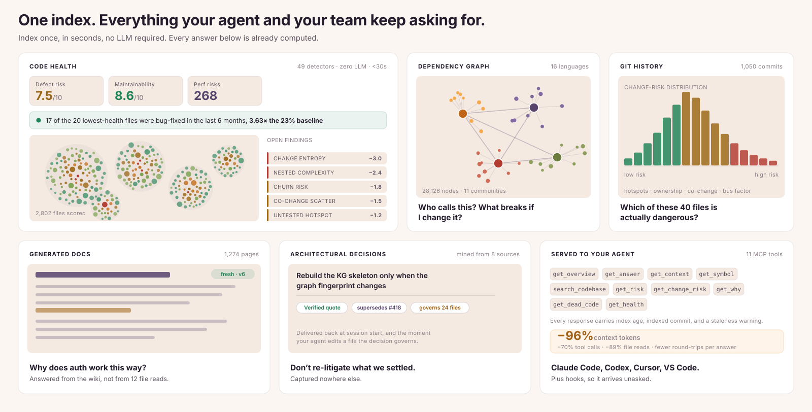

# repowise documentation

Index your codebase once. Your agent stops grepping, your team stops guessing
which change is dangerous, and both get their answers from the same place.

To set up with an agent, paste this into it:

```text
Read https://docs.repowise.dev/setup.md and set up Repowise in this repository.
```

By hand: the [Quickstart](start/QUICKSTART.md) installs, indexes and connects
your agent with no API key. A small repository indexes in under a minute.

<div align="center">
  
</div>

For a map of every layer and how they feed each other, read
[layers/INTELLIGENCE_LAYERS.md](layers/INTELLIGENCE_LAYERS.md).

---

## Get started

| Doc | What it covers |
|-----|----------------|
| [start/QUICKSTART.md](start/QUICKSTART.md) | Install, index, open the dashboard and connect your agent |
| [start/MODES.md](start/MODES.md) | The three index modes, what a model adds and costs, every provider and embedder |
| [start/USER_GUIDE.md](start/USER_GUIDE.md) | How the index, layers, agent, CLI and dashboard fit together |
| [layers/INTELLIGENCE_LAYERS.md](layers/INTELLIGENCE_LAYERS.md) | The five layers and how they combine |
| [start/DASHBOARD.md](start/DASHBOARD.md) | Every view in the local dashboard |
| [start/OFFLINE.md](start/OFFLINE.md) | Keyless and air-gapped runs, local semantic search, Repowise in a benchmark harness |
| [start/TROUBLESHOOTING.md](start/TROUBLESHOOTING.md) | `repowise doctor`, then install, indexing and answer problems |

## Agents

| Doc | What it covers |
|-----|----------------|
| [agent/INTEGRATIONS.md](agent/INTEGRATIONS.md) | The nine supported agent hosts, at what depth, and how to add one |
| [agent/MCP_TOOLS.md](agent/MCP_TOOLS.md) | The ten task-shaped tools, what each answers, and the opt-in extras |
| [agent/HOOKS.md](agent/HOOKS.md) | Context and warnings that reach the agent without it asking |
| [agent/DISTILL.md](agent/DISTILL.md) | Compress noisy command output before your agent reads it |
| [agent/CLAUDE_CODE_COMMANDS.md](agent/CLAUDE_CODE_COMMANDS.md) | The 18 `/repowise:*` slash commands in the Claude Code plugin |
| [agent/CLAUDE_CODE_PROVIDER.md](agent/CLAUDE_CODE_PROVIDER.md) | Claude Code as the model that writes your docs |
| [agent/CODEX.md](agent/CODEX.md) | Codex: MCP and hooks setup, the `codex_cli` provider, the plugin |
| [agent/OPENCODE.md](agent/OPENCODE.md) | OpenCode as an MCP host and as a provider |
| [agent/HERMES.md](agent/HERMES.md) | Wiring Hermes to the index |
| [agent/VSCODE.md](agent/VSCODE.md) | The VS Code extension |

## Guides

### Understand your code

| Doc | What it covers |
|-----|----------------|
| [layers/GRAPH.md](layers/GRAPH.md) | The dependency graph, and how much to trust each edge |
| [layers/LANGUAGE_SUPPORT.md](layers/LANGUAGE_SUPPORT.md) | What works per language: 29 parsed to a full AST, 43 on the support ladder |
| [layers/WIKI.md](layers/WIKI.md) | The generated wiki: page types, styles, and what `update` re-renders |
| [layers/DECISIONS.md](layers/DECISIONS.md) | Architectural decisions mined from your repo and your agent sessions |
| [layers/OWNERSHIP.md](layers/OWNERSHIP.md) | Owners, bus factor, and where knowledge is at risk |
| [layers/CHANGES.md](layers/CHANGES.md) | Change Records: each merged PR, MR or commit read back from git, with an in-toto export |
| [layers/ATTRIBUTION.md](layers/ATTRIBUTION.md) | AI attribution: public markers by default, opt-in edit capture, coverage beside every share |

### Change code safely

| Doc | What it covers |
|-----|----------------|
| [layers/CHANGE_RISK.md](layers/CHANGE_RISK.md) | Score a commit, a `base..head` range or uncommitted work against your repo's own history |
| [layers/BUG_HISTORY.md](layers/BUG_HISTORY.md) | Which files and functions keep getting fixed, and how recently |
| [layers/TEST_INTELLIGENCE.md](layers/TEST_INTELLIGENCE.md) | Coverage ingestion, untested hotspots, and the tests a diff touches |
| [layers/SECURITY.md](layers/SECURITY.md) | The local scan: 25 pattern kinds plus a symbol-name scan, and secrets across history |
| [start/CI.md](start/CI.md) | Gate pull requests with the GitHub Action or the GitLab template |
| [start/GIT_HOSTS.md](start/GIT_HOSTS.md) | What works on each git host and CI, and how to name a self-managed host |

### Improve the codebase

| Doc | What it covers |
|-----|----------------|
| [layers/CODE_HEALTH.md](layers/CODE_HEALTH.md) | Defect risk, maintainability and performance risk per file, and the Fix first queue |
| [layers/PERFORMANCE.md](layers/PERFORMANCE.md) | N+1 queries, I/O in loops and blocking calls, grouped into plans |
| [layers/RUNTIME_EVIDENCE.md](layers/RUNTIME_EVIDENCE.md) | Profiles, benchmarks, test timings and query counts joined to the functions they measured |
| [layers/REFACTORING.md](layers/REFACTORING.md) | Seven graph-aware refactoring plan types, from Extract Method to Performance Fix |
| [layers/DEAD_CODE.md](layers/DEAD_CODE.md) | Unreachable files, unused exports and zombie packages, by confidence tier |
| [layers/DOC_DRIFT.md](layers/DOC_DRIFT.md) | Claims in your markdown checked against the tree |

### Across repositories

| Doc | What it covers |
|-----|----------------|
| [scale/WORKSPACES.md](scale/WORKSPACES.md) | Multi-repo intelligence: cross-repo contracts, co-changes, one MCP server |
| [scale/LARGE_MONOREPOS.md](scale/LARGE_MONOREPOS.md) | Index a multi-million-line monorepo with its full history |
| [scale/WORKTREES.md](scale/WORKTREES.md) | Linked git worktrees seed their index from the base checkout |
| [scale/AUTO_SYNC.md](scale/AUTO_SYNC.md) | Keep the index fresh on every commit, by hook, watcher, webhook or polling |
| [../docker/README.md](../docker/README.md) | Running repowise in Docker |

## Reference

| Doc | What it covers |
|-----|----------------|
| [reference/CLI_REFERENCE.md](reference/CLI_REFERENCE.md) | Every command and flag |
| [reference/CONFIG.md](reference/CONFIG.md) | `.repowise/config.yaml`, `health-rules.json`, and environment variables |
| [reference/MCP_RESPONSE_FIELDS.md](reference/MCP_RESPONSE_FIELDS.md) | The field dictionary for every MCP response, including the `_meta` envelope |
| [reference/API_REFERENCE.md](reference/API_REFERENCE.md) | The `repowise serve` HTTP API: spend, auth, errors, streaming |
| [reference/HOOKS_REFERENCE.md](reference/HOOKS_REFERENCE.md) | The exact settings entries each hook install writes |
| [reference/PLUGINS.md](reference/PLUGINS.md) | Build, test and publish a plugin |
| [reference/CHANGE_REVIEW_API.md](reference/CHANGE_REVIEW_API.md) | Reviewing a change from Python, with or without a checkout |
| [reference/PACKAGE_USAGE.md](reference/PACKAGE_USAGE.md) | Where third-party packages are imported, CycloneDX export, Syft, SPDX and OSV input |
| [reference/WORKSPACE_CONTRACTS.md](reference/WORKSPACE_CONTRACTS.md) | How a workspace names, reads and matches cross-repo contracts |
| [reference/COMPUTED_GLOSSARY.md](reference/COMPUTED_GLOSSARY.md) | Definitions for every computed metric |
| [reference/TELEMETRY.md](reference/TELEMETRY.md) | What anonymous telemetry collects, and how to turn it off |
| [reference/UPGRADING.md](reference/UPGRADING.md) | Notes for upgrading between versions |
| [CHANGELOG.md](CHANGELOG.md) | Release history |

## Hosted

| Doc | What it covers |
|-----|----------------|
| [business/COMMERCIAL.md](business/COMMERCIAL.md) | Hosted tier, enterprise options and commercial licensing |
| [business/FORESIGHT.md](business/FORESIGHT.md) | Foresight on Hosted and enterprise: the files and tests a change will need, from your git history |

## For teams

| Doc | What it covers |
|-----|----------------|
| [business/EVALUATION.md](business/EVALUATION.md) | Try it on your own code in an afternoon, offline, from index to evidence packs |
| [business/SECURITY_COMPLIANCE.md](business/SECURITY_COMPLIANCE.md) | What leaves your machine, what is stored, and the answers your security team wants |
| [layers/REPORTS.md](layers/REPORTS.md) | Components and their owners, change policy checked locally or in CI, and evidence packs for an auditor, acquirer or board |
| [BENCHMARKS.md](BENCHMARKS.md) | Every published number with its sample size and method |
| [LINEAGE.md](LINEAGE.md) | The published research each layer is built on, and how we checked it |
| [../ROADMAP.md](../ROADMAP.md) | What we are building next, and what we are not |

## Contribute

| Doc | What it covers |
|-----|----------------|
| [../.github/CONTRIBUTING.md](../.github/CONTRIBUTING.md) | How to set up, test and submit a change |
| [architecture/README.md](architecture/README.md) | Index of the internals pages |
| [architecture/ARCHITECTURE.md](architecture/ARCHITECTURE.md) | How repowise is built, end to end |
| [architecture/single-sources.md](architecture/single-sources.md) | Which module owns each shared concept; check it before writing a helper |
| [architecture/version-stamps.md](architecture/version-stamps.md) | Every version stamp and what bumping it does; check it before moving one |
| [architecture/ci.md](architecture/ci.md) | Which CI jobs run when, and how to reproduce a failure |
| [architecture/deep-dives.md](architecture/deep-dives.md) | Algorithm walkthroughs referenced from the architecture page |
| [architecture/graph-algorithms.md](architecture/graph-algorithms.md) | Every graph algorithm, its math, and why it was chosen |
| [architecture/language-support.md](architecture/language-support.md) | The language pipeline, and how to add a language |
| [architecture/build-units.md](architecture/build-units.md) | Build units: projects, crates and packages a build tool declares |
| [architecture/code-health.md](architecture/code-health.md) | Code health internals and the full detector roster |
| [architecture/refactoring.md](architecture/refactoring.md) | Refactoring plan internals |
| [architecture/dead-code.md](architecture/dead-code.md) | Dead-code analysis internals |
| [architecture/change-risk.md](architecture/change-risk.md) | The change-risk model, its calibration and every risk scale |
| [architecture/bug-history.md](architecture/bug-history.md) | How fix history is stored and rolled up |
| [architecture/test-intelligence.md](architecture/test-intelligence.md) | The inferred test tier: test reach without a coverage report |
| [architecture/security.md](architecture/security.md) | Security scanner internals |
| [architecture/decisions.md](architecture/decisions.md) | How decisions are captured, verified and ranked |
| [architecture/workspace.md](architecture/workspace.md) | Workspace internals: contracts, matching, the system graph |
| [architecture/forges.md](architecture/forges.md) | Git host (forge) support in one package |
| [architecture/agent-platform.md](architecture/agent-platform.md) | How agent hosts are described, and how to add one |
| [architecture/editor-files.md](architecture/editor-files.md) | How `CLAUDE.md`, `AGENTS.md` and other editor files are generated |
| [architecture/chat.md](architecture/chat.md) | The codebase chat agent and its tools |
| [architecture/savings-accounting.md](architecture/savings-accounting.md) | How Repowise decides what it saved an agent |
| [architecture/pluggable-storage.md](architecture/pluggable-storage.md) | Plugins, seams and pluggable storage |
| [architecture/structurizr-export.md](architecture/structurizr-export.md) | Structurizr DSL export of the C4 model |
| [architecture/retired-page-archive.md](architecture/retired-page-archive.md) | How regrouped wiki pages keep their history |
| [design/theme-tokens.md](design/theme-tokens.md) | UI design tokens and the contrast matrix |
